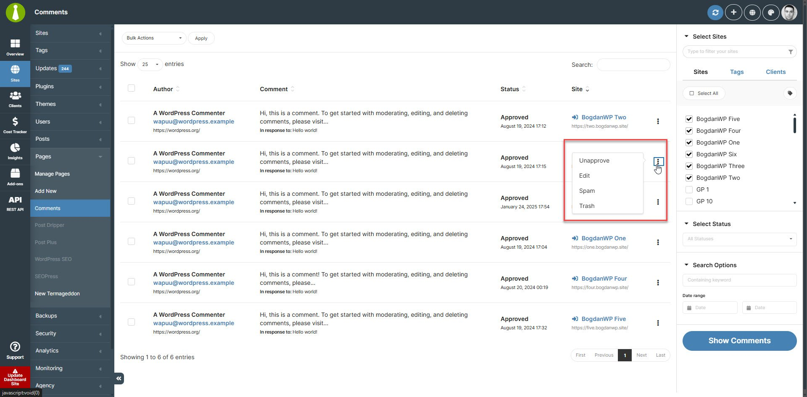

## What You'll Learn

- How to manage comments across multiple sites
- Using bulk actions for comment moderation
- Approving, unapproving, spam marking, and deleting comments
- Customizing comment display settings

---

<div
  id="addon-data"
  style={{display: 'none'}}
  data-title="Comments"
  data-purchase-url="https://mainwp.com/extension/comments/"
  data-pricing-tier="pro"
  data-bundle="MainWP Pro"
  data-addon-type="extension"
  data-version="5.0"
  data-developer="MainWP"
  data-changelog-url="https://mainwp.com/changelog/mainwp-comments-extension/"
  data-owned-by="Jestart LLC"
  data-privacy-url="https://mainwp.com/mainwp-plugin-privacy-policy/"
/>
<Info>
**Extension Add-on** - This add-on provides standalone functionality within MainWP Dashboard. No third-party plugins required.
</Info>

<iframe
  className="w-full aspect-video rounded-xl"
  src="https://www.youtube.com/embed/tCSX3z1KOOg"
  title="Comments - Video Tutorial"
  frameBorder="0"
  allow="accelerometer; autoplay; clipboard-write; encrypted-media; gyroscope; picture-in-picture"
  allowFullScreen
></iframe>

The [MainWP Comments Extension](https://mainwp.com/add-on/comments/) lets you approve, unapprove, mark comments as spam, move them to Trash, restore them, edit them, and permanently delete them across your child sites from one place. You can use bulk actions to handle multiple comments at once or moderate them one by one.

## The Recent Comments Widget

A great addition to this add-on is the **Recent Comments** widget. It shows the latest Approved and Pending comments from your sites and provides quick links to moderate them or open the full comments page.

## Manage Comments

The MainWP Comments Extension allows you to manage comments on your websites. It lets you remotely

-   Approve
-   Unapprove
-   Mark as Spam
-   Not Spam
-   Move to Trash
-   Restore
-   Edit
-   Delete Permanently

On the **MainWP > Sites > Content Operations > Comments** page, you can find comments across your child sites and manage them without logging in to each site separately.

<Steps>
<Step title="Log in to your MainWP Dashboard">
</Step>
<Step title="Go to the MainWP > Sites > Content Operations > Comments page">
</Step>
<Step title="Select the Child Sites you want">
</Step>
<Step title="Use Select Status and Search Options to set your filters">
Use the sidebar filters to narrow your results:
    1.  **Select Status** lets you filter comments by Approved, Pending, Spam, or Trash
    2.  **Containing keyword** lets you find comments containing a specific word
    3.  **Date range** narrows comments by the selected dates
</Step>
<Step title="Click the Show Comments button">
</Step>
</Steps>


 By default, the MainWP Dashboard plugin is set to return (show) a maximum of 50 comments from one Child Site.

### Review Bulk Moderation Results

With MainWP Child 6.3, comment moderation reports only changes completed by WordPress. A missing or invalid comment does not stop the remaining comments in a bulk action. Review the results and refresh the comment list before retrying any items that were not changed.

## Unapprove Comment

<Steps>
<Step title="Log in to your MainWP Dashboard">
</Step>
<Step title="Go to the MainWP > Sites > Content Operations > Comments page">
</Step>
<Step title="Select the Child Sites you want">
</Step>
<Step title="Use Select Status and Search Options to find the comments you need">
</Step>
<Step title="Click the Show Comments button">
</Step>
<Step title="Once the list of found comments appears">
Once the list of found comments appears
    1.  Locate the Comment you want to update
    2.  Click the **Unapprove** action in the Actions menu
</Step>
</Steps>


The Unapprove action will appear only for comments that are already approved.

## Approve Comment

<Steps>
<Step title="Log in to your MainWP Dashboard">
</Step>
<Step title="Go to the MainWP > Sites > Content Operations > Comments page">
</Step>
<Step title="Select the Child Sites you want">
</Step>
<Step title="Use Select Status and Search Options to find the comments you need">
</Step>
<Step title="Click the Show Comments button">
</Step>
<Step title="Once the list of found comments appears">
Once the list of found comments appears
    1.  Locate the Comment you want to update
    2.  Click the **Approve** action in the actions menu
</Step>
</Steps>


The Approve action will appear only for comments that are waiting for approval.

## Mark Comment as Spam

<Steps>
<Step title="Log in to your MainWP Dashboard">
</Step>
<Step title="Go to the MainWP > Sites > Content Operations > Comments page">
</Step>
<Step title="Select the Child Sites you want">
</Step>
<Step title="Use Select Status and Search Options to find the comments you need">
</Step>
<Step title="Click the Show Comments button">
</Step>
<Step title="Once the list of found comments appears">
Once the list of found comments appears
    1.  Locate the Comment you want to update
    2.  Click the **Spam** action in the actions menu
</Step>
</Steps>


## Edit Comment

<Steps>
<Step title="Log in to your MainWP Dashboard">
</Step>
<Step title="Go to the MainWP > Sites > Content Operations > Comments page">
</Step>
<Step title="Select the Child Sites you want">
</Step>
<Step title="Use Select Status and Search Options to find the comments you need">
</Step>
<Step title="Click the Show Comments button">
</Step>
<Step title="Once the list of found comments appears">
Once the list of found comments appears
    1.  Locate the Comment you want to edit
    2.  Click the **Edit** action in the actions menu
</Step>
</Steps>


## Move Comment to Trash

<Steps>
<Step title="Log in to your MainWP Dashboard">
</Step>
<Step title="Go to the MainWP > Sites > Content Operations > Comments page">
</Step>
<Step title="Select the Child Sites you want">
</Step>
<Step title="Use Select Status and Search Options to find the comments you need">
</Step>
<Step title="Click the Show Comments button">
</Step>
<Step title="Once the list of found comments appears">
Once the list of found comments appears
    1.  Locate the Comment you want to trash
    2.  Click the **Trash** action in the actions menu
</Step>
</Steps>


### Delete Comment Permanently

In the comments list, the **Delete Permanently** action is available for comments that are already in **Trash** or marked as **Spam**.

The comments table also includes **Restore** and **Not Spam** bulk actions. When a comment is in **Trash**, its row actions include **Restore** and **Not Spam**.

## Set Custom Comment Display Length

To set the custom comment length, please [see this gist.](https://gist.github.com/bogdan-mainwp/8fab61ca689f24aae74565f714ef00b6)

## Network Activity Logging

Comment moderation actions performed through the add-on (approve, unapprove, spam, unspam, trash, restore, delete) are recorded in [Network Activity](/sites/network-activity) under the **Comments** connector. Use this to audit who moderated which comment and when, alongside the rest of your Dashboard activity.

Network Activity logging must be enabled in **MainWP menu (three lines, top right) > MainWP Settings > Network Activity Settings** (`/wp-admin/admin.php?page=SettingsInsights`) for these events to be stored.

## Manage Comments via the REST API

The Comments Extension exposes REST API v2 routes so you can list and moderate comments programmatically across your child sites.

| Method | Path | Purpose |
|---|---|---|
| GET | `/mainwp/v2/comments` | List comments across selected sites |
| GET | `/mainwp/v2/comments/{id_or_domain}` | List comments for one site |
| PUT, PATCH | `/mainwp/v2/comments/{id_or_domain}/{id_comment}/action` | Perform an action on one comment |
| PUT, PATCH | `/mainwp/v2/comments/{id_or_domain}/bulk-action` | Perform an action on multiple comments |

Supported actions: `approve`, `unapprove`, `spam`, `unspam`, `trash`, `restore`, `delete`.

Example — approve a comment on site `12`:

```bash
curl -X PUT \
  -H "Authorization: Bearer YOUR_API_KEY" \
  -H "Content-Type: application/json" \
  -d '{ "action": "approve" }' \
  "https://your-dashboard.com/wp-json/mainwp/v2/comments/12/482/action"
```

See [Add-on Endpoints](/api-reference/rest-api/extensions#comments) for the full parameter reference and additional examples.

---

## Automate comments with Abilities

Comments row-action replies appear as plain text. Error messages no longer display links or formatting supplied in a site reply. Successful actions still show a green check and fade the row. Blank or unusable errors receive a generic message.

The Comments extension registers five WordPress Abilities. Use an administrator account with permission to use MainWP's Abilities API. Team Control extension rights and assigned-site restrictions are checked again before requests are sent. A staff role's extension right alone does not grant access through the Abilities bridge.

Live get, moderation, and permanent deletion require a Child that supports the v2 comments contract. An unsupported or unreadable reply produces an error, not a confirmed change. See [Abilities API authentication](/api-reference/abilities-api/overview) for connection details.

| Ability | Inputs | Result |
|---|---|---|
| `mainwp/list-comments-v1` | Optional `site_ids`, `status`, `keyword`, `start_date`, `end_date`, `post_id`, `maximum_per_site`, `page`, `per_page` | Live `comments`, per-site `site_results`, `total`, `partial`, and `pagination` |
| `mainwp/get-comment-v1` | `site_id`, `comment_id` | One `comment`, its `site`, and `observed_at` |
| `mainwp/list-synced-recent-comments-v1` | Optional `site_ids`, `status`, `page`, `per_page` | Cached `comments`, per-site results, sync times, truncation indicators, and pagination |
| `mainwp/moderate-comments-v1` | `site_id`, `action`, `items` | Requested and applied counts, `partial`, and a result for each comment |
| `mainwp/delete-comments-permanently-v1` | `site_id`, `items`, `dry_run`, `confirm` | Eligible and deleted counts, plus a result for each comment |

The live list defaults to 50 comments per site and accepts at most 100. Site pages contain at most 100 sites. `status: "all"` includes approved and pending comments. Date boundaries use the Child site's local comment date: after 00:00 on `start_date`, before 00:00 on `end_date`. To request one day, use the following day as the end date. Equal dates return no matches. A `post_id` filter cannot be combined with a keyword or date range.

The synced list reads the last completed sync; it does not fetch fresh comments. It covers approved and pending comments and may be truncated. Check each site's sync time and status before treating it as current. Live and synced lists preserve comments with no attached post as `post_id: 0`; the stricter v2 get route returns an error for those records. Unusable GMT dates can fail a site's read.

Moderation accepts `approve`, `unapprove`, `spam`, `unspam`, `trash`, and `restore`. Each item supplies a positive `comment_id` and the `expected_status` you observed (`approved`, `pending`, `spam`, or `trash`). Requests contain at most 100 distinct items on one site. Refresh before acting and inspect every result: a batch can contain applied, conflict, not-found, and failed outcomes.

With a Child that includes the v2 trash guard, `trash` is refused when the site's `EMPTY_TRASH_DAYS` setting is zero. WordPress would permanently delete the comment in that configuration. The item returns `failed` with `mutation_failed`; its state stays unchanged. The separate permanent-delete operation retains its preview, confirmation, and already-trashed requirements. The legacy Comments action retains WordPress's trash-disabled behavior, so this refusal applies specifically to v2 moderation.

For example, the input for approving a pending comment is:

```json
{"site_id": 12, "action": "approve", "items": [{"comment_id": 482, "expected_status": "pending"}]}
```

Permanent deletion accepts only comments expected to be in `trash`. Preview first:

```json
{"site_id": 12, "items": [{"comment_id": 482, "expected_status": "trash"}], "dry_run": true, "confirm": false}
```

After reviewing the preview and obtaining explicit confirmation, submit the same items with `dry_run: false` and `confirm: true`. Both fields must be booleans; exactly one must be true. Deletion is irreversible. A preview does not delete anything.

These operations check expected state before changing a comment. A repeat request may report a conflict or not-found instead of applying the same change again. If the reply says the outcome is unknown, some work may have completed. Read the comments again before deciding which items to retry. Network Activity records only confirmed changed IDs.

## Related Resources

- [Administrative Add-ons](/add-ons/administrative) - Browse administrative add-ons
- [Add-ons Overview](/add-ons/overview) - All add-on categories
- [Add-on Endpoints](/api-reference/rest-api/extensions#comments) - Comments REST API reference
- [Network Activity](/sites/network-activity) - Review and configure activity logging
