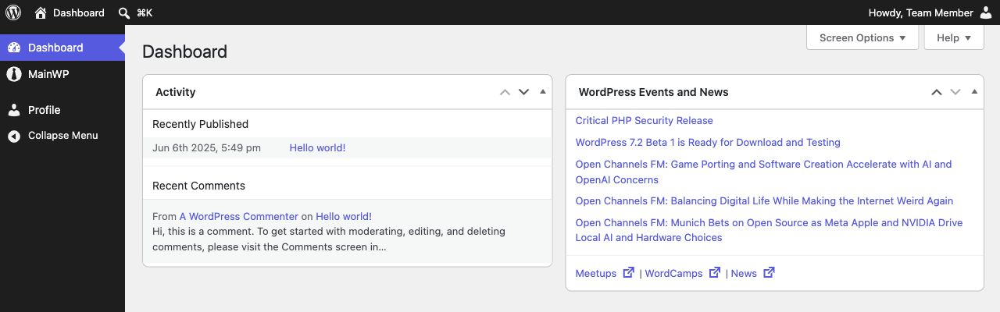
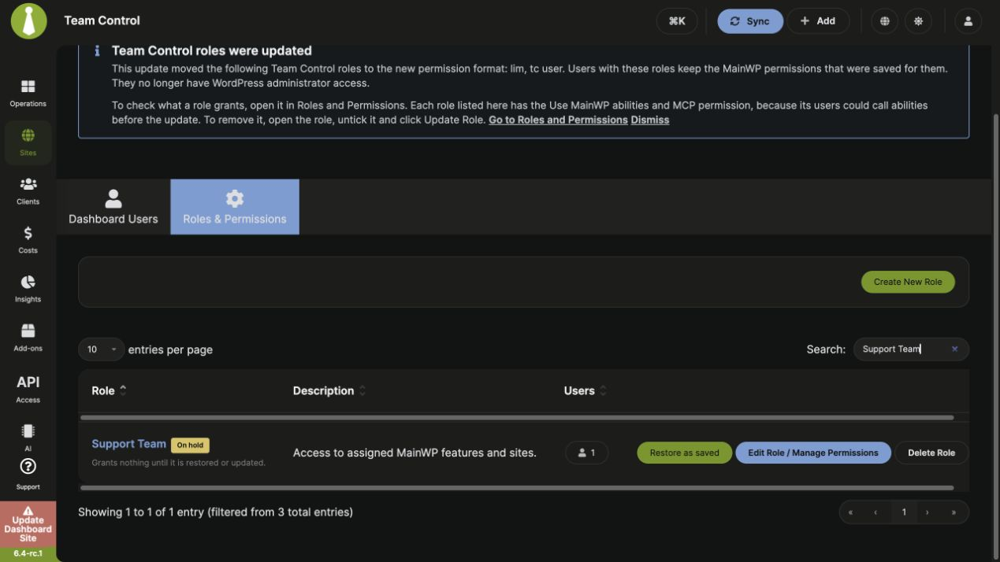
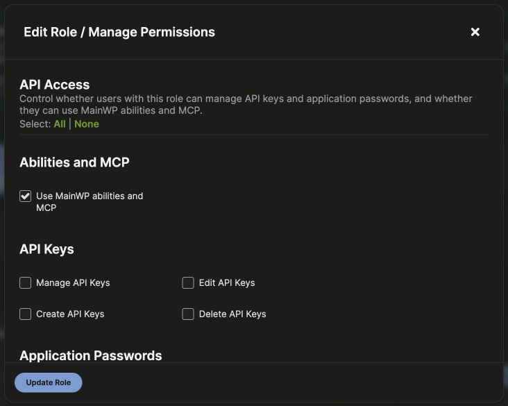

## What You'll Learn

- Understand WordPress admin access for custom roles in 5.2
- Upgrade existing roles and resolve roles placed on hold
- Create custom roles and assign them to team members
- Define permissions, allowed add-ons, and allowed Child sites
- Control access to MainWP abilities and MCP
- Map each staff member to their own WordPress account on Child sites

---

<div
  id="addon-data"
  style={{display: 'none'}}
  data-title="Team Control"
  data-purchase-url="https://mainwp.com/extension/team-control/"
  data-pricing-tier="pro"
  data-bundle="MainWP Pro"
  data-addon-type="extension"
  data-version="5.2.1"
  data-developer="MainWP"
  data-changelog-url="https://mainwp.com/changelog/mainwp-team-control-extension/"
  data-owned-by="Jestart LLC"
  data-privacy-url="https://mainwp.com/mainwp-plugin-privacy-policy/"
/>

<Info>
**Extension Add-on** - This add-on provides standalone functionality within MainWP Dashboard. No third-party plugins required.
</Info>

[MainWP Team Control Add-on](https://mainwp.com/add-on/team-control/) lets you create custom roles for users on your MainWP Dashboard site. Limit each role to the MainWP features, add-ons, and Child sites its users need.

<Warning>
**Important change in Team Control 5.2: custom roles no longer have WordPress administrator access.**

Users assigned a Team Control custom role can still access:

- **MainWP Dashboard** pages, add-ons, and Child sites allowed by their role.
- The **WordPress Dashboard** home page (`/wp-admin/index.php`).
- Their own **Profile** page (`/wp-admin/profile.php`).

The custom role no longer grants access to other WordPress admin sections on the Dashboard site, including Plugins, Themes, Users, and Settings. Earlier versions gave these roles administrator capabilities outside MainWP; 5.2 removes those capabilities from new and successfully migrated roles.
</Warning>

This restriction applies to the WordPress site hosting your MainWP Dashboard. It does not change user roles on connected Child sites. A separate WordPress role or direct user permission can still grant additional access; review accounts that have more than one role.



Other plugins may add their own pages for users with basic read access. Team Control custom roles do not grant the WordPress administrator capabilities those roles had in earlier versions.

<Note>
The **Access WP Admin** permission under **Role Permissions > Sites** controls opening a Child site's WordPress admin through MainWP. It does not restore access to WordPress admin sections on the Dashboard site.
</Note>

## Prerequisites

- An active MainWP Dashboard and Team Control 5.2.0.
- A [Team Control owner](#team-control-owners) account to manage roles and users.
- Connected Child sites if you want to assign site access.

Open **MainWP > Add-ons > Agency > Team Control** (`/wp-admin/admin.php?page=Extensions-Mainwp-Team-Control`). To set up your team:

<Steps>
<Step title="Create your custom role(s)">
</Step>
<Step title="Define permissions and select allowed add-ons and child sites for the role(s)">
</Step>
<Step title="Create new users (optional)">
</Step>
<Step title="Assign the role to Dashboard site users">
</Step>
</Steps>


The Team Control screen has two tabs:

- **Dashboard Users** - View users immediately, filter by one or more roles, search the users table, and apply bulk actions.
- **Roles & Permissions** - Create roles, review role descriptions, see how many users have each role, and manage or delete roles.

## Team Control Owners

Only registered **Team Control owners** can manage Team Control roles, users, and notes. An owner must retain WordPress administrator permissions and must not hold a Team Control custom role. You cannot delegate owner access through a custom role or the **Allowed Add-ons** list.

When no owner registry exists, Team Control registers all eligible administrators as initial owners. Creating an administrator after the registry exists does not automatically make that account an owner.

Keep at least one eligible owner account available. If Team Control reports that only an owner can manage roles and users, sign in with an existing owner or follow [Recover Owner Access](#recover-owner-access).

## Upgrade to Team Control 5.2

<Steps>
<Step title="Back up the complete Dashboard database before updating">
Keep the previous Team Control plugin files as well. The update changes saved roles and WordPress capabilities, so a plugin downgrade alone cannot undo it.
</Step>
<Step title="Confirm that an administrator can become an owner">
Use an administrator account with no Team Control custom role. If owners are already registered, confirm that at least one remains eligible.
</Step>
<Step title="Update Team Control and open the Dashboard as that administrator">
Team Control migrates existing roles automatically when an eligible owner is available. Successfully migrated roles keep their saved MainWP permissions and lose their WordPress administrator capabilities.
</Step>
<Step title="Review the migration notices and Roles & Permissions">
The **Team Control roles were updated** notice lists migrated roles. Review any roles marked **On hold**, and check each role's permissions, allowed add-ons, and allowed sites.
</Step>
<Step title="Review users with multiple Team Control roles">
In 5.2, a user's permissions combine the grants from all their active Team Control roles, including site and tag access. Earlier versions could use only the first matching role, so these users may gain additional MainWP access after upgrading.
</Step>
</Steps>

Automatically migrated roles also receive **Use MainWP abilities and MCP** to preserve their previous ability access. An owner can disable it per role under [API Access](#abilities-and-mcp-permissions).

<Warning>
Downgrading Team Control does not restore removed WordPress capabilities or reverse the role migration. Use the complete pre-update database backup and matching plugin files if a full rollback is required.
</Warning>

### Resolve Roles on Hold

A role that cannot be migrated safely is marked **On hold** in **Roles & Permissions**. Held and disabled roles grant no MainWP permissions. Review the explanation beside the role before restoring or editing it.

<Warning>
Some held roles still have their pre-update WordPress capabilities because Team Control could not safely change their WordPress role. The Roles list identifies this condition. **On hold does not guarantee that WordPress administrator access has been removed.**
</Warning>



<Steps>
<Step title="Open Team Control as an owner and select Roles & Permissions">
Locate the role marked **On hold** and read its status message.
</Step>
<Step title="Choose how to recover the role">
Where **Restore as saved** is available, click it to recover the stored permissions. Review the **Restore this role as saved?** confirmation, then click **Restore Role**.

To change the permissions before reactivating a role, use **Edit Role / Manage Permissions**, review the available permissions, and click **Update Role**. If the WordPress role is missing or the saved data cannot be read, follow the role's message; editing may be unavailable.
</Step>
<Step title="Review the restored role's access">
Confirm that the role is active and its permissions are appropriate. Check **Use MainWP abilities and MCP** separately; restoring a held role does not automatically add that permission if it was not saved.
</Step>
</Steps>

**Restore as saved** preserves stored grants, including grants for sites, tags, or add-ons that no longer appear in the editor. **Update Role** saves the permissions currently shown in the form and removes grants that are no longer available there. Review any warning about omitted permissions before saving.

### Recover Owner Access

If the **Team Control is waiting for an owner** notice appears, the update cannot finish migrating roles. Until an eligible owner is available, unmigrated roles keep working as they did before the update, including their previous WordPress access.

If no owner registry exists, remove the Team Control custom role from an administrator account while retaining its administrator role, then reload WordPress admin. If an existing owner became ineligible, restore that account's administrator access and remove any Team Control role assigned to it.

If another administrator must become an owner, use WP-CLI on the Dashboard installation. The account running the command must have WordPress administrator permissions. The target account must have administrator permissions and no Team Control custom role.

1. Prepare the owner change. Replace `123` with the target user's ID and `admin-login` with the administrator running the command:

   ```bash
   wp mainwp team-control-owner prepare --action=add --user_id=123 --user=admin-login
   ```

2. Apply the change within ten minutes using the returned confirmation token and the same administrator:

   ```bash
   wp mainwp team-control-owner apply --confirmation=CONFIRMATION_TOKEN --user=admin-login
   ```

3. Reload WordPress admin so any waiting migration can finish.

## Create a Custom Role


To create a custom role,

<Steps>
<Step title="Log in to your MainWP Dashboard as a Team Control owner">
</Step>
<Step title="Open Team Control">
</Step>
<Step title="Go to the Roles & Permissions tab">
</Step>
<Step title="Click the Create New Role button in the action bar">
</Step>
<Step title="Enter the role name and description">
</Step>
<Step title="Configure the role permissions in the same modal">
The **Create Role / Manage Permissions** modal includes the role information fields and permission sections together, so you can define the role before saving it.
</Step>
<Step title="Click the Create Role button">
</Step>
</Steps>


After the role is created, it appears in the **Roles & Permissions** table.

## Define Role Permissions

<Steps>
<Step title="Log in to your MainWP Dashboard as a Team Control owner">
</Step>
<Step title="Open Team Control">
</Step>
<Step title="Go to the Roles & Permissions tab">
</Step>
<Step title="Locate the previously created role">
</Step>
<Step title="Click the Edit Role / Manage Permissions button">
</Step>
<Step title="Set MainWP Dashboard permissions">
</Step>
<Step title="Set API Access permissions">
Review API key and application password permissions. Under **Abilities and MCP**, enable **Use MainWP abilities and MCP** only if this role needs that access.
</Step>
<Step title="Set Allowed Add-ons">
</Step>
<Step title="Set Allowed Sites">
Use **Select by Site** or **Select by Tag** to choose the child sites this role can access.
</Step>
<Step title="Click the Update Role button">
</Step>
</Steps>


After setting custom permissions, assign this role to an existing user or [create a new user](https://wordpress.org/documentation/article/users-add-new-screen/) with this role. Permissions determine which actions the role can perform; **Allowed Sites** determines where it can perform them. **Select by Tag** also grants access to Child sites that belong to the selected tags.

In MainWP Dashboard 6.4, staff with **Manage Posts** or **Manage Pages** can use the corresponding bulk content tools within MainWP, subject to their site access and action permissions. This does not grant access to the Dashboard site's WordPress Posts or Pages sections.

Only unrestricted Dashboard administrators can create or edit legacy REST API v1 keys. Granting API key permissions to a Team Control role does not grant access to these legacy keys.

### Backup Permissions

The **Backups** permission group controls backup actions such as execution, restoration, downloads, and backup task management. On a Dashboard with built-in backups, this group appears when built-in backups are enabled. On older Dashboards, its visibility follows the legacy backup setting. **API Backups** remains a separate permission group. MainWP Dashboard 6.4.1 adds separate permissions for deleting backup snapshots and running **Clean Up**. Review both when configuring a role that manages built-in backups.

**Delete Backups** controls whether staff can delete existing backups. It appears after **Download Backups** and is enabled by default for new roles. Untick it to let a role run backups without deleting them.

When you update to a Team Control version that adds **Delete Backups**, existing roles that have **Execute Backups** receive it automatically. Team Control applies this grant once, the first time a Team Control owner opens WordPress admin after the update. Until then, staff keep their current ability to delete backups. After the grant runs, you can untick **Delete Backups** on any role, and Team Control does not add it back.

<Note>
**Delete Backups** takes effect only on a MainWP Dashboard version that supports it. On older Dashboards, the checkbox appears but **Execute Backups** continues to control backup deletion.
</Note>

Built-in backup abilities also check the user's site access and the Dashboard's permissions for each operation. **Use MainWP abilities and MCP** alone does not authorize every backup action.

MainWP Dashboard 6.4.1 adds a separate permission for deleting backup snapshots and running **Clean Up**. When your Team Control version supports this permission, staff members also need it to delete snapshots or run **Clean Up**, in addition to permission to run backups. Without it, the **Delete** and **Clean Up** controls on **Backups > Snapshots & Restore** are hidden, and the matching backup abilities are refused. Grant it only to roles that should be able to permanently remove backups.

### Cost Tracker Permissions

The **Cost Tracker** permission group includes **Manage Cost Tracker Settings**, which controls whether staff can change Cost Tracker settings.

When you update to Team Control 5.2.1, existing roles that have **Manage Dashboard Settings** receive **Manage Cost Tracker Settings** automatically, so staff who could manage Cost Tracker settings before keep that access. Team Control applies this grant once, the first time a Team Control owner opens WordPress admin after the update. Roles that already have **Manage Cost Tracker Settings** explicitly enabled or disabled keep their saved choice. After the grant runs, you can untick **Manage Cost Tracker Settings** on any role, and Team Control does not add it back.

### Abilities and MCP Permissions

In the role editor, find **API Access > Abilities and MCP > Use MainWP abilities and MCP**. This permission lets users with the role run MainWP abilities that support Team Control, through the [MainWP MCP Server](/mcp-server/overview) (`@mainwp/mcp`) or the WordPress Abilities REST API. Each user signs in with their own Application Password. Every call still applies the role's MainWP permissions for that operation and its allowed sites and tags. Core abilities report a site outside the role's access as not found.



On MainWP Dashboard 6.5 and later with a Team Control build that supports per-ability access:

- **Core abilities:** every MainWP Dashboard ability supports Team Control except these, which stay administrator-only: `mainwp/add-site-v1`, `mainwp/sync-sites-v1`, `mainwp/get-batch-job-status-v1`, `mainwp/list-upcoming-renewals-v1`, `mainwp/list-api-backups-providers-v1`, `mainwp/list-api-backups-site-status-v1`, `mainwp/update-backup-settings-v1`, `mainwp/test-backup-destination-v1`, `mainwp/set-default-backup-destination-v1`, `mainwp/update-backup-destination-v1`, and `mainwp/delete-backup-destination-v1`.
- **Advanced Uptime Monitor:** In builds that opt into Team Control, `mainwp/list-uptime-monitors-v1`, `mainwp/list-uptime-monitor-events-v1`, `mainwp/get-site-uptime-summary-v1`, `mainwp/create-site-uptime-monitor-v1`, `mainwp/set-uptime-monitor-state-v1`, and `mainwp/delete-uptime-monitor-v1` support Team Control. They also need the role's Advanced Uptime Monitor permission and access to the site. `mainwp/sync-uptime-monitors-v1` stays administrator-only because it needs access to all sites.
- **Other add-ons:** their abilities stay administrator-only until each add-on adds Team Control support.
- The permission does not grant access to Team Control's own management abilities.

Staff can start an operation that the Dashboard queues as a background job, such as updates across more than 200 sites, but `mainwp/get-batch-job-status-v1` is administrator-only, so they cannot poll that job's status. See [Batch Operations](/api-reference/abilities-api/batch-operations).

The **MainWP > AI** pages, including MCP, Knowledge, and Control setup, stay administrator-only. So do the Dashboard's built-in remote MCP connector and the MainWP Assistant.

On older Dashboards, Team Control lends administrator access for a fixed set of core abilities instead. Team Control stops lending that access on a Dashboard that checks Team Control support for each ability.

- On older Dashboards with ability scoping, the fixed set includes scoped site, client, tag, update, and built-in backup operations. Site creation, tag creation or editing, and batch operations are excluded.
- On MainWP Dashboard 6.2, 6.2.1, 6.2.2, and 6.2.3, restricted users can run only `list-sites`, `count-sites`, and `get-sites-basic`, limited to their allowed sites.

Owners can untick the permission and click **Update Role** to remove it from a role. If a user has several active Team Control roles, another role can still grant it.

See [Abilities API Overview](/api-reference/abilities-api/overview) and [MainWP MCP Server](/mcp-server/overview) for platform and authentication setup. WordPress Abilities API support is required for these features.

## Assign Role to a User


<Steps>
<Step title="Log in to your MainWP Dashboard as a Team Control owner">
</Step>
<Step title="Open Team Control">
</Step>
<Step title="Go to the Dashboard Users tab">
The users table loads automatically when you open the tab.
</Step>
<Step title="Filter or search for the user">
Use the role filter in the action bar and click **Filter Users**, or use the table search field to narrow the visible users.
</Step>
<Step title="Select the user">
Use the checkbox next to the user. You can select multiple users when you need to assign the same role to more than one account.
</Step>
<Step title="Choose Change role from the Bulk actions menu">
Select the new role, then click **Apply**.
</Step>
</Steps>


<Note>
To grant access through a site tag, select that tag under **Allowed Sites > Select by Tag**. Users with several active Team Control roles receive the combined permissions of those roles. Team Control protects owner and administrator accounts from delegated role changes.
</Note>

## Edit Custom Role

<Steps>
<Step title="Log in to your MainWP Dashboard as a Team Control owner">
</Step>
<Step title="Open Team Control">
</Step>
<Step title="Go to the Roles & Permissions tab">
</Step>
<Step title="Locate the role you want to edit">
Use the table search, sorting, pagination, or the **Users** count column to review the available roles. The **Users** count links to the Dashboard Users tab filtered by that role.
</Step>
<Step title="Click the Edit Role / Manage Permissions button">
</Step>
<Step title="Set MainWP Dashboard permissions">
</Step>
<Step title="Set API Access permissions">
Review **Use MainWP abilities and MCP**, API key permissions, and application password permissions.
</Step>
<Step title="Set Allowed Add-ons">
</Step>
<Step title="Set Allowed Sites">
Use **Select by Site** or **Select by Tag** to choose the child sites this role can access.
</Step>
<Step title="Click the Update Role button">
</Step>
</Steps>


Updating a role replaces its previous permission set with the permissions submitted by the form. Review warnings about saved grants for removed sites, tags, or inactive add-ons before clicking **Update Role**.

## Delete Custom Role

<Steps>
<Step title="Log in to your MainWP Dashboard as a Team Control owner">
</Step>
<Step title="Open Team Control">
</Step>
<Step title="Go to the Roles & Permissions tab">
</Step>
<Step title="Locate the role you want to delete">
</Step>
<Step title="Click the Delete Role button">
</Step>
<Step title="Reassign affected users if prompted">
If any users currently have that role, choose a replacement role for each user in the confirmation dialog.
</Step>
<Step title="Click the Delete Role button in the confirmation dialog">
</Step>
</Steps>

## Per-Staff Child Site Logins

This section applies to Team Control builds that show **Child site logins** under a user on the **Dashboard Users** tab.

Without a mapping, every Dashboard user reaches a Child site as the shared administrator account the site was connected with. Team Control can map each staff member to their own WordPress account on Child sites. With a mapping in place:

- WordPress post locking can tell two staff members apart, so the second person to open a post sees that the first is already editing it.
- Work done while logged in as that account is recorded under it. WordPress attributes new posts and revisions to the account, and activity log plugins on the Child site see it as the acting user instead of the shared administrator.
- When someone leaves, you can delete their account on each Child site. WordPress ends that account's sessions on the site and leaves everyone else signed in. Their Dashboard access is separate; see [Limits](#limits).

**Go to WP Admin**, syncs, and updates that the staff member starts run as their mapped account on that site. Scheduled maintenance and WP-CLI commands use the shared administrator.

Staff members with no mapping keep using the shared administrator, as before.

### Before You Set Up Logins

- Mapped accounts must be administrators on the Child site. Other WordPress roles aren't supported yet.
- Team Control doesn't create the accounts. Create them on each Child site yourself.
- Use a matching MainWP Dashboard and MainWP Child build that supports per-staff logins. See [Sites with an older MainWP Child](#sites-with-an-older-mainwp-child).

### Set Up Child Site Logins

<Steps>
<Step title="Create an administrator account for the staff member on each Child site">
Using the same username on every site lets one default username cover all of them.
</Step>
<Step title="Log in to your MainWP Dashboard as a Team Control owner">
</Step>
<Step title="Open Team Control and go to the Dashboard Users tab">
</Step>
<Step title="Expand Child site logins under the staff member's username">
The table lists only the Child sites that person can access.
</Step>
<Step title="Enter the Default WordPress username on child sites">
Every site set to **Use the default username** uses this account. If you leave it empty, that option reads **Use the default username (none set)** and those sites use the shared administrator.
</Step>
<Step title="Change the username choice for sites that need something else">
Choose **Use a different username** and enter the account in the field that appears for that site, or choose **Use the shared administrator** to keep the shared account on that site.
</Step>
<Step title="Click Save">
</Step>
</Steps>

### Read the Setup Check

After you save, Team Control checks each site in the table once and shows the result with the date and time of the check, in your Dashboard site's date and time format. It looks for an account with that username; a partial match such as `jane2` for `jane` doesn't count. The check never blocks the save: the mapping is saved even when some sites report a problem.

Each result describes the site at the time of the check. Nothing rechecks automatically, so an account deleted later still shows its old result. Click **Check Again** on a site to rerun its check, for example after you create a missing account. **Check Again** is unavailable while the form has unsaved changes.

| Result | What it means | What to do |
|---|---|---|
| **Administrator found** | The account exists and is an administrator. | Nothing. |
| **Found but not an administrator** | The account exists without administrator rights. Check the account before relying on the mapping. | Make the account an administrator and click **Check Again**. Or pick a different username or the shared administrator for this site and click **Save**, which runs the check again. |
| **Username not found** | No account on the site has that username. Check the account before relying on the mapping. | Create the account on the site and click **Check Again**. Or correct the username, or choose **Use the shared administrator** for this site, and click **Save**, which runs the check again. |
| **MainWP Child too old. Update it to run this check.** | The site runs a MainWP Child version without this feature. | Update MainWP Child on the site, then click **Check Again**. |
| **Check failed** | The Dashboard couldn't complete the check. The cause follows the label, for example that the Child site did not respond. This doesn't mean the account is missing. | Fix the connection to the site, then click **Check Again**. |
| **Uses the shared administrator** | The site is set to **Use the shared administrator**, or it uses the default and no default username is set. | Nothing. |

### Sites with an Older MainWP Child

A site running an older MainWP Child can fall back to the shared administrator if the mapped user is missing or lacks administrator rights. If **Check Again** reports that MainWP Child is too old, update the Child plugin and check again. Verify the account shown in WordPress after opening **Go to WP Admin**.

### Limits

- Mapped accounts must be administrators on the Child site.
- Removing a mapping or choosing **Use the shared administrator** gives that person shared administrator access on those sites again. Neither one revokes access. To revoke a staff member's Dashboard access, select them on the **Dashboard Users** tab and use **Delete** or **Change role** from the **Bulk actions** menu to move them to a role without Team Control permissions.
- Scheduled maintenance and WP-CLI commands use the shared administrator.

## Team Control Abilities

Team Control 5.2 registers 12 abilities in the `mainwp-team-control` category. Builds with Child login mapping add a thirteenth. They let an authenticated owner list available permissions, read and manage roles and users, update user notes, and reconcile roles that need recovery. These abilities require the WordPress Abilities API and MainWP Dashboard's abilities integration.

Management access remains restricted to registered owners. Assigning **Use MainWP abilities and MCP** to a custom role does not authorize its users to manage Team Control.

Changes through these abilities require a preview followed by confirmation. Automation must review the preview and use its returned confirmation token; it must also supply current revisions where the operation requires them. Full role replacements replace the prior permission set, rather than adding to it.

Role and membership changes run one at a time and use database transactions. Team Control validates its table structure and uses InnoDB for its own tables. WordPress options and user metadata can only participate in rollback when their core tables also use transactional storage. After a failed change, review the reported role and membership state before retrying.

---

### Read or Replace a User's Child Site Logins

On a build that registers `mainwp/replace-team-control-user-child-login-v1`, an authenticated Team Control owner can read the mapping with `mainwp/get-team-control-user-v1` and replace it with a preview and confirmation. The read returns `child_login.default`, `child_login.overrides`, and `child_login.revision`. If the mapping cannot be read, `child_login.error` reports the error code.

| Input | Meaning |
| --- | --- |
| `user_ref` | The opaque reference returned by Team Control's user abilities. |
| `default` | The default WordPress username on Child sites, or an empty string to use the shared administrator where there is no username override. |
| `overrides` | The full list of site choices. Each entry has a unique allowed `site_id`, a `mode`, and a `username`. Use a nonempty username for `username` mode and an empty string for `default` or `shared_admin`. Omit a site's entry to remove its saved override. |
| `if_match` | The current `child_login.revision` returned by the read. |
| `request_ref` | A UUID for this replacement. Reuse it for the preview and confirmation of the same request. |
| `dry_run`, `confirm`, `preview_token` | For preview, send `true`, `false`, and `null` respectively. For confirmation, send `false`, `true`, and the token returned by the preview, with the same mapping inputs. |

The confirmed response reports `mode: "completed"`, the user reference, and the new mapping revision. If the mapping changes after the preview, read it again and start a new preview. To check whether the mapped account exists and is an administrator, use **Check Again** under [Child site logins](#read-the-setup-check).

## Related Resources

- [White Label Extension](/add-ons/agency/white-label-extension) - Rebrand MainWP for clients
- [Agency Add-ons](/add-ons/agency) - Browse agency add-ons
- [Abilities API Overview](/api-reference/abilities-api/overview) - Platform requirements and authentication
- [MainWP MCP Server](/mcp-server/overview) - Connect tools to your MainWP Dashboard
- [Database Health Check](/dashboard/overview/mainwp-database-health-check) - Check MainWP database tables
