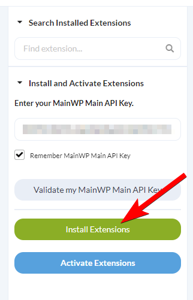
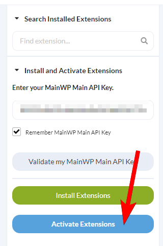
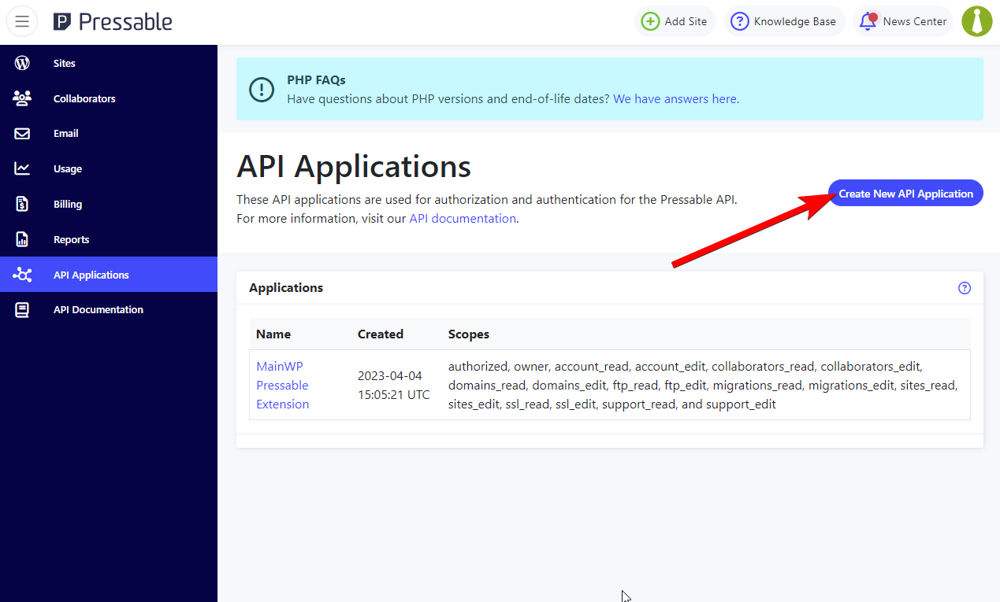
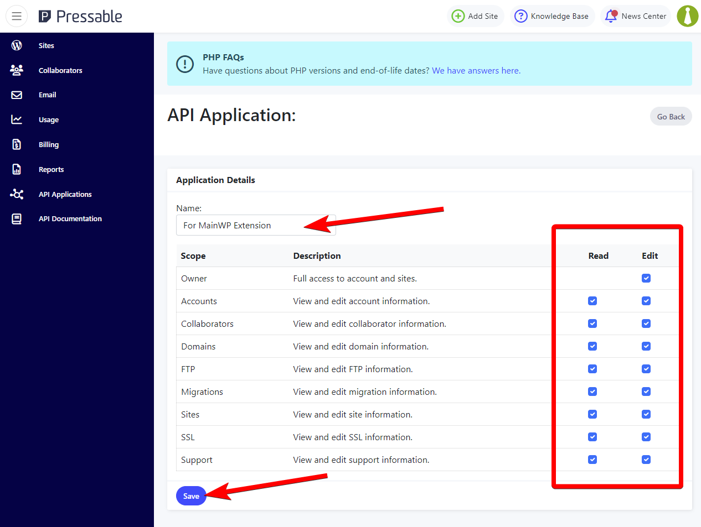
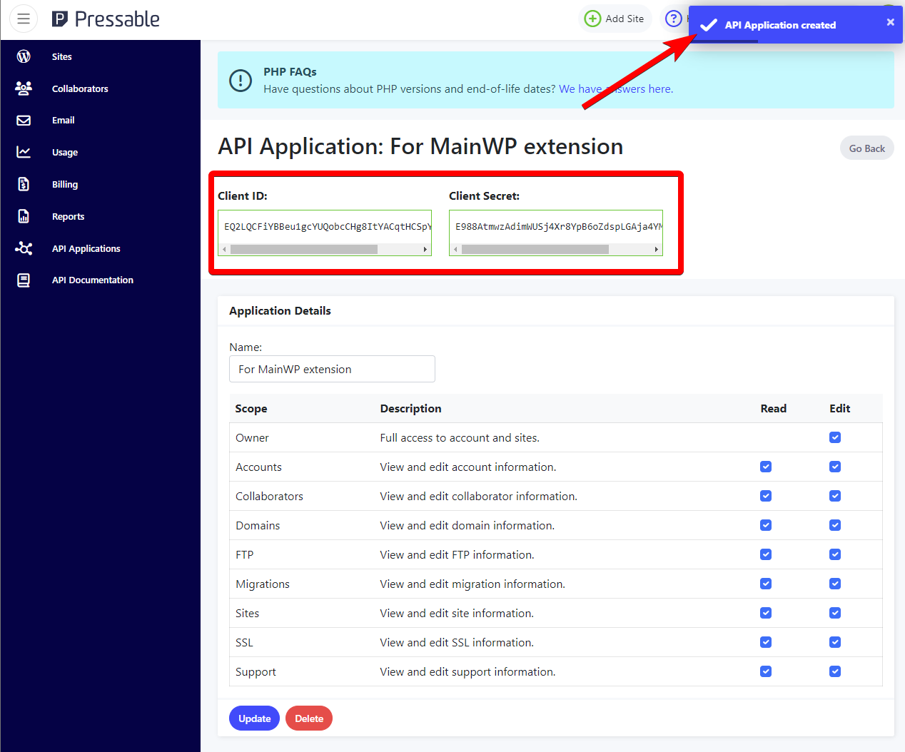
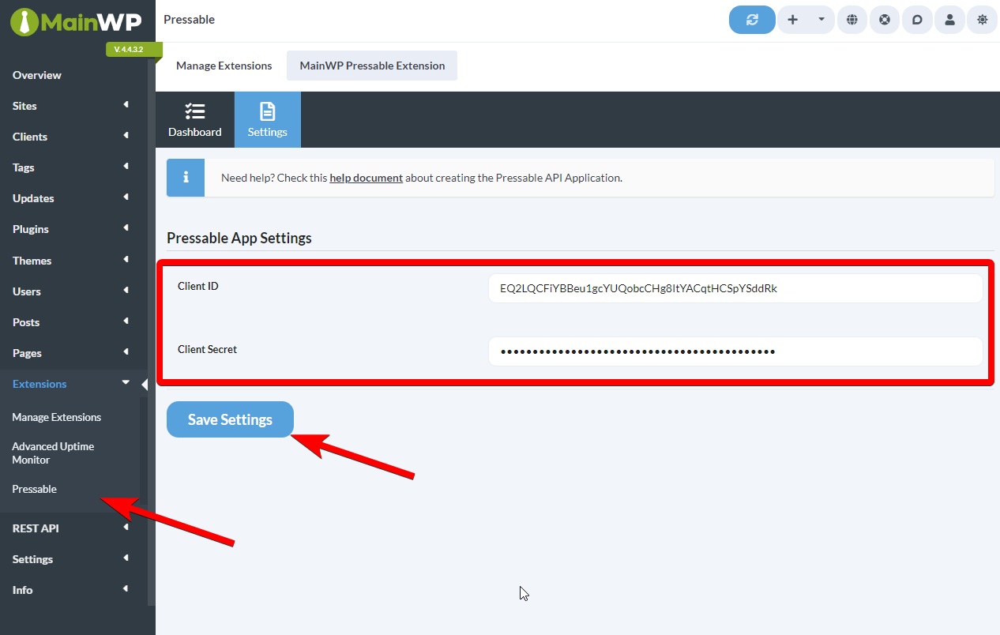
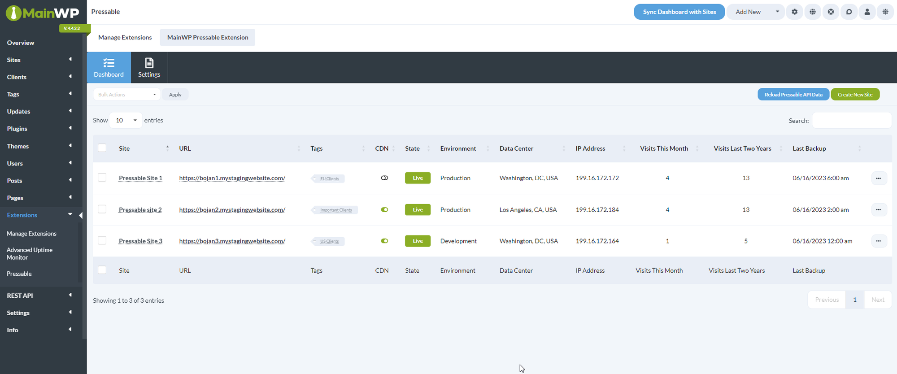
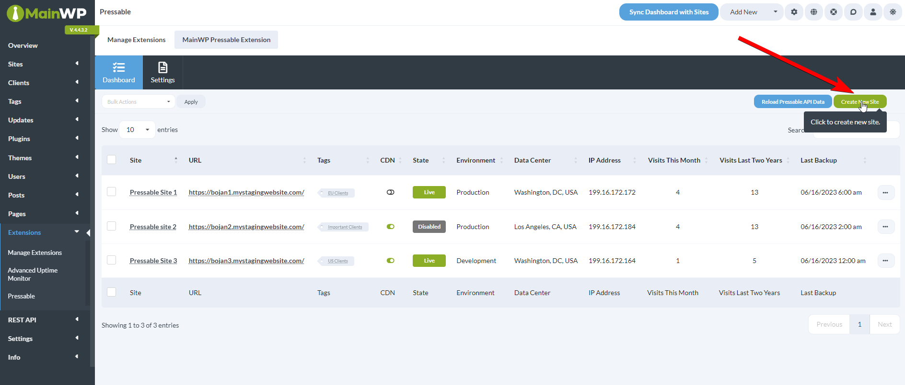
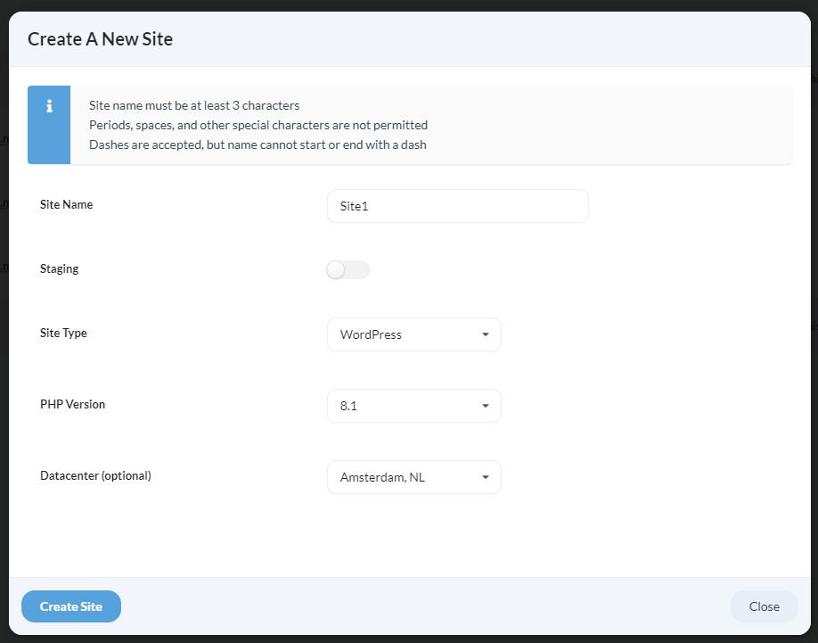

## What You'll Learn

- Connecting your Pressable account to MainWP
- Creating new Pressable sites from the Dashboard
- Managing CDN, backups, and site state
- Understanding the Dashboard page features

---

<Info>
**Integration Add-on** - This add-on extends MainWP to work with Pressable. Requires a Pressable account and Pressable-hosted sites added to your MainWP Dashboard as child sites.
</Info>

The Pressable Integration provides access to the most important Pressable management features. It allows you to quickly **create new Pressable sites** directly in the add-on and, at a glance, gives quick insight into the **State, Environment** and **Data Center** of the Pressable site and **Visitor Analytics**, and provides **Backup** and **CDN management**.

<iframe
  className="w-full aspect-video rounded-xl"
  src="https://www.youtube.com/embed/TKnPW-QghHo"
  title="Pressable - Video Tutorial"
  frameBorder="0"
  allow="accelerometer; autoplay; clipboard-write; encrypted-media; gyroscope; picture-in-picture"
  allowFullScreen
></iframe>

## Install the Integration

Follow these steps to install the Pressable Integration.

<Steps>
<Step title="Go to your MainWP Dashboard">
</Step>
<Step title="Go to the MainWP Dashboard > Add-ons > Manage Add-ons page">
</Step>
<Step title="Click the Install Add-ons button">
Click the **Install Add-ons** button 
</Step>
<Step title="Locate the Pressable Integration and select it">
</Step>
<Step title="Click the Install button">
</Step>
<Step title="Once the installation process is complete, click the Activate Add-ons button.">
Once the installation process is complete, click the **Activate Add-ons** button. 
</Step>
</Steps>

## Connect the Integration to Your Pressable Account

<Steps>
<Step title="Navigate to your Pressable account and open the API Application page">
Navigate to your Pressable account and open the [API Application](https://my.pressable.com/api/applications) page
</Step>
<Step title="Click the Create New API Application button">

</Step>
<Step title="Enter a desired name for the API Application, give the application all permissions, and click the Save button">
Enter a desired name for the API Application, give the application all permissions, and click the **Save** button 
</Step>
<Step title="You will be presented with a Client ID and Client Secret">
You will be presented with a Client ID and Client Secret. We will use these to connect the integration, so copy them somewhere or leave this browser tab open 
</Step>
<Step title="Now navigate to your MainWP Dashboard > Add-ons > Administrative > Pressable page, and open the Settings tab">
Now navigate to your **MainWP Dashboard > Add-ons > Administrative > Pressable** page, and open the Settings tab
</Step>
<Step title="Enter the Client ID and Client Secret and click the Save Settings button">
Enter the Client ID and Client Secret and click the **Save Settings** button 
</Step>
</Steps>

## Team Control compatibility

The Pressable Integration respects access restrictions configured by the [Team Control Extension](/add-ons/agency/team-control-extension). Only team members whose role grants access to the Pressable Integration will see the Pressable menu and be able to perform Pressable actions. If a user does not have permission, the integration UI and bulk actions are hidden for them.
## Clearing Pressable credentials

The Settings tab shows whether credentials are configured. The Client ID and Client Secret fields stay blank to protect the saved values. Leave both fields empty to keep the existing connection. To replace it, enter both new values and save. Invalid credentials leave the working connection in place.

To disconnect, select **Clear the configured Pressable credentials** and click **Save Settings**. This clears the saved connection and synced site data. It does not delete sites at Pressable.

## Empty-state placeholders

The Dashboard tab shows contextual placeholders when there is nothing to display:

- **No credentials saved** — a *Pressable API Credentials Required* placeholder links you to the Settings tab to add a Client ID and Client Secret.
- **Credentials saved but no sites found** — a *No Pressable Sites Found* placeholder prompts you to create a site in Pressable or reload Pressable API data to sync sites.

These replace the previous empty table so the next step is always clear.

## Site matching by primary URL and custom domains

The mapping page suggests MainWP child sites whose URLs match a Pressable primary URL or custom domain. Review and apply the suggested association before managing the site through MainWP.

Reload Pressable API data after adding or changing sites. Open the mapping section to look for additional custom-domain matches. Discovery requires an unrestricted administrator with Pressable Manage Account, Manage Hosting and Dashboard settings rights. Restricted users cannot use it to view domains for unmapped sites.

Site actions require access to the mapped MainWP child site. Restores check both the source and destination. MainWP checks permissions again before queued work contacts Pressable.

## Integration Dashboard Page

This page contains all of the features or shortcuts to the features of the Pressable Integration.  This table will contain all sites from the Pressable account you connected in the integration settings that are also added to this MainWP Dashboard. Sites from the Pressable account that are not added to the MainWP Dashboard as child sites will NOT be shown here.

Backup and creation timestamps in the table show a human-readable elapsed time (for example, *2 days ago*) on hover, and sort by their underlying date.

The columns of the table that are specific to the Pressable Integration are as follows:

-   **CDN**: Shows a graphical indicator of whether the Pressable CDN is enabled on the child site
-   **State**: Displays the status of the child site, either Live or Disabled
-   **Environment:** Displays the environment type, either Staging, Development or Production
-   **Data Center:** Displays the location of the Pressable data center where the child site is hosted at
-   **IP Address:** Displays the IP Address of the Pressable data center where the child site is hosted at
-   **Visits This Month:** Displays the number of visits for this child site for this month, as logged by Pressable
-   **Visits Last Two Years:** Displays the number of visits for this child site for the last two years, as logged by Pressable
-   **Last Backup:** Displays the date and time of the last performed Pressable backup

## Create a new Pressable site

<Steps>
<Step title="Navigate to MainWP Dashboard > Add-ons > Administrative > Pressable page">
</Step>
<Step title="Click the Create New Site button">

</Step>
<Step title="Enter the information for the new site">

1.  Enter a **Site Name** with 4–63 lowercase letters, digits or dashes. Start and end with a letter or digit.
    2.  Choose whether the site should be **Staging** or not
    3.  From the **Site Type** dropdown, select either WordPress or WooCommerce
    4.  From the **PHP Version** dropdown, select the available PHP version
    5.  From the **Datacenter** dropdown, optionally select the location of the data center
</Step>
<Step title="Click the Create Site button">
</Step>
</Steps>

## Available Actions for Child Sites

Site actions are in the ellipsis menu. The Bulk Actions menu also supports enabling, disabling or deleting sites, converting between live and staging, and enabling or disabling CDN.

-   **Sync Data:** Synchronizes the child site through the MainWP Dashboard site sync
-   **Overview**: Opens the Child Site Overview on the MainWP Dashboard
-   **Edit**: Opens the Child Site Edit page on the MainWP Dashboard
-   **Enable/Disable Site**: Changes the State of the site in the Pressable hosting account to either Live or Disabled
-   **Delete Site:** Deletes the site from the Pressable hosting account
-   **Convert to Staging** / **Staging to Live:** Converts the site either from Staging to Live, or from Live to Staging
-   **Enable/Disable CDN:** Either enables or disables the CDN feature on the Pressable hosting account
-   **Manage Backups:** Opens the site's Pressable backups. Choose the source backup, destination site and available files or database before requesting a restore. A restore overwrites destination content; keep a separate backup of that destination first.

## Automate Pressable hosting tasks

The [Pressable Abilities API](/api-reference/abilities-api/pressable) can read cached status, manage the connection and mappings, refresh hosting information, change site state, create or delete sites, and restore backups. Changes require a preview and confirmation. Queued work returns an operation ID so your tool can check completion.

---

## Related Resources

- [Development Add-ons](/add-ons/development) - Browse all development tools
- [Hosting Compatibility](/advanced/miscellaneous/hosting-compatibility) - Hosting provider information
- [Manage Child Sites](/sites/management/manage-child-sites) - Site management guide
