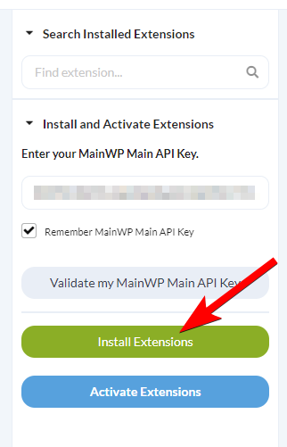
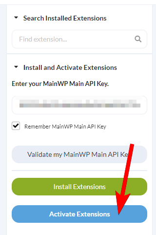
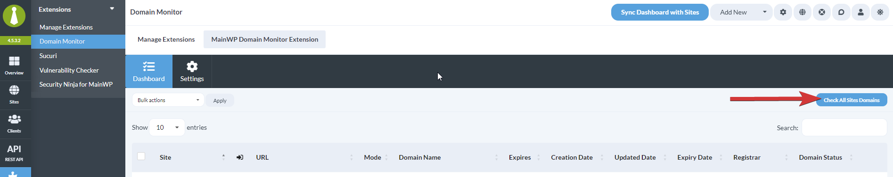
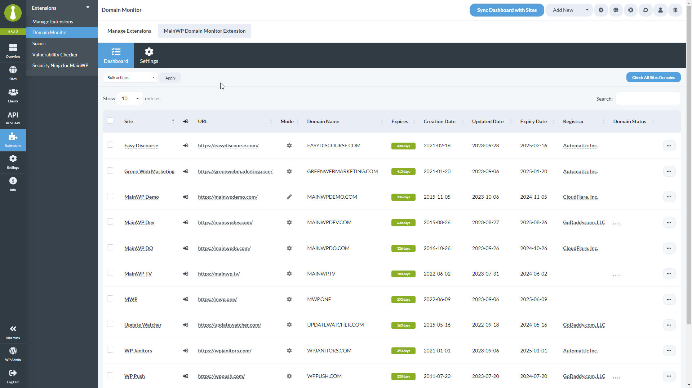
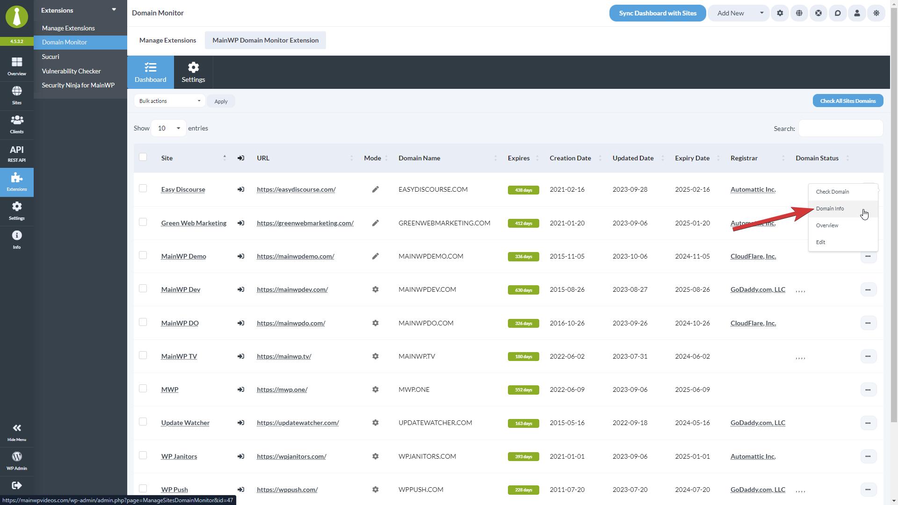
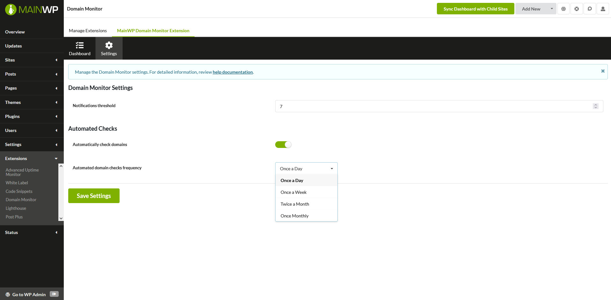

## What You'll Learn

- Checking domain expiration dates across all sites
- Reading expiration status in the dashboard and Overview widgets
- Monitoring domains that are not connected to a child site
- Entering domain info manually for unsupported TLDs
- Scheduling automated domain checks
- Overriding general settings for individual sites
- Using Pro Reports tokens for domain data
- Automating Domain Monitor through MainWP Abilities

---

<div id="addon-data" style={{display: 'none'}} data-title="Domain Monitor" data-purchase-url="https://mainwp.com/extension/domain-monitor/" data-pricing-tier="pro" data-bundle="MainWP Pro" data-addon-type="integration" data-version="5.5" data-developer="MainWP" data-changelog-url="https://mainwp.com/changelog/mainwp-domain-monitor-extension/" data-owned-by="Jestart LLC" data-privacy-url="https://mainwp.com/mainwp-plugin-privacy-policy/" />

<iframe className="w-full aspect-video rounded-xl" src="https://www.youtube.com/embed/QMziJ1BxEcE" title="Domain Monitor - Video Tutorial" frameBorder="0" allow="accelerometer; autoplay; clipboard-write; encrypted-media; gyroscope; picture-in-picture" allowFullScreen />

## Supported TLDs

<Info>
  **Integration Add-on** - This add-on connects MainWP Dashboard to domain registry data through RDAP and WHOIS. No third-party WordPress plugin is required.
</Info>

**Domain lookup may fail or return incomplete data for some TLDs due to restrictions or a lack of available information from RDAP or WHOIS services.**

### TLD lookup support

Domain Monitor attempts lookups through RDAP first. If RDAP does not return usable domain data, the add-on falls back to its built-in WHOIS server map for TLDs with a configured WHOIS server.

For current TLD lookup references, use these maintained external sources:

- [IANA RDAP DNS bootstrap data](https://data.iana.org/rdap/dns.json) - Current RDAP service coverage by TLD.
- [IANA Root Zone Database](https://www.iana.org/domains/root/db) - Current TLD registry records, including WHOIS server details where available.

If the add-on cannot retrieve your domain information automatically, you can enter it manually as described [**below**](#enter-domain-info-manually).

## Install and Set Domain Monitor Extension

<Steps>
  <Step title="Go to your MainWP Dashboard">
  </Step>
  <Step title="Go to Add-ons > Manage Add-ons">
  </Step>
  <Step title="Click the Install Add-ons button">
    
  </Step>
  <Step title="Locate the Domain Monitor Extension and select it">
  </Step>
  <Step title="Click the Install button">
  </Step>
  <Step title="Once the installation process is complete, click the Activate Add-ons button">
    Once the installation process is complete, click the **Activate Add-ons** button 
  </Step>
  <Step title="After successful installation, proceed to the add-on settings">
  </Step>
  <Step title="Set your preferences, Save Settings, and you are ready to audit your sites.">
  </Step>
</Steps>

## Check Domains

### Automatic Inclusion of New Sites

Domain Monitor 5.3 and later automatically creates a domain monitoring record when you connect a new site to MainWP Dashboard. The first domain lookup is handled by the scheduler when **Automated Checks** are enabled; connecting a site does not perform an immediate RDAP or WHOIS request.

The Add-on also adds missing monitoring records when an automatic checking run starts or when you save global settings with **Automated Checks** enabled. This includes sites connected before automatic checks were enabled. Existing manual domain profiles and individual settings, including disabled automatic checks, are preserved.

To retrieve domain information immediately, use one of the manual check actions below.

### Run Manual Checks

<Steps>
  <Step title="Go to Add-ons > Monitoring > Domain Monitor > Dashboard">
  </Step>
  <Step title="Locate the Check All Sites Domains button">
    
  </Step>
  <Step title="Click it, and wait until the add-on completes the process.">
  </Step>
</Steps>

Alternatively, you can use the **Bulk actions** menu to check selected sites, or use the **Check Domain** action from the site **Actions** menu to audit just one site.

When a **Check Domain** lookup succeeds, the row shows **domain lookup completed successfully** and the page reloads after 3 seconds. When the lookup fails, the page does not reload. Domain Monitor restores the row with its **Actions** menu and shows the error message in red under the site name, or in the first visible column if the Site column is hidden. If the lookup returns no error details, the message reads **Domain lookup failed. Please try again.** The message stays in the row when you move between table pages, so you can review it and run **Check Domain** again.

### Monitor Domains Not Connected to a Child Site

Domain Monitor 5.5 and later can monitor domains that are not MainWP child sites, such as non-WordPress sites or parked domains. These domains appear in the same Domain Monitor table as your child sites.

<Note>
  Only users with access to all child sites can see the **Add Domain Monitor** button and add, check, or remove these domains.
</Note>

<Steps>
  <Step title="Go to Add-ons > Monitoring > Domain Monitor > Dashboard">
  </Step>
  <Step title="Click the Add Domain Monitor button">
    The button is next to **Check All Sites Domains**. It opens the **Add Domain Monitor** modal.
  </Step>
  <Step title="Enter the domain in the Domain name field">
    Enter a domain name, such as `example.com`, or paste a full URL, such as `https://www.example.com/page`. Domain Monitor keeps only the hostname and drops a leading `www.`, so both examples are saved as `example.com`.
  </Step>
  <Step title="Click Add Monitor or press Enter">
    Domain Monitor saves the domain, runs the first lookup, and reloads the table.
  </Step>
</Steps>

If the input is not a valid domain name, the modal shows **Enter a valid domain name, for example example.com.** If the domain is already in the list, it shows **This domain is already being monitored.** When a submission fails, the modal keeps your entry and the error message, even if you close and reopen it, so you can correct the domain and try again.

You can close the modal with the close icon, including by focusing it with the keyboard and pressing Enter or Space.

Added domains are labelled **Not a child site** in the table. They work like child site domains in these ways:

- **Check Domain**, **Bulk actions**, and **Check All Sites Domains** include them.
- Automated checks and expiration notifications use your general [Domain Monitor Settings](#domain-monitor-settings).

These domains do not have a **Domain Info** page, **Individual Site Settings**, or Overview and Edit links.

To stop monitoring a domain, choose **Remove Domain** from its **Actions** menu and confirm. Domain Monitor deletes the domain and its stored domain info. The **Remove Domain** action is only available for domains that are not connected to a child site.

### Unscanned Sites

Sites that have not been checked yet are highlighted in the Domain Monitor dashboard so you can spot them at a glance:

- The row is shaded yellow.
- The **Expires** column shows a **Not checked** button instead of remaining days. Click it to run a check for that site.
- Domain fields with no data display **N/A**.
- The **Domain Info** action is disabled until the first successful check completes.

Once a check completes, the row returns to its normal style and the remaining-days indicator (green, yellow, or red hourglass) appears based on how close the domain is to expiration.

### Expiration Status

Domain Monitor uses hourglass icons and short status messages to show how close each domain is to expiration:

- **Green hourglass** - The domain expires in 30 or more days.
- **Yellow hourglass** - The domain expires in fewer than 30 days.
- **Red hourglass** - The domain expires today or has already expired.
- **Grey hourglass** - No expiration data is available for the domain.

The Overview widgets pair the icons with a relative status message: **Expires in X days**, **Expires today**, **Expired today**, or **Expired X days ago**. Domains without expiration data show **Expiration information unavailable**.

## Overview Widgets

Domain Monitor adds widgets to your MainWP Dashboard Overview pages:

- The main **Overview** page widget lists all monitored domains with their expiration dates and status icons.
- The individual site **Overview** page widget shows the site's domain, its expiration status, and the saved domain profile. If no domain data is saved yet, the widget prompts you to recheck the domain or add the data manually.

## Enter Domain Info Manually

If your domain is not on the list of supported TLDs, you can add information manually by following the steps below. 

<Steps>
  <Step title="Go to Add-ons > Monitoring > Domain Monitor > Dashboard">
  </Step>
  <Step title="Choose Domain Info from the site's Actions menu">
  </Step>
  <Step title="Open the Settings tab">
  </Step>
  <Step title="Toggle on the Manual Domain information entry option and click Save Settings">
    Toggle on the **Manual Domain information entry** option and click **Save Settings**
  </Step>
  <Step title="Open the Edit Domain Info tab">
  </Step>
  <Step title="Enter or change the desired information, and click Save Settings">
  </Step>
</Steps>

## See Domain Info

<Steps>
  <Step title="Go to Add-ons > Monitoring > Domain Monitor > Dashboard">
  </Step>
  <Step title="Locate the site or domain and choose Domain Info from the Actions menu">
    Locate the site/domain you want to check in the list and use the **Domain Info** action from the **Actions** menu.

    
  </Step>
  <Step title="Once redirected to the report page, you can review all details">
  </Step>
</Steps>

## Schedule Automated Checks

<Steps>
  <Step title="Go to Add-ons > Monitoring > Domain Monitor > Settings">
  </Step>
  <Step title="Locate the Automatically check domains option and enable it">
  </Step>
  <Step title="Locate the Automated domain checks frequency option and set how often you want checks to run">
    Choose **Once a Day**, **Once a Week**, **Twice a Month**, or **Once Monthly**.
  </Step>
  <Step title="Click Save Settings">
  </Step>
</Steps>

## Domain Monitor Settings



- **Notifications threshold** - Set the threshold for notifications. If the domain expiration is less in the set number of days, an email will be sent.
- **Automatically check domains** - If you want the add-on to automatically run checks, enable this feature.
- **Automated domain checks frequency** - If automated checks are enabled, here you can set how often you want them to run.

Expiration notifications require a successful latest check and a valid expiration date. If the latest automatic lookup fails, Domain Monitor does not send an expiration alert based on previously saved data. Eligible failed lookups are normally retried after one hour, subject to the Dashboard's background job processing.

### Individual Site Settings

You can override the general settings for a specific child site:

<Steps>
  <Step title="Go to Add-ons > Monitoring > Domain Monitor > Dashboard">
  </Step>
  <Step title="Choose Domain Info from the site's Actions menu">
  </Step>
  <Step title="Open the Settings tab">
  </Step>
  <Step title="Enable the Overwrite general settings option">
    Once enabled, the **Notifications threshold**, **Automatically check domains**, and **Automated domain checks frequency** options appear for this site only.
  </Step>
  <Step title="Set your preferences and click Save Settings">
  </Step>
</Steps>

The same tab also contains the **Manual domain information entry** toggle described [**above**](#enter-domain-info-manually).

## Check Sites via WP CLI

Check one or more sites:

```bash
wp mainwp-domain-monitor check 129
wp mainwp-domain-monitor check 129,130
```

Check all sites:

```bash
wp mainwp-domain-monitor check --all
```

View saved domain profiles for one or more sites:

```bash
wp mainwp-domain-monitor results 129
wp mainwp-domain-monitor results 129,130
wp mainwp-domain-monitor results --all
```

## Domain Monitor REST API

MainWP REST API calls, including Domain Monitor endpoints, full documentation, and examples, are available in the [MainWP Postman workspace](https://www.postman.com/mainwp/workspace/mainwp/overview). Refer to our [REST API documentation](/api-reference/rest-api/overview) for more details on enabling REST API and managing API keys.

## Domain Monitor Abilities API

The Abilities-enabled Domain Monitor release registers nine MainWP abilities in the `mainwp-domain-monitor` category. Use them to read stored domain expiry summaries and profiles, read or replace global and per-site monitoring settings, replace manually entered domain information, check a site's domain, and request background domain checks or expiry-alert evaluations for selected sites.

The abilities require WordPress 6.9 or later on the MainWP Dashboard site, MainWP Dashboard with Abilities API support, and a Domain Monitor release with Abilities support. The user needs permission to use MainWP abilities, access to the Domain Monitor Add-on, and access to each site. Changing the global settings requires access to all sites. Write abilities use revisions, and checks, manual profile changes, and batch requests require a preview or explicit confirmation.

See [Domain Monitor Abilities](/api-reference/abilities-api/domain-monitor) for request examples, response fields, and error handling.

## Available Reports Tokens

- `[domain.monitor.domain.name]` - Displays the domain name.
- `[domain.monitor.registrar]` - Displays the domain registrar.
- `[domain.monitor.updated.date]` - Displays the domain updated date.
- `[domain.monitor.creation.date]` - Displays the domain creation date.
- `[domain.monitor.expiry.date]` - Displays the domain expiry date.
- `[domain.monitor.expires]` - Displays the number of days left before the domain expires.
- `[domain.monitor.status]` - Displays the domain status.
- `[domain.monitor.last.check]` - Displays the last check timestamp.

---

## Related Resources

- [Database Health Check](/dashboard/overview/mainwp-database-health-check) - Check the Add-on's Dashboard database table and column definitions
- [Monitoring Add-ons](/add-ons/monitoring) - Browse all monitoring tools
- [SSL Monitor](/add-ons/monitoring/mainwp-ssl-monitor-extension) - Monitor SSL certificates
- [Domain Monitor Abilities](/api-reference/abilities-api/domain-monitor) - Read domain data, manage settings, and request checks through MainWP Abilities
- [Pro Reports Extension](/add-ons/agency/pro-reports-extension-overview) - Include domain data in reports
