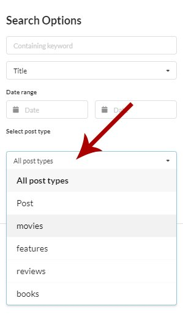
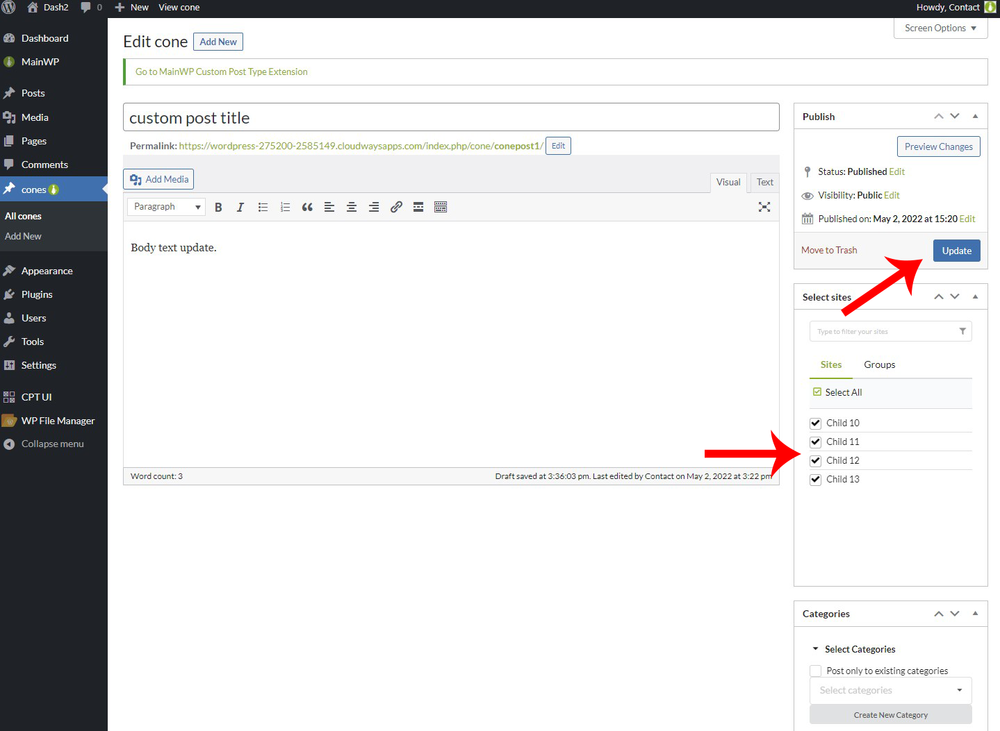

## What You'll Learn

- Understanding matching CPTs between Dashboard and child sites
- Registering custom post types on your Dashboard
- Creating and managing CPT posts remotely
- Bulk editing custom post type content
- Recovering a publication after an uncertain result
- Using the extension's WordPress abilities

---

<Info>
**Extension Add-on** - This add-on provides custom post type publishing and management inside MainWP Dashboard.
</Info>

<Warning>
**Required Plugin** - The [Classic Editor](https://wordpress.org/plugins/classic-editor/) plugin must be installed on both your MainWP Dashboard and all child sites for this extension to work correctly.
</Warning>

Custom post types are basic posts with different parameters defined inside your code. You may have seen Products, Testimonials, Features, Projects, or similar items in your WordPress sites and wanted to manage these from your MainWP Dashboard. The [MainWP Custom Post Types](https://mainwp.com/add-on/custom-post-types/) extension allows you to manage custom post types on your child sites. To manage custom post types on your child sites, you need to have the matching Custom Post Type (CPT) on your MainWP Dashboard too. Once you register the same CPT on your MainWP Dashboard site, this extension will add the [Select sites metabox](/getting-started/mainwp-user-interface) to the Add New Item interface, and it will allow you to control where you want to publish this CPT content. Support for the CPT is also added to the Manage Posts screen, so you can search and manage CPT posts.

## What is Matching CPT?

There are three required arguments for each CPT:

1.  CPT Slug
2.  CPT Plural Label
3.  CPT Singular Label

If all three are in the match, you can say that you have the matching CPTs.

Let's review the example of the **Movies** CPT.

On your child site(s), you have a **Movies** CPT (Slug: _movies_, Plural Label: _Movies_, Singular Label: _Movie_).
To be able to manage this CPT from your MainWP Dashboard, you need to create the same CPT on your MainWP Dashboard site.

### WooCommerce Products

If you want to use this extension to publish WooCommerce Products to your child site(s), it is enough to install the WooCommerce plugin on your dashboard site. The extension will automatically create support for Products.

#### Important Notes

MainWP Custom Post Types extension DOES NOT register CPTs on your child sites. It only allows you to manage existing CPTs. To properly use it, you need to have the same CPT on your MainWP Dashboard and child site(s). It doesn't matter if a CPT on your child sites has been created by a plugin, registered with a snippet in the functions.php, or added by your WordPress theme; this extension will be able to manage it as long as you can create the **Matching CPT** on your MainWP Dashboard site.

## Register Custom Post Types on Your MainWP Dashboard Site

To do this, you have two options:

<Steps>
<Step title="Create a code snippet and add it to the functions.php">
</Step>
<Step title="Use a third-party plugin to register CPTs on your MainWP Dashboard site">
Use one of these third-party plugins to register CPTs on your MainWP Dashboard site:
    -   [Custom Post Type UI](https://wordpress.org/plugins/custom-post-type-ui/)
    -   [Pods](https://wordpress.org/plugins/pods/)
</Step>
</Steps>

[Read more about registering CPTs here!](https://www.elegantthemes.com/blog/tips-tricks/creating-custom-post-types-in-wordpress) After registering a CPT on your MainWP Dashboard, the MainWP Icon will be appended next to the link in the WP Admin menu, and it means that the CPT is ready to be managed through the MainWP Dashboard.

## Create a New CPT Post

<Steps>
<Step title="Log in to your MainWP Dashboard">
</Step>
<Step title="Go to MainWP Dashboard > Add-ons > Administrative > Custom Post Type">
</Step>
<Step title="In the Custom Post Types box, you will be able to see all registered CPTs on your MainWP Dashboard">
In the Custom Post Types box, you will be able to see all registered CPTs on your MainWP Dashboard
</Step>
<Step title="Locate the one you want to publish to your Child Site(s)">
</Step>
<Step title="Click the Add New button">
</Step>
<Step title="You will be sent to the Add New screen">
</Step>
<Step title="Enter the CPT post title, content, and metadata">
</Step>
<Step title="Select your Child Sites where you want to publish">
[Select your Child Sites](/getting-started/mainwp-user-interface) where you want to publish
</Step>
<Step title="Click the Publish button">
</Step>
</Steps>

## Recover a Blocked Publication

If a publication's result is uncertain, the extension blocks another publication for that Dashboard post and child site to avoid creating a duplicate. Open the Custom Post Types extension page and find **Publication recovery**. Each entry identifies the site, Dashboard post, and post type.

Recovery requires permission to use the extension, access the selected site, and edit the Dashboard post. Only entries you can access appear. If there are no entries, the section says that no publications need recovery for sites and posts you can access.

### The Post Exists on the Child Site

1. Log in to the child site and find the post that belongs to the Dashboard post. Check its content and post type, then copy its WordPress post ID.
2. Enter that ID in **Child post ID** for the matching recovery entry.
3. Select **I checked the Child site and this ID is the post for this Dashboard post.**
4. Click **Adopt Child post**.

The extension checks that the supplied ID exists on the child site and has the expected post type. Your confirmation establishes that it is the correct post. Adoption saves that child post ID as the Dashboard connection and removes the publication block. It does not publish or create a post.

### The Post Is Absent from the Child Site

Check the child site directly before using this option. The recovery section does not know whether the post type is registered there. If its plugin is missing, restore the plugin before checking for the post. A recent-posts list alone cannot prove absence.

<Warning>
If the post exists on the child site, clearing the block can create a duplicate on the next publish. Clear it only after checking the child site and confirming that the post is absent.
</Warning>

1. Select **I checked the Child site and this post is not there.** for the matching recovery entry.
2. Click **Clear publication block**.
3. Publish through the normal workflow when you are ready. Clearing the block does not start a publication.

Recovery records the operator, time, site/post pair, and supplied ID or absence confirmation in the extension log. It refuses conflicting mappings or a changed publication owner. If an entry reports an active owner or conflicting mapping, preserve the publication evidence for support. If a request expires, reload the page and check the entry again.

## WordPress Abilities

The extension provides four abilities for integrations using the WordPress Abilities API. Availability depends on the Dashboard's Abilities API support and the caller's permissions. Site-specific requests require access to that exact MainWP site; requests for a Dashboard post also require permission to edit it.

| Ability | Input | Result |
| --- | --- | --- |
| `mainwp/list-custom-post-types-v1` | Optional `page` and `per_page` | Custom post types registered on the Dashboard. This does not check registration on child sites. |
| `mainwp/get-custom-post-type-connection-v1` | `site_id`, `post_id` | The Dashboard's stored connection for that site and Dashboard post. This does not check whether the child post still exists. |
| `mainwp/list-site-custom-taxonomy-terms-v1` | `site_id`, `post_type`; optional `page` and `per_page` | Terms from the last taxonomy snapshot stored on the Dashboard. This is cached information, not a live child-site lookup. |
| `mainwp/publish-custom-post-type-to-site-v1` | `site_id`, `post_id`; optional `dry_run` or `confirm` | A local publication preview, or a publication to one child site. |

For paginated requests, `page` defaults to `1` and accepts `1–1000`; `per_page` defaults to `50` and accepts `1–100`.

For publication, first request `dry_run: true` to inspect the local intent without contacting the child site. To execute, send the same site and Dashboard post IDs with `confirm: true`, omitting `dry_run`. Do not send both flags as true. Omitting both flags also executes a publication, so integrations should set their intended mode explicitly. A preview does not confirm that the child site is ready.

A publication uses the Dashboard post's status. Inspect the response's `status`, `content_status`, `partial_stage`, and `mapping_saved` fields before treating it as complete. If reconciliation is required, check **Publication recovery** before retrying. Recovery is an operator action in the extension UI, not an additional ability.

## Manage Custom Post Types

The Custom Post Types extension allows you to manage custom post type content on your websites. It will allow you to create new CPT posts on your managed sites remotely, edit, change the status for existing CPT posts, move them to Trash, or delete trashed posts. On the **MainWP Dashboard > Sites > Content Operations > Manage Posts** page, you can find existing CPT posts and manage them without logging into each child site separately.

<Steps>
<Step title="Log in to your MainWP Dashboard">
</Step>
<Step title="Go to MainWP Dashboard > Sites > Content Operations > Manage Posts">
</Step>
<Step title="In the Search Options, set your search preference">

**Status** filters will allow you to narrow down the search to selected CPT post statuses only.
    -   **The keyword** field will allow you to find CPT posts where an entered word has been used.
    -   **Date Range** will narrow down the search to posts that have been published in the selected date range.
    -   **Select post type** will allow you to target a specific post type
</Step>
<Step title="Select wanted Child Sites">
[Select wanted Child Sites](/getting-started/mainwp-user-interface)
</Step>
<Step title="Click the Show Posts button">
</Step>
</Steps>

Once the search is complete, a list of found posts will appear at the bottom of the page.

## Edit a CPT Post

<Steps>
<Step title="Log in to your MainWP Dashboard">
</Step>
<Step title="Go to MainWP Dashboard > Sites > Content Operations > Manage Posts">
</Step>
<Step title="In the Search Options, set your search preferences">

</Step>
<Step title="Select wanted Child Sites">
[Select wanted Child Sites](/getting-started/mainwp-user-interface)
</Step>
<Step title="Click the Show Posts button">
</Step>
<Step title="Once the list of found posts appears, locate the CPT Post you want to edit">
</Step>
<Step title="Click the Edit action in the actions menu.">
</Step>
</Steps>

## View a CPT Post

<Steps>
<Step title="Log in to your MainWP Dashboard">
</Step>
<Step title="Go to MainWP Dashboard > Sites > Content Operations > Manage Posts">
</Step>
<Step title="In the Search Options, set your search preferences">

</Step>
<Step title="Select wanted Child Sites">
[Select wanted Child Sites](/getting-started/mainwp-user-interface)
</Step>
<Step title="Click the Show Posts button">
</Step>
<Step title="Once the list of found posts appears, locate the CPT Post you want to view">
</Step>
<Step title="Click the View action in the actions menu">
</Step>
</Steps>

## Delete a CPT Post

### Move CPT Post(s) to Trash

<Steps>
<Step title="Log in to your MainWP Dashboard">
</Step>
<Step title="Go to MainWP Dashboard > Sites > Content Operations > Manage Posts">
</Step>
<Step title="In the Search Options, set your search preferences">

</Step>
<Step title="Select wanted Child Sites">
[Select wanted Child Sites](/getting-started/mainwp-user-interface)
</Step>
<Step title="Click the Show Posts button">
</Step>
<Step title="Once the list of found posts appears, locate the CPT Post you want to move to Trash">
</Step>
<Step title="Click the Trash action in the actions menu">
</Step>
</Steps>

If you need to delete multiple posts at once, before clicking the Trash action, select all posts you want to move to Trash and use the Bulk Actions menu to delete them.

### Delete Permanently

Since WordPress allows you to permanently delete only posts that are currently in Trash, before you can permanently delete them, you need to send them to Trash. Once they are in Trash, the **Delete** action will be available.

## Bulk Edit CPT posts

<iframe
  className="w-full aspect-video rounded-xl"
  src="https://www.youtube.com/embed/pZ2KUuD47Cc"
  title="Custom Post Types - Video Tutorial"
  frameBorder="0"
  allow="accelerometer; autoplay; clipboard-write; encrypted-media; gyroscope; picture-in-picture"
  allowFullScreen
></iframe>

<Steps>
<Step title="Log in to your MainWP Dashboard">
</Step>
<Step title="Go to the desired custom post type list">
</Step>
<Step title="Locate the post and click Edit">
</Step>
<Step title="Make the appropriate changes and select wanted Child Sites">
Make the appropriate changes and [select wanted Child Sites](/getting-started/mainwp-user-interface) 
</Step>
<Step title="Click the Update button">
</Step>
</Steps>

Please note that you will not be able to Bulk Edit if the CPT post was not published through MainWP Dashboard.

---

## Related Resources

- [Posts/Pages Add-ons](/add-ons/posts-pages) - Browse all content tools
- [Manage Posts](/sites/content/manage-posts) - Post management guide
- [WooCommerce Status Extension](/add-ons/administrative/woocommerce-status-extension) - WooCommerce integration
