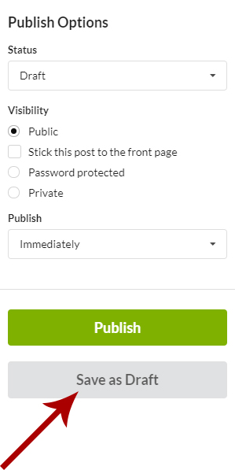
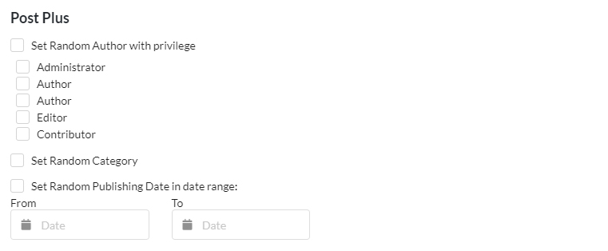
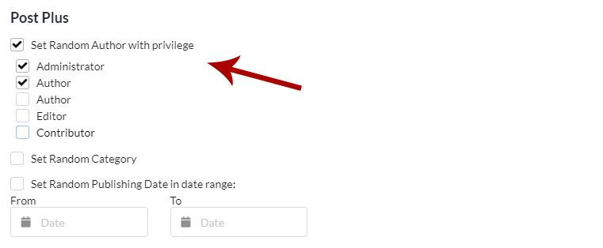
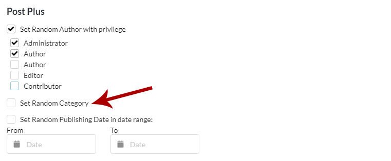
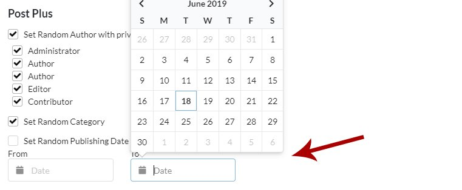

## What You'll Learn

- Saving post and page drafts on your Dashboard
- Publishing and editing saved drafts
- Randomizing authors, categories, and dates
- Using the Post Plus randomizer options
- Reading saved drafts through MainWP Abilities

---

<Info>
**Extension Add-on** - This add-on provides standalone functionality within MainWP Dashboard. No third-party plugins required.
</Info>

MainWP Post Plus Extension provides two important features:

1.  Ability to save post and page drafts on your MainWP Dashboard
2.  Ability to set random metadata for your posts and pages

## Drafts

Extending your MainWP Dashboard with this tool gives you the ability to save drafts while creating new posts and pages. A quick one-button click will save your work in progress without worrying about losing your current work.

## Post Plus Randomizer

This addition to your Add New Post/Page screen is the Post Plus meta box. This will allow you to randomize metadata for your content giving the appearance of multiple active bloggers. Simply selecting options to randomize, you can have random authors for your posts or pages, assign posts to random categories, and have randomly picked publishing dates. You can also narrow the randomized data to specific user roles and a date range.

## Save Draft

### Save Post Draft

<Steps>
<Step title="Log in to your MainWP Dashboard">
</Step>
<Step title="Go to the Sites > Content Operations > Add New page for posts">
</Step>
<Step title="Start creating a new post">
Start [creating a new post](/sites/content/manage-posts)
</Step>
<Step title="Click the Save as Draft button when you want to save your current progress">
Click the **Save as Draft** button when you want to save your current progress
</Step>
</Steps>

### Save Page Draft

<Steps>
<Step title="Log in to your MainWP Dashboard">
</Step>
<Step title="Go to the Sites > Content Operations > Add New page for pages">
</Step>
<Step title="Start creating a new page">
Start [creating a new page](/sites/content/manage-pages)
</Step>
<Step title="Click the Save as Draft button when you want to save your current progress">
</Step>
</Steps>

## Publish Draft

Drafts can be published in 2 ways.

-   Directly from the Drafts page
-   From the Draft Edit mode

### Publish Post Draft from the Drafts page

<Steps>
<Step title="Log in to your MainWP Dashboard">
</Step>
<Step title="Go to the Sites > Content Operations > Manage Posts > Drafts page">
</Step>
<Step title="Locate the draft that you want to publish">
</Step>
<Step title="Click the Publish action">
</Step>
</Steps>

### Publish Page Draft from the Drafts page

<Steps>
<Step title="Log in to your MainWP Dashboard">
</Step>
<Step title="Go to the Sites > Content Operations > Manage Pages > Drafts page">
</Step>
<Step title="Locate the draft that you want to publish">
</Step>
<Step title="Click the Publish action">
</Step>
</Steps>

### Publish Post Draft from the edit mode

<Steps>
<Step title="Log in to your MainWP Dashboard">
</Step>
<Step title="Go to the Sites > Content Operations > Manage Posts > Drafts page">
</Step>
<Step title="Locate the draft that you want to publish">
</Step>
<Step title="Click the Edit action">
</Step>
<Step title="If needed, edit wanted fields">
</Step>
<Step title="Click the Publish button in the Publish section">
</Step>
</Steps>

### Publish Page Draft from the edit mode

<Steps>
<Step title="Log in to your MainWP Dashboard">
</Step>
<Step title="Go to the Sites > Content Operations > Manage Pages > Drafts page">
</Step>
<Step title="Locate the draft that you want to publish">
</Step>
<Step title="Click the Edit action">
</Step>
<Step title="If needed, edit wanted fields">
</Step>
<Step title="Click the Publish button in the Publish section">
</Step>
</Steps>

## Edit Draft

### Edit Post Draft

<Steps>
<Step title="Log in to your MainWP Dashboard">
</Step>
<Step title="Go to the Sites > Content Operations > Manage Posts > Drafts page">
</Step>
<Step title="Locate the draft that you want to edit">
</Step>
<Step title="Click the Edit action">
</Step>
<Step title="Edit wanted fields">
Edit wanted fields
    -   If you want to save draft updates, click the **Save as Draft** button
    -   if you want to publish the post, click the **Publish** button
</Step>
</Steps>

### Edit Page Draft

<Steps>
<Step title="Log in to your MainWP Dashboard">
</Step>
<Step title="Go to the Sites > Content Operations > Manage Pages > Drafts page">
</Step>
<Step title="Locate the draft that you want to edit">
</Step>
<Step title="Click the Edit action">
</Step>
<Step title="Edit wanted fields">
Edit wanted fields
    -   If you want to save draft updates, click the **Save as Draft** button
    -   if you want to publish the page, click the **Publish** button
</Step>
</Steps>

## Delete Draft

### Delete Post Draft

<Steps>
<Step title="Log in to your MainWP Dashboard">
</Step>
<Step title="Go to the Sites > Content Operations > Manage Posts > Drafts page">
</Step>
<Step title="Locate the draft that you want to delete">
</Step>
<Step title="Click the Delete action">
</Step>
</Steps>

### Delete Page Draft

<Steps>
<Step title="Log in to your MainWP Dashboard">
</Step>
<Step title="Go to the Sites > Content Operations > Manage Pages > Drafts page">
</Step>
<Step title="Locate the draft that you want to delete">
</Step>
<Step title="Click the Delete action">
</Step>
</Steps>

## Set Random Metadata

If you want to use a random Author or Publishing date for your Posts or Pages, you can do it by using the options in the Post Plus section. Random Category is available for posts.  The Extension adds this section to both:

-   **Sites > Content Operations > Add New** page for posts
-   **Sites > Content Operations > Add New** page for pages

### Set Random Author

If you want to assign a random author for a post or page,

<Steps>
<Step title="Select the Set random author with privilege option">
</Step>
<Step title="Select roles">
</Step>
</Steps>

 The Post Plus Extension will set random **(existing)** users from the selected role(s) from your child site and assign the post. As a result, the article will have a different author on each of your child sites.

### Set Random Category

If you want to set a random category, select the **Set random category** option.  The Extension will pick one of the existing categories from your child site and assign the post.

### Set Random Publishing Date

To set a random publishing date,

<Steps>
<Step title="Check the Set random publishing date in date range checkbox">
</Step>
<Step title="Optionally set a date range">
</Step>
</Steps>

 If you set a specific date range, the Extension will pick a random date from the range. If you leave the range blank, the Extension will pick a random date between now and seven days from now. As a result, the article will have different publishing dates on each of your child sites.

---

## MainWP Abilities

The Abilities-enabled Post Plus release adds two read-only abilities for saved drafts:

- `mainwp/list-post-plus-drafts-v1` lists saved post and page drafts, with an optional `post` or `page` filter
- `mainwp/get-post-plus-draft-v1` reads one saved draft with its slug and a masked plain-text excerpt of up to 300 characters

Use them to review saved drafts from an AI assistant or script before you publish them. Both require `manage_options` and access to Post Plus. Target sites you cannot access are counted but not named. Client-targeted drafts return their client IDs without expanding them to sites. The abilities do not create, edit, publish, or delete drafts, and they do not contact Child sites. See the [Post Plus Abilities reference](/api-reference/abilities-api/post-plus) for request examples and response fields.

---

## Related Resources

- [Post Plus Abilities](/api-reference/abilities-api/post-plus) - List and read saved drafts
- [Posts/Pages Add-ons](/add-ons/posts-pages) - Browse all content tools
- [Manage Posts](/sites/content/manage-posts) - Post management guide
- [Boilerplate Extension](/add-ons/posts-pages/boilerplate-extension) - Reusable content templates
