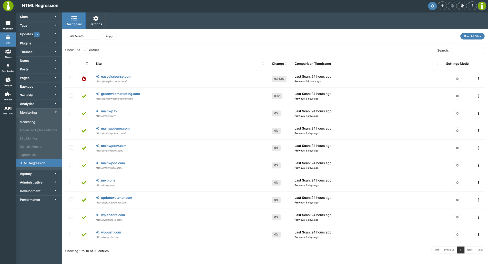
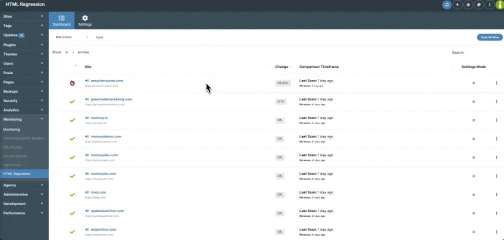
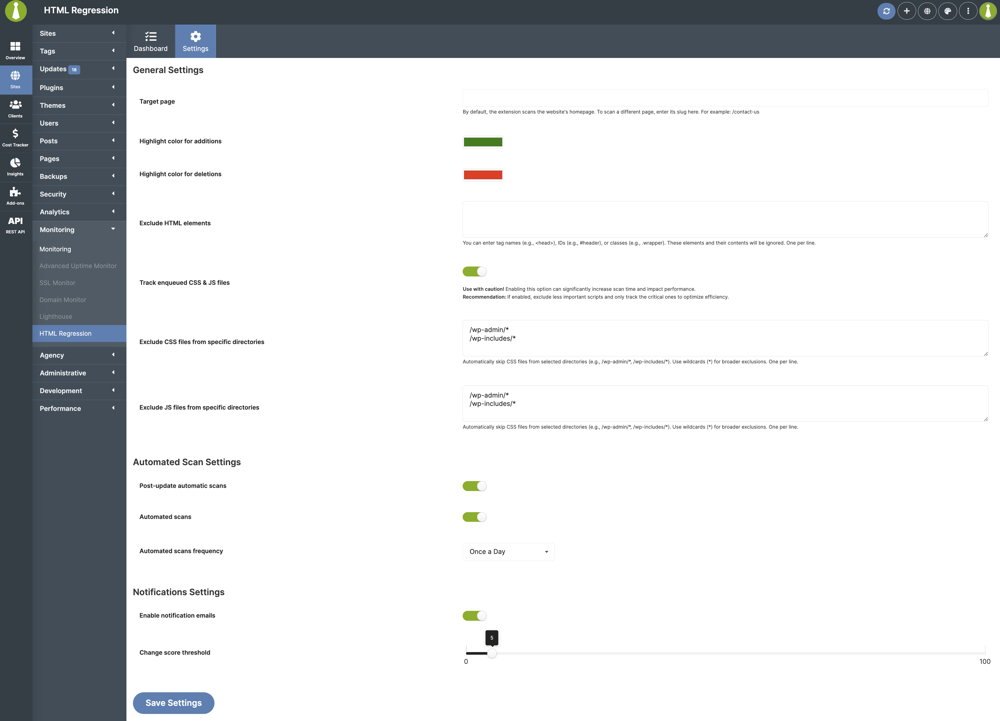
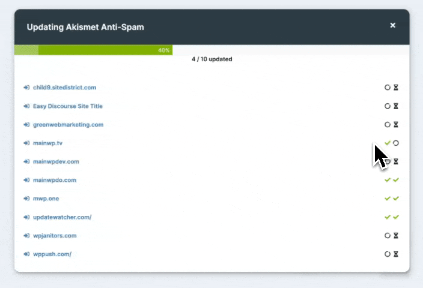
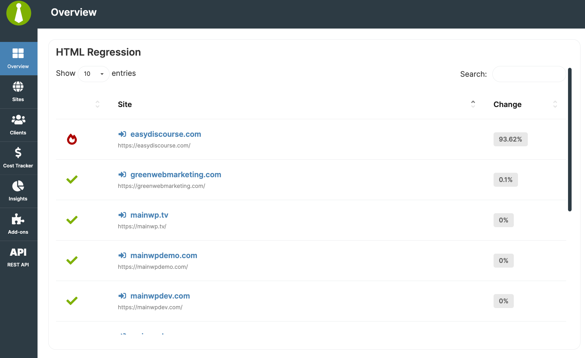
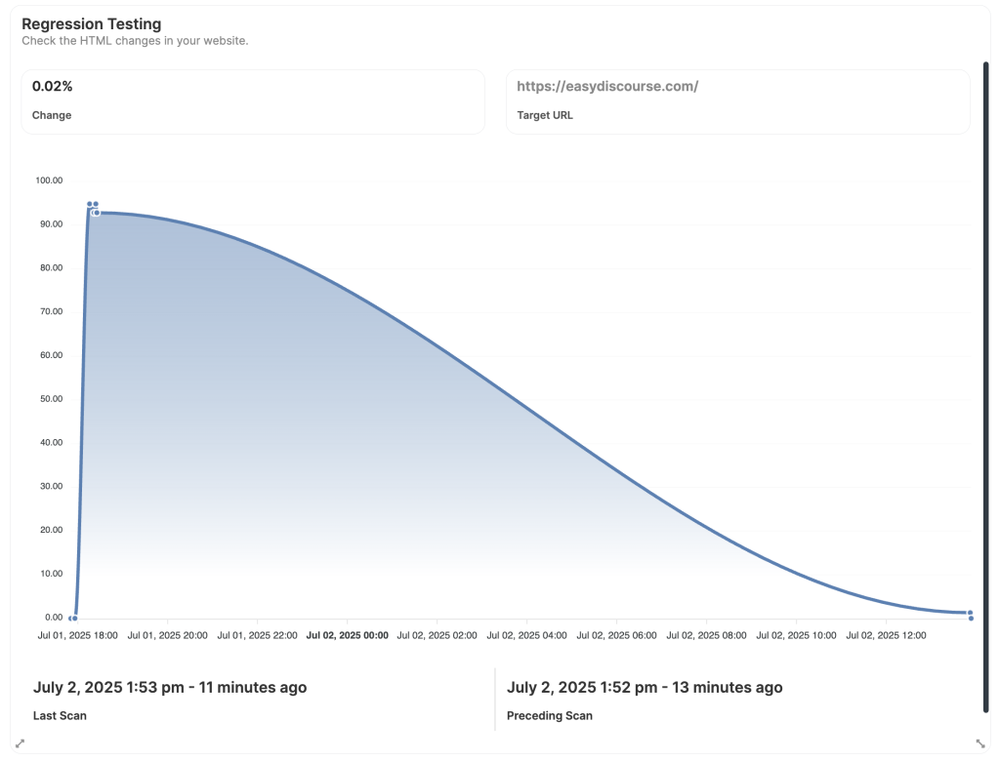

## What You'll Learn

- Configuring automated and manual HTML scans
- Setting up post-update regression scans
- Viewing raw HTML and rendered differences
- Using change thresholds for notifications

---

<div id="addon-data" style={{display: 'none'}} data-title="Regression Testing" data-purchase-url="https://mainwp.com/extension/regression-testing/" data-pricing-tier="pro" data-bundle="MainWP Pro" data-addon-type="extension" data-version="5.3" data-developer="MainWP" data-changelog-url="https://mainwp.com/changelog/mainwp-regression-testing-extension/" data-owned-by="Jestart LLC" data-privacy-url="https://mainwp.com/mainwp-plugin-privacy-policy/" />

<Info>
  **Extension Add-on** - This add-on provides standalone functionality within MainWP Dashboard. No third-party plugins required.
</Info>

<iframe className="w-full aspect-video rounded-xl" src="https://www.youtube.com/embed/rrynCqVxKSw" title="Regression Testing - Video Tutorial" frameBorder="0" allow="accelerometer; autoplay; clipboard-write; encrypted-media; gyroscope; picture-in-picture" allowFullScreen />

The **Regression Testing** extension for MainWP helps you monitor changes in your child sites' source code. Any modification to a site's HTML, whether from a plugin update, theme change, or a manual edit can introduce unexpected issues. This extension allows you to detect these differences early by comparing the most recent scan with the previous one.

You can configure scans to run on a **fixed schedule** (daily, weekly, twice per month, or monthly) or **automatically trigger** them after an update to plugins, themes, or WordPress core. Once a scan is complete, the system evaluates the differences, and if the percentage change exceeds a defined threshold, an email notification can be sent to alert you.



## Regression Testing Dashboard

To open the add-on, go to **MainWP \> Add-ons \> Monitoring \> Regression Testing**. The **Dashboard** page provides an overview of all connected child sites and their scan results.

Each site in the list includes:

• **Site Name & URL** – Click the site name to open its MainWP child site Dashboard.

• **Change Percentage** – Displays how much the site’s HTML has changed since the last scan, giving you an immediate sense of whether an update introduced modifications.

• **Comparison Timeframe** – Shows when the last two scans occurred.

• **Settings Mode** – Lets you know if the site is using global settings or has custom, per-site configurations



At the far right of each row, clicking the **ellipsis menu (⋮)** reveals additional options:

• **Overview**  – Opens the Overview page of this Child Site.

• **Edit –** Opens the Edit page of this Child Site.

• **Scan Site** – Manually trigger a new Regression Testing scan for the site.

• **Raw HTML Diff** – View side-by-side changes in the site's HTML code to detect structural modifications.

• **Rendered HTML Diff** – See a visual before-and-after comparison to spot layout or content changes.

• **Enqueued Files Diff** – Compare changes in CSS and JavaScript files if tracking is enabled in the Settings.

## General Settings

To customize how scans are performed, navigate to **MainWP \> Add-ons \> Monitoring \> Regression Testing \> Settings**.



• **Additional target pages** – By default, the add-on scans the site's homepage on the `/` slug. If you want to scan another page, enter its slug, such as `/contact-us`. This is useful if a particular page, such as a pricing or checkout page, is more critical to monitor.

Target pages follow these rules. Your Dashboard refuses to save settings that break them.

- A site can have up to 100 target pages.
- Slugs can use WordPress routing and pagination queries, such as `/?p=123`, `/?page_id=2`, or `/?post_type=product`. Other query keys, such as `/shop/?orderby=popularity` or `/?currency=EUR`, are not accepted.
- Slugs can contain `@` and non-ASCII characters.
- Two slugs that differ only in letter case, such as `/About` and `/about`, count as the same page and are refused.

• **Highlight color for additions** and **Highlight color for deletions** – Set custom colors to highlight added and removed content in difference views.

• **Exclude HTML elements** – Specify elements to ignore, such as `head`, `#header`, or `.wrapper`.

• **Track enqueued CSS & JS files** – If enabled, the add-on will also track changes to JavaScript and CSS files. However, **this can significantly increase scan time**. Only files served from the site's own address are tracked. Files from another host, such as a CDN, and font files are skipped. The first 50 files on a page are tracked. A file that fails to load is recorded for that file without failing the page.

• **Exclude CSS files from specific directories** and **Exclude JS files from specific directories** – Prevent selected CSS or JS files from being included in the scan by specifying directories, such as `/wp-admin/*`.

• **Snapshot retention policy** - Set how long HTML snapshots should be kept before they are automatically deleted. Choose from 1 day, 1 week, 2 weeks, 1 month, 2 months, 3 months, 6 months, 1 year, or unlimited. Default is 30 days. The Child Site Overview widget uses this retention window for its Change chart history.

### Automated Scan Settings

• **Post-update automatic scans** – Automatically perform a scan after a plugin, theme, or WordPress core update. After updates are finished on a Child Site, Regression Testing will begin automatically. The UI reflects this sequence, with status messages and icons that accurately indicate when an update or a regression scan is underway.



• **Delay regression scans after updates** – When **Post-update automatic scans** are enabled, you can choose to delay the regression scan instead of running it immediately after updates finish. This gives caches, CDNs, page builders, and background processes time to settle before a snapshot is captured, reducing false positives caused by transient changes.

<Frame>
  
</Frame>

When enabled, set the **Delay duration (minutes)** to any value between **1 and 60 minutes**. The post-update regression scan will be queued and begin once the delay has elapsed. If Post-update automatic scans are disabled, the delay setting is hidden and ignored.

The delay counts from the last update of a run. When you update several items on a site, for example with **Update Everything**, each update joins the scan that is already queued, so the site is scanned once after the last update.

Use this when:

- Your sites use full-page caching, object caching, or a CDN that needs time to refresh after updates.
- Plugins or themes perform background tasks (e.g., asset rebuilding, cache warming) immediately after activation or update.
- You want a more stable baseline by scanning after the site has stabilized post-update.

• **Automated scans** and **Automated scans frequency** – Choose how often automatic scans run: Once a day, Once a week, Twice a month, Once a month.

### **Notifications Settings**

• **Enable notification emails** – Get an email alert if a site's changes exceed a specified threshold.

• **Change score threshold** – Set the percentage difference that triggers a notification.

Your Dashboard sends the notification when a page crosses the threshold. Later scans that still find the page above the threshold do not send it again. Notifications use the MainWP notification email template and settings.

<Note>
  If a child site has its own notification email recipients configured (see [Per-site Settings](#per-site-settings)), those recipients are used for that site's alerts and override the general notification email settings. If no site-specific recipients are set, the general settings apply.
</Note>

## Per-site Settings

<Steps>
  <Step title="Go to the MainWP > Sites > Manage Sites page">
  </Step>
  <Step title="Locate the desired child site and click on its name">
  </Step>
  <Step title="Click Regression Testing in the sidebar on the left">
  </Step>
  <Step title="Click the Settings tab">
  </Step>
  <Step title="Enable Overwrite General Settings and click Save">
  </Step>
  <Step title="Set your desired per-site preferences">
  </Step>
  <Step title="Click the Save Settings button at the bottom of the page">
  </Step>
</Steps>

## Viewing Scan Results

<Steps>
  <Step title="Navigate to MainWP > Add-ons > Monitoring > Regression Testing">
  </Step>
  <Step title="Locate the desired Child Site in the table, and then from the ellipsis menu choose:">
    Locate the desired Child Site in the table, and then from the ellipsis menu choose:
  </Step>
</Steps>

**Raw HTML Diff**


Provides a side-by-side comparison of the site's HTML between the last two scans. The left side displays removed elements, while the right side highlights newly added content. This helps detect missing sections, unexpected code injections, or unwanted structural modifications caused by updates.

**Rendered HTML Diff**


Shows a visual before-and-after comparison of the site. This allows you to spot layout shifts, missing elements, or content changes. **However, due to security restrictions, JavaScript execution is blocked, external scripts are not loaded, and some HTML tags are escaped.** While the rendering may not be 100% accurate, it remains a reliable way to track unintended modifications.

**Enqueued Files Diff**


Displays changes in CSS and JavaScript files if tracking is enabled in the settings. This helps you identify updates to stylesheets and scripts that might have affected the site's design or functionality.

**Running a Manual Scan**

To request a manual scan, open the ellipsis menu on the **Regression Testing Dashboard** and select **Scan Site**. The scan joins the queue, and the page shows the result when it finishes.

You can also initiate a scan from an individual **Child Site Overview Page** under the Regression Testing tab. Manual scans are useful when performing maintenance or troubleshooting specific issues.

## Widgets

**MainWP Overview Page Widget**



This widget offers a high-level summary of HTML changes across all connected child sites. It displays a list of sites where significant modifications have been detected, allowing you to identify potential issues at a glance. This is particularly useful for catching unexpected changes across multiple sites without needing to open each one individually.

**Child Site Overview Page Widget**

On an individual site level, the **Child Site Overview Page Widget** provides a quick way to review the latest scan results. It displays the most recent **Change Percentage**, the **Target URL** that was scanned, and the timestamp of the **Last Scan**. This allows you to monitor specific sites directly from their MainWP overview pages, making it easy to track and review unexpected modifications as they occur.

The chart also includes timestamps on the x-axis and reflects the history of Change Percentage values within your snapshot retention window.



## How scans run

Scans started with **Scan Site**, after updates, or on a schedule are queued. With WordPress cron running, a background worker on your Dashboard checks the queue every minute. Each site runs one scan at a time. Start and completion times depend on work already in the queue and the time each page takes to scan.

- **Scheduled scans** start at their scheduled local time. Your Dashboard checks for due schedules every minute. A suspended site, or a site whose last sync failed, skips that run. When your Dashboard was offline at the scheduled time, the schedule runs once to catch up.
- **Post-update scans** start after the configured delay, as described in [Automated Scan Settings](#automated-scan-settings).
- A scan that saved results for most pages and failed on a few shows as finished.

<Warning>
WordPress cron must run on your Dashboard for queued scans to start. The direct `cron/*.php` files in the add-on no longer run scans. If you turned off **Use WP Cron** in MainWP, load any admin page once after updating the add-on, and keep WordPress cron running from then on. See [Disable WP Cron](/customization/disable-wp-cron).
</Warning>

## Failed pages

When a page cannot be scanned, its tooltip in the Regression Testing table names the reason when you can act on it:

| Reason | What to do |
|--------|------------|
| The site asks for its HTTP authentication login over `http://` | Change the site URL in MainWP to `https://`. Your Dashboard sends the saved HTTP authentication login only over HTTPS. |
| The site refused the request (HTTP 401 or 403) | Check the saved HTTP authentication login, or allow the request in the site's firewall or security plugin. |
| The page redirects to a different site | Scan a page that does not redirect away. Redirects between `example.com` and `www.example.com`, and from `http://` to `https://`, are followed. |
| The site address points to a private or reserved network address | See [Scan sites on a private network](#scan-sites-on-a-private-network). |
| The page did not return HTML | Scan a page that returns an HTML page with HTTP status 200. A 404 or 500 error page fails the scan instead of becoming a snapshot. |
| The page is larger than 2 MB | Scan a smaller page. |
| A scan of this site is already running | Try again when the current scan finishes. |
| Scans are turned off for this site through the Abilities API | Turn scans back on with the [Regression Testing Abilities](/api-reference/abilities-api/regression-testing#read-and-replace-a-site-configuration). |

Other failures show **Please check your connection.**

Sites with an IP address as their URL are scanned at that address. Sites with a Unicode host name, such as `https://müller.de`, are requested in their punycode form. Sites installed in a subdirectory are scanned at their own path.

### Scan sites on a private network

Your Dashboard refuses to scan sites whose address resolves to a private network address, such as `10.0.0.5` or `192.168.1.20`. To allow specific private sites, add the `mainwp_html_regression_private_origin_allowed` filter to your Dashboard site, for example in a code snippet:

```php
add_filter(
    'mainwp_html_regression_private_origin_allowed',
    function ( $allowed, $host, $address ) {
        return 'staging.example.local' === $host ? true : $allowed;
    },
    10,
    3
);
```

The filter receives the host name and the resolved address. It can allow addresses in the `10.0.0.0/8`, `172.16.0.0/12`, `192.168.0.0/16`, and `fc00::/7` ranges. Loopback addresses, such as `127.0.0.1`, are always refused.

## Permissions

Viewing Regression Testing results requires access to the add-on. Saving general or per-site settings, changing **Overwrite General Settings**, and running scans also require the WordPress `manage_options` capability or the **Regression Testing Management** permission. With [Team Control](/add-ons/agency/team-control-extension), assign **Regression Testing Management** to a custom role to let its users make these changes.

---

## Related Resources

- [Monitoring Add-ons](/add-ons/monitoring) - Browse all monitoring tools
- [Regression Testing Abilities](/api-reference/abilities-api/regression-testing) - Automate scans and settings through the Abilities API
- [Manage Updates](/sites/updates/manage-updates) - Update management guide
- [Dashboard Insights](/dashboard/overview/dashboard-insights) - Analytics for your Dashboard
