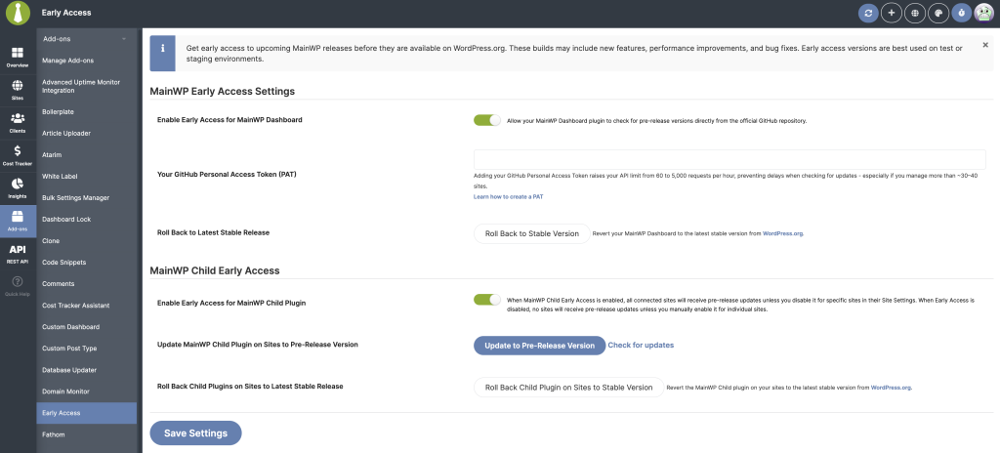
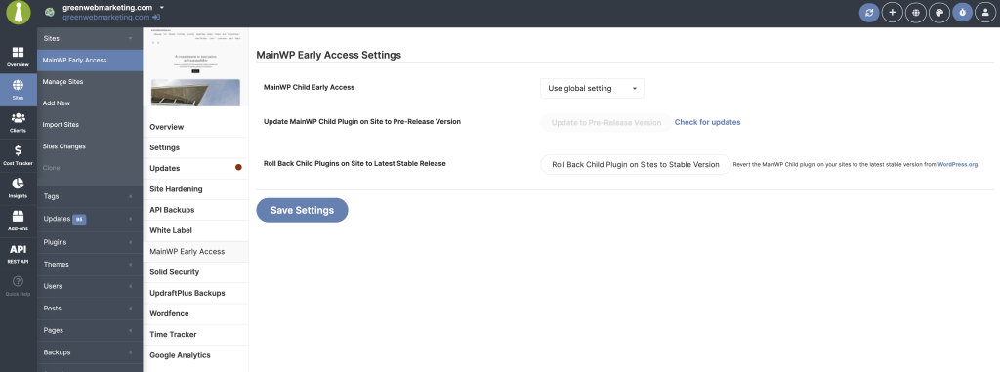

<iframe
  className="w-full aspect-video rounded-xl"
  src="https://www.youtube.com/embed/aX-LTHqmmBg"
  title="MainWP Early Access Extension - Video Tutorial"
  frameBorder="0"
  allow="accelerometer; autoplay; clipboard-write; encrypted-media; gyroscope; picture-in-picture"
  allowFullScreen
></iframe>

The MainWP Early Access Extension lets you opt into Early Access versions of both the MainWP Dashboard plugin and the MainWP Child plugin. This allows you to test upcoming features, help evaluate changes before they reach WordPress.org, or prepare workflows for new versions still in development.

## What You'll Learn

- How to install and configure the Early Access Extension
- How to enable Early Access updates globally or per-site
- How to create a GitHub Personal Access Token for higher rate limits
- How to roll back to stable versions
- How to receive nightly Add-on updates and read their changelogs

## Prerequisites

- Active MainWP license with Early Access Extension access
- Staging or testing environment (Early Access builds should not be used in production)

<Warning>
Early Access builds are best used on staging or testing environments, not production sites.
</Warning>

---

## Install the Early Access Extension

<Steps>
<Step title="Open the Add-ons page">
Go to **MainWP Dashboard > Add-ons**.
</Step>
<Step title="Click Install Add-ons">
Click the **Install Add-ons** button.
</Step>
<Step title="Search for Early Access">
Search for "MainWP Early Access" in the add-on list.
</Step>
<Step title="Install the add-on">
Select it in the list, then click **Install Selected Add-ons**.
</Step>
<Step title="Wait for installation">
The page will automatically refresh after installation completes.
</Step>
<Step title="Activate the license">
Click the **Activate Add-ons** button to activate the license for the newly installed add-on.
</Step>
</Steps>

---

## Access Early Access Settings

The add-on provides two settings locations:

| Location | Path |
|----------|------|
| Global settings | **MainWP > Add-ons > Early Access** |
| Per-site settings | **MainWP > Sites > Manage Sites > (Select Site) > MainWP Early Access tab** |

---

## Nightly Add-on Updates and Changelogs

MainWP Dashboard 6.5 and later supports nightly updates for eligible MainWP Add-ons through Early Access. Use an Early Access version that includes nightly-build support, and activate the licenses for the Add-ons you want to test.

<Warning>
Nightly builds are prereleases and may contain bugs. Test them on a staging or test Dashboard, and back up the Dashboard before installing them.
</Warning>

### Enable Nightly Add-on Updates

<Steps>
<Step title="Open Early Access settings">
Go to **MainWP > Lab** and open **Early Access Settings**, then select the **Early Access** tab.
</Step>
<Step title="Give nightly consent">
Select **I agree to receive nightly builds**. This consent also applies to supported Add-ons; there is no separate nightly switch for each Add-on.
</Step>
<Step title="Choose how updates install">
Leave **Let WordPress automatic updates install nightly builds** unchecked to install nightlies manually. Selecting it permits nightly installation where WordPress automatic updates are enabled.
</Step>
<Step title="Save and review available updates">
Click **Save Settings**. Review the Add-on's nightly changes before installing an available update from **WP Admin > Plugins** with **Update now**.
</Step>
</Steps>

The **Enable Early Access for MainWP Dashboard** and **Enable Early Access for MainWP Child Plugin** switches control those plugins. You do not need to enable them to receive eligible Add-on nightly updates.

Nightly Add-on updates come from mainwp.com and do not require a GitHub Personal Access Token. The GitHub token instructions later on this page apply to older, GitHub-based Early Access versions.

### Read Nightly Add-on Changelogs

Open the **Nightly Changes** tab on the Early Access settings page. After nightly consent, the table includes supported Add-ons with activated licenses alongside MainWP Dashboard and MainWP Child.

| Column | Shows |
|---|---|
| **Product** | The Add-on name |
| **Installed version** | The Add-on version on your Dashboard |
| **Newest nightly** | The newest nightly version in the available change list |
| **Changes** | Recent builds with their dates and **Added**, **Fixed**, **Updated**, or **Removed** entries |

Expand **Older builds** to review entries at or below your installed version. **Up to date** means the change list has no newer build. **No nightly builds are available yet** means that product has no nightly entries in the current list. An Add-on does not necessarily have a nightly build available.

Opening this tab does not install updates.

### Stop Receiving Nightly Add-on Updates

Clear **I agree to receive nightly builds** on the **Early Access** tab and click **Save Settings**. This withdraws nightly consent for Dashboard, Child, and Add-ons. It stops nightly offers but does not replace an installed nightly build.

To reinstall an Add-on's stable release, use **Roll back (Add-on name) to stable** in Early Access settings and confirm the replacement.

---

## Global Settings

### Enable Early Access for MainWP Dashboard

Toggle this option to receive Early Access updates for your Dashboard plugin. When enabled, update checks include GitHub releases marked as prereleases.

### GitHub Personal Access Token (PAT)

If you manage many sites, GitHub rate limits may slow update checks. Adding a PAT increases your limit from 60 requests/hour to 5,000 requests/hour.

<Steps>
<Step title="Open GitHub Developer Settings">
Go to [GitHub Developer Settings](https://github.com/settings/apps).
</Step>
<Step title="Navigate to tokens">
Click **Personal access tokens > Fine-Grained tokens**.
</Step>
<Step title="Generate new token">
Click **Generate new token**.
</Step>
<Step title="Name the token">
Give the token a descriptive name (e.g., "MainWP Early Access").
</Step>
<Step title="Set expiration">
Select an expiration date. We recommend longer than the default 30 days.
</Step>
<Step title="Select scopes">
Use the default scope (Public repositories, no additional permissions). This provides the minimal required permission level.
</Step>
<Step title="Generate and copy">
Click **Generate token** and copy the token immediately.
</Step>
<Step title="Save in MainWP">
Paste your PAT into the Early Access settings field and save.
</Step>
</Steps>

<Note>
The PAT key is securely encrypted by the Dashboard.
</Note>

### Roll Back to Latest Stable Release

This reinstalls the current stable version of your MainWP Dashboard plugin from WordPress.org.

Use this option if:
- You no longer want to stay on Early Access builds
- An Early Access build causes compatibility issues

---

## Child Site Settings

These settings control Early Access for the MainWP Child plugin on your connected sites.

### Enable Early Access for MainWP Child Plugin

When enabled, all child sites will use the Early Access track unless an individual site overrides this setting.

### Update MainWP Child Plugin on Sites to Pre-Release Version

Runs a bulk update across all eligible sites after you confirm the action. The Dashboard prepares sites for the update only when you start this action. Invalid site selections don't start the preparation.

A modal window then lists each site with a **Pending** status. The progress bar starts at zero and counts up to the total number of prepared sites as your Dashboard reports site-by-site results.

### Check for Updates

If a new Early Access version is available, this link forces a fresh update check.

### Roll Back Child Plugins on Sites to Latest Stable Release

Reinstalls the stable WordPress.org version of MainWP Child on all eligible sites. Use this button when you want to roll back your whole network. To roll back a single site, use the per-site option instead.

---

## Per-Site Settings

These controls are available inside each site's **MainWP Early Access** tab.

### MainWP Child Early Access

A dropdown lets you choose:
- **Use global setting** - Follow the global Early Access configuration
- **Enable** - Force Early Access on for this site
- **Disable** - Force Early Access off for this site

### Update MainWP Child Plugin on Site to Pre-Release Version

Runs the same action as the global updater but affects only that single site. A **Check for updates** link refreshes Early Access update availability for that site.

### Roll Back Child Plugin on Site to Latest Stable Release

Reverts the site back to the stable MainWP Child plugin from WordPress.org.

This action affects only the site you are viewing. Your other child sites keep their current MainWP Child version. If the Dashboard can't identify a valid site you have access to, it refuses the request with **No available sites to perform this action.** and makes no changes.

---

## What to Expect During Updates

- Updating MainWP Child to a pre-release version and rolling it back both require permission to install plugins in MainWP Dashboard. Users without this permission see **No available sites to perform this action.**
- Manual **Check for updates** links are available on both global and per-site pages
- If an Early Access version of MainWP Child is available and Early Access is enabled, the Dashboard may display an admin notice with a shortcut to the Early Access settings page
- When the Early Access Extension license is active, plugin row meta will include a **Check for updates now** link

---

## Best Practices

- Test Early Access builds on staging sites before rolling into production
- Per-site overrides always take priority over global settings
- If an Early Access update fails, check the site's connection status and retry from the modal
- Dashboard and Child rollback uses stable WordPress.org releases. Add-on rollback uses the Add-on's stable release from mainwp.com.

---

## Self-Check Checklist

- [ ] Early Access Extension installed and activated
- [ ] License activated for the add-on
- [ ] Global settings configured for Dashboard and/or Child plugin
- [ ] GitHub PAT added (optional, for higher rate limits)
- [ ] Per-site overrides configured where needed
- [ ] Testing on staging environment (not production)

---

## Related Resources

- [Manage Add-ons](/dashboard/overview/manage-extensions) - Add-on management
- [MainWP Telemetry](/advanced/miscellaneous/mainwp-telemetry-early-access) - Early Access telemetry options
