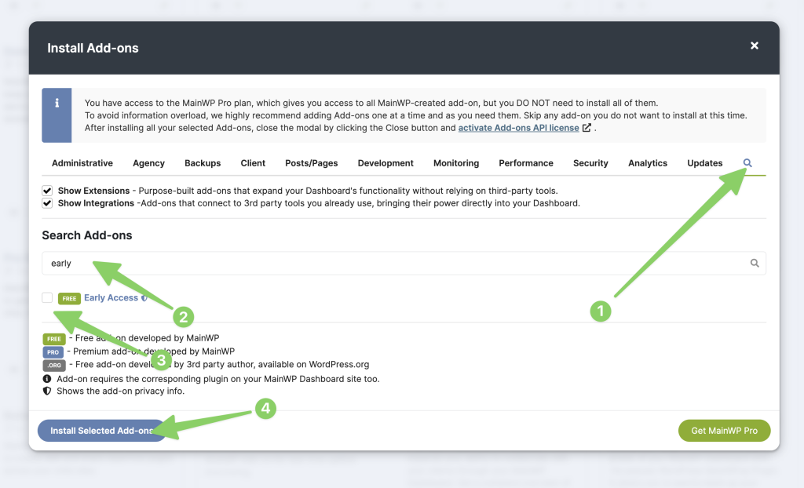
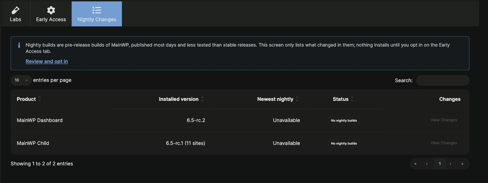
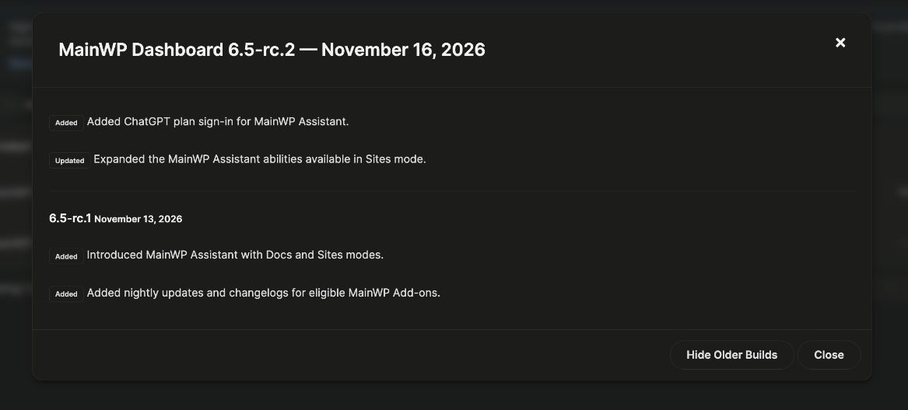
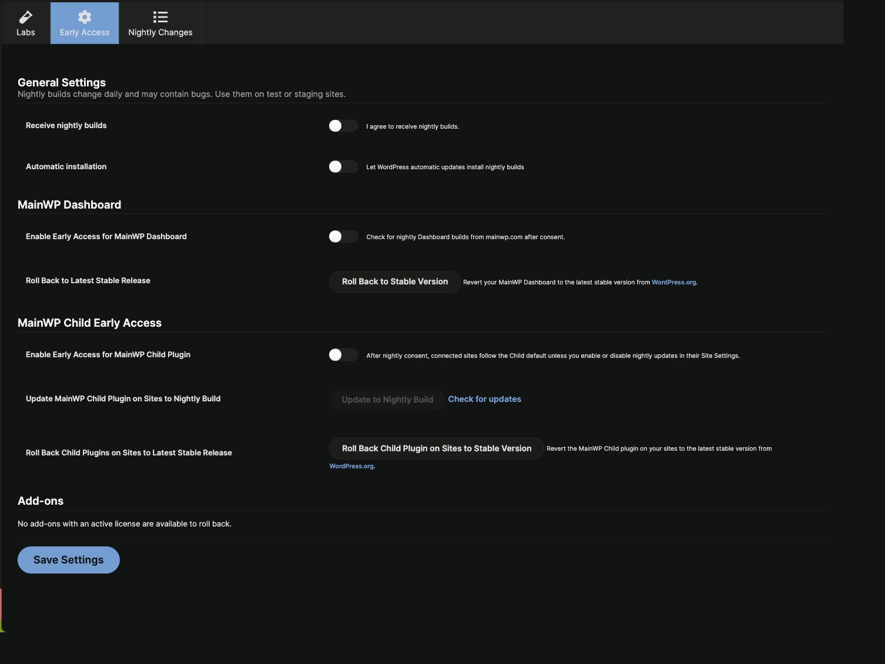
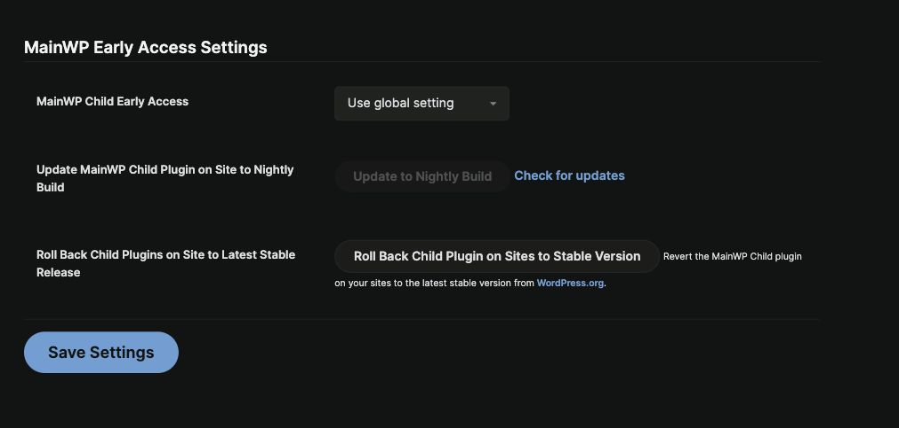

<iframe
  className="w-full aspect-video rounded-xl"
  src="https://www.youtube.com/embed/aX-LTHqmmBg"
  title="MainWP Early Access Extension - Video Tutorial"
  frameBorder="0"
  allow="accelerometer; autoplay; clipboard-write; encrypted-media; gyroscope; picture-in-picture"
  allowFullScreen
></iframe>

The MainWP Early Access Extension lets you opt into Early Access versions of both the MainWP Dashboard plugin and the MainWP Child plugin. This allows you to test upcoming features, help evaluate changes before they reach WordPress.org, or prepare workflows for new versions still in development.

Starting with Early Access Extension 6.0, Early Access delivers nightly builds from mainwp.com. Nightly builds are pre-release builds that mainwp.com publishes most days. They are less tested than stable releases, and the Extension delivers them only after you give nightly consent. If you used Early Access before 6.0, you need to opt in again after updating.

## What You'll Learn

- How to install and configure the Early Access Extension
- How to enable Early Access updates globally or per-site
- How to give nightly consent and choose whether nightly builds install automatically
- How to roll back to stable versions
- How to receive nightly Add-on updates and read their changelogs

## Prerequisites

- Active MainWP license with Early Access Extension access
- Staging or testing environment (Early Access builds should not be used in production)

<Warning>
Early Access builds are best used on staging or testing environments, not production sites.
</Warning>

---

## Install the Early Access Extension

<Steps>
<Step title="Open the Add-ons page">
Go to **MainWP Dashboard > Add-ons**.
</Step>
<Step title="Click Install Add-ons">
Click the **Install Add-ons** button.
</Step>
<Step title="Search for Early Access">
Search for "MainWP Early Access" in the add-on list.
</Step>
<Step title="Install the add-on">
Select it in the list, then click **Install Selected Add-ons**.
</Step>
<Step title="Wait for installation">
The page will automatically refresh after installation completes.
</Step>
<Step title="Activate the license">
Click the **Activate Add-ons** button to activate the license for the newly installed add-on.
</Step>
</Steps>

---

## Access Early Access Settings

The add-on provides two settings locations:

| Location | Path |
|----------|------|
| Global settings | Go to **MainWP > Labs** and click **Settings** on the Early Access card. |
| Per-site settings | Go to **MainWP > Sites**, open a site's dashboard, and click **Early Access**. |

---

## Nightly Add-on Updates and Changelogs

MainWP Dashboard 6.5 and later supports nightly updates for eligible MainWP Add-ons through Early Access. Use Early Access Extension 6.0 or later, and activate the licenses for the Add-ons you want to test.

<Warning>
Nightly builds are prereleases and may contain bugs. Test them on a staging or test Dashboard, and back up the Dashboard before installing them.
</Warning>

### Enable Nightly Add-on Updates

<Steps>
<Step title="Open Early Access settings">
Go to **MainWP > Labs** and click **Settings** on the Early Access card.
</Step>
<Step title="Give nightly consent">
In **General Settings**, turn on **Receive nightly builds** (**I agree to receive nightly builds.**). This consent also applies to supported Add-ons; there is no separate nightly switch for each Add-on.
</Step>
<Step title="Choose how updates install">
Leave **Automatic installation** (**Let WordPress automatic updates install nightly builds**) off to install nightlies manually. Turning it on permits nightly installation where WordPress automatic updates are enabled.
</Step>
<Step title="Save and review available updates">
Click **Save Settings**. Review the Add-on's nightly changes before installing an available update from **WP Admin > Plugins** with **Update now**.
</Step>
</Steps>

The **Enable Early Access for MainWP Dashboard** and **Enable Early Access for MainWP Child Plugin** switches control those plugins. You do not need to enable them to receive eligible Add-on nightly updates.

Nightly updates come from mainwp.com and do not require a GitHub Personal Access Token.

### Read Nightly Add-on Changelogs

Open the **Nightly Changes** tab on the Early Access settings page, or click **Nightly Changes** on the Early Access card in **MainWP > Labs**. The table shows MainWP Dashboard and MainWP Child before you opt in. After you give nightly consent, it also lists supported Add-ons with activated licenses.

| Column | Shows |
|---|---|
| **Product** | MainWP Dashboard, MainWP Child, or the Add-on name |
| **Installed version** | The version on your Dashboard. For MainWP Child, each reported version shows how many sites run it. |
| **Newest nightly** | The newest nightly version in the available change list |
| **Status** | **Update available**, **Up to date**, **No nightly builds**, **Version unknown**, or **Unavailable** |
| **Changes** | A **View Changes** button that opens the build notes when available |

Click **View Changes** to open the build notes. Each build shows its date and any **Added**, **Fixed**, **Updated**, or **Removed** entries. When more older builds are available, click **View Older Builds** to expand the list or **Hide Older Builds** to collapse it. Click **Close** to return to the table.

The example below uses MainWP Dashboard 6.5 release candidate notes.

**Up to date** means the list has no newer build. **No nightly builds** means there are no build notes in the list for that product. **Unavailable** in the **Status** column means the changes could not be loaded.

Opening this tab does not install updates.

### Stop Receiving Nightly Add-on Updates

Turn off **Receive nightly builds** on the **Early Access** tab and click **Save Settings**. This withdraws nightly consent for Dashboard, Child, and Add-ons. It stops nightly offers but does not replace an installed nightly build.

To reinstall an Add-on's stable release, go to the **Add-ons** section of the **Early Access** tab and click **Roll Back to Stable Version** in the Add-on's row. Confirm **Replace this add-on with its latest stable release?** The section lists one row per license-activated Add-on. If no Add-on has an active license, it shows **No add-ons with an active license are available to roll back.**

---

## Global Settings

The **Early Access** tab includes **General Settings**, **MainWP Dashboard**, **MainWP Child Early Access**, and **Add-ons**.

### General Settings

This section holds your nightly consent. Its subheader reads **Nightly builds change daily and may contain bugs. Use them on test or staging sites.**

- **Receive nightly builds**: Turn on **I agree to receive nightly builds.** to allow nightly delivery for the Dashboard, Child, and Add-on updates you enable. Turn it off to opt out.
- **Automatic installation**: Turn on **Let WordPress automatic updates install nightly builds** to let WordPress automatic updates install nightly builds. Leave it off to install them only when you start the update yourself.

An info message under these switches summarizes your setup: whether Dashboard nightlies are on, whether the Child default is on, and how many sites you explicitly enabled.

If you previously enabled Early Access for your Dashboard, for Child sites globally, or for an individual Child site, your Dashboard shows the **Early Access now delivers nightly builds.** notice after you upgrade to 6.0. Your Dashboard and Child preferences carry over, and you must opt in again to receive nightly builds. Click **Review and opt in** to open the settings page, or click **Stay on stable releases** to decline.

<Note>
Nightly packages are verified before installation. When installation is refused, the Extension deletes the downloaded package. Stable updates keep working without nightly consent.
</Note>

### Enable Early Access for MainWP Dashboard

In the **MainWP Dashboard** section, turn on this option to check for nightly Dashboard builds from mainwp.com after you give nightly consent.

### Roll Back to Latest Stable Release

This reinstalls the current stable version of your MainWP Dashboard plugin from WordPress.org.

Use this option if:
- You no longer want to stay on Early Access builds
- An Early Access build causes compatibility issues

### Add-ons

The **Add-ons** section lists each license-activated Add-on with a **Roll Back to Stable Version** button. See [Stop Receiving Nightly Add-on Updates](#stop-receiving-nightly-add-on-updates).

---

## Child Site Settings

These controls in the **MainWP Child Early Access** section apply to your connected sites.

### Enable Early Access for MainWP Child Plugin

When enabled, and after you give nightly consent, all child sites receive nightly MainWP Child updates unless an individual site overrides this setting. This option is off by default.

### Update MainWP Child Plugin on Sites to Nightly Build

Click **Update to Nightly Build** to update MainWP Child to the latest nightly build from mainwp.com on all eligible sites after you confirm the action. A site is eligible when you gave nightly consent and Early Access is enabled for it, either through the global Child setting or its own setting. The Dashboard prepares sites for the update only when you start this action. Invalid site selections don't start the preparation.

A modal window then lists each site with a **Pending** status. The progress bar starts at zero and counts up to the total number of prepared sites as your Dashboard reports site-by-site results.

Your Dashboard updates one site first and stops the rollout if that site fails. After the first site succeeds, two failures stop the Dashboard from starting new updates. Updates already in progress can finish, and the dialog lists the sites the Dashboard skipped. After each nightly install, the Dashboard verifies that MainWP Child is active and running the expected version.

### Check for Updates

If a new nightly build is available, this link forces a fresh update check.

### Roll Back Child Plugins on Sites to Latest Stable Release

Reinstalls the stable WordPress.org version of MainWP Child on all eligible sites. Use this button when you want to roll back your whole network. Stable rollback always runs on every selected site, even after failures. To roll back a single site, use the per-site option instead.

---

## Per-Site Settings

Open a site's dashboard and click **Early Access** to open **MainWP Early Access Settings**.

### MainWP Child Early Access

A dropdown lets you choose:
- **Use global setting** - Follow the global Early Access configuration
- **Enable** - Force Early Access on for this site
- **Disable** - Force Early Access off for this site

### Update MainWP Child Plugin on Site to Nightly Build

Runs the same action as the global updater but affects only that single site. If the site is not eligible, the Dashboard shows **This site is not eligible for nightly Child updates.** A **Check for updates** link refreshes Early Access update availability for that site.

### Roll Back Child Plugin on Site to Latest Stable Release

Reverts the site back to the stable MainWP Child plugin from WordPress.org.

This action affects only the site you are viewing. Your other child sites keep their current MainWP Child version. If the Dashboard can't identify a valid site you have access to, it refuses the request with **No available sites to perform this action.** and makes no changes.

---

## What to Expect During Updates

- Updating MainWP Child to a nightly build and rolling it back both require permission to install plugins in MainWP Dashboard. Users without this permission see **No available sites to perform this action.**
- Manual **Check for updates** links are available on both global and per-site pages
- If a nightly build of MainWP Child is available and you enabled nightly Child updates, the Dashboard may display an admin notice with a shortcut to the Early Access settings page
- When the Early Access Extension license is active, plugin row meta will include a **Check for updates now** link

---

## Best Practices

- Test Early Access builds on staging sites before rolling into production
- Per-site overrides always take priority over global settings
- If an Early Access update fails, check the site's connection status and retry from the modal
- Dashboard and Child rollback uses stable WordPress.org releases. Add-on rollback uses the Add-on's stable release from mainwp.com.

---

## Self-Check Checklist

- [ ] Early Access Extension installed and activated
- [ ] License activated for the add-on
- [ ] Nightly consent given, with automatic installation on or off as you prefer
- [ ] Global settings configured for Dashboard and/or Child plugin
- [ ] Per-site overrides configured where needed
- [ ] Testing on staging environment (not production)

---

## Related Resources

- [Manage Add-ons](/dashboard/overview/manage-extensions) - Add-on management
- [MainWP Telemetry](/advanced/miscellaneous/mainwp-telemetry-early-access) - Early Access telemetry options
