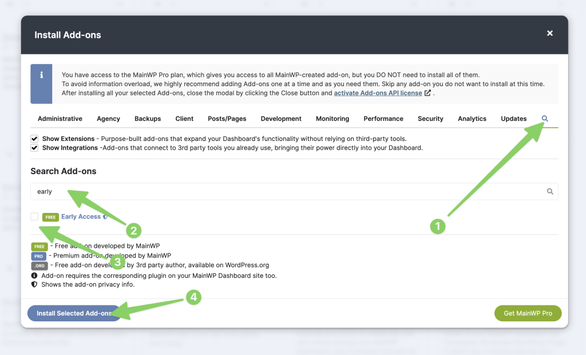
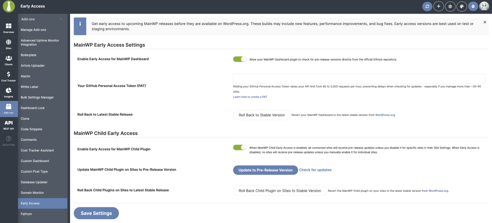
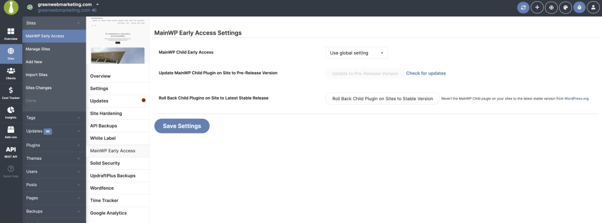

<iframe
  className="w-full aspect-video rounded-xl"
  src="https://www.youtube.com/embed/aX-LTHqmmBg"
  title="MainWP Early Access Extension - Video Tutorial"
  frameBorder="0"
  allow="accelerometer; autoplay; clipboard-write; encrypted-media; gyroscope; picture-in-picture"
  allowFullScreen
></iframe>

The MainWP Early Access Extension lets you opt into nightly builds of both the MainWP Dashboard plugin and the MainWP Child plugin. This allows you to test upcoming features, help evaluate changes before they reach WordPress.org, or prepare workflows for new versions still in development.

Nightly builds are pre-release builds of MainWP that mainwp.com publishes most days. They are less tested than stable releases. Early Access delivers them only after you give nightly consent.

## What You'll Learn

- How to install and configure the Early Access Extension
- How to give nightly consent and choose whether nightly builds install automatically
- How to enable Early Access updates globally or per-site
- How to review what changed in recent nightly builds
- How to roll back to stable versions

## Prerequisites

- Active MainWP license with Early Access Extension access
- Staging or testing environment (Early Access builds should not be used in production)

<Warning>
Early Access builds are best used on staging or testing environments, not production sites.
</Warning>

---

## Install the Early Access Extension

<Steps>
<Step title="Open the Add-ons page">
Go to **MainWP Dashboard > Add-ons**.
</Step>
<Step title="Click Install Add-ons">
Click the **Install Add-ons** button.
</Step>
<Step title="Search for Early Access">
Search for "MainWP Early Access" in the add-on list.
</Step>
<Step title="Install the add-on">
Select it in the list, then click **Install Selected Add-ons**.
</Step>
<Step title="Wait for installation">
The page will automatically refresh after installation completes.
</Step>
<Step title="Activate the license">
Click the **Activate Add-ons** button to activate the license for the newly installed add-on.
</Step>
</Steps>

---

## Access Early Access Settings

The add-on provides two settings locations:

| Location | Path |
|----------|------|
| Global settings | **MainWP > Add-ons > Early Access** |
| Per-site settings | **MainWP > Sites > Manage Sites > (Select Site) > MainWP Early Access tab** |

---

## Global Settings

### Nightly consent

The Early Access settings page shows a summary of your current nightly setup: whether Dashboard nightlies are on, whether the Child default is on, and how many sites you explicitly enabled. Nightly builds install only after you consent.

- **I agree to receive nightly builds**: Turns on nightly delivery for the updates you enable on this page. Clear it to opt out.
- **Let WordPress automatic updates install nightly builds**: Leave it cleared to install nightly builds only when you start the update yourself. MainWP saves a change to this option even when you change nothing else.

After an Extension update that switches Early Access to nightly builds, MainWP Dashboard shows the notice **Early Access now delivers nightly builds.** Early Access updates are paused until you choose. Click **Review and opt in** to open the settings page, or click **Stay on stable releases** to decline.

<Note>
Before MainWP Dashboard installs a nightly update on your Dashboard site, it checks that the package comes from mainwp.com and that its SHA-256 checksum matches the published one. When a check fails, MainWP stops the installation and deletes the downloaded package. Stable updates keep working without nightly consent.
</Note>

### Enable Early Access for MainWP Dashboard

Toggle this option to check for nightly Dashboard builds from mainwp.com after you give nightly consent.

### Roll Back to Latest Stable Release

This reinstalls the current stable version of the MainWP Dashboard plugin from WordPress.org.

Use this option if:
- You no longer want to stay on Early Access builds
- An Early Access build causes compatibility issues

### Roll back add-ons to stable

For each activated MainWP add-on, the settings page shows a **Roll back (add-on name) to stable** button. After you confirm, MainWP replaces the add-on with its latest stable release and verifies its version and activation.

---

## Child Site Settings

These settings control Early Access for the MainWP Child plugin on your connected sites.

### Enable Early Access for MainWP Child Plugin

When enabled, and after you give nightly consent, all child sites receive nightly MainWP Child updates unless an individual site overrides this setting. This option is off by default.

### Update MainWP Child Plugin on Sites to Nightly Build

Click **Update to Nightly Build** to update MainWP Child to the latest nightly build from mainwp.com on all eligible sites after you confirm the action. A site is eligible when you gave nightly consent and Early Access is enabled for it, either through the global Child setting or its own setting. MainWP prepares sites for the update only when you start this action. Invalid site selections don't start the preparation.

A modal window then lists each site with a **Pending** status. The progress bar starts at zero and counts up to the total number of prepared sites as MainWP reports site-by-site results.

MainWP rolls out the nightly build to one site first and continues with the remaining sites only if that site succeeds. The rollout stops when the first site fails or when two sites fail. The modal then lists the sites that were not updated. After each install, MainWP checks that the site runs the expected MainWP Child version and that the plugin is active.

### Check for Updates

If a new nightly build is available, this link forces a fresh update check.

### Roll Back Child Plugins on Sites to Latest Stable Release

Reinstalls the stable WordPress.org version of MainWP Child on all eligible sites. Use this button when you want to roll back your whole network. To roll back a single site, use the per-site option instead.

---

## Per-Site Settings

These controls are available inside each site's **MainWP Early Access** tab.

### MainWP Child Early Access

A dropdown lets you choose:
- **Use global setting** - Follow the global Early Access configuration
- **Enable** - Force Early Access on for this site
- **Disable** - Force Early Access off for this site

### Update MainWP Child Plugin on Site to Nightly Build

Runs the same action as the global updater but affects only that single site. If the site is not eligible, MainWP shows **This site is not eligible for nightly Child updates.** A **Check for updates** link refreshes Early Access update availability for that site.

### Roll Back Child Plugin on Site to Latest Stable Release

Reverts the site back to the stable MainWP Child plugin from WordPress.org.

This action affects only the site you are viewing. Your other child sites keep their current MainWP Child version. If the Dashboard can't identify a valid site you have access to, it refuses the request with **No available sites to perform this action.** and makes no changes.

---

## Nightly Changes

Open the **Nightly Changes** tab on the Early Access settings page to see what changed in recent nightly builds before you install them. This tab only lists changes. Nothing installs until you opt in on the **Early Access** tab.

The table shows a row for MainWP Dashboard and MainWP Child with these columns:

| Column | Description |
|--------|-------------|
| **Product** | MainWP Dashboard or MainWP Child |
| **Installed version** | The version you run. For MainWP Child, each reported version shows how many sites run it. |
| **Newest nightly** | The latest nightly build available from mainwp.com |
| **Changes** | Entries labeled **Added**, **Fixed**, **Updated**, or **Removed** for each recent build |

Builds older than your installed version appear under **Older builds**. When you already run the newest build, the row shows **Up to date**. MainWP caches the change list for about two hours. If mainwp.com can't be reached, the tab shows **Changes could not be loaded from mainwp.com. The next attempt is in about two hours.**

---

## What to Expect During Updates

- Updating MainWP Child to a nightly build and rolling it back both require permission to install plugins in MainWP Dashboard. Users without this permission see **No available sites to perform this action.**
- Manual **Check for updates** links are available on both global and per-site pages
- If a nightly build of MainWP Child is available and you enabled nightly Child updates, the Dashboard may display an admin notice with a shortcut to the Early Access settings page
- When the Early Access Extension license is active, plugin row meta will include a **Check for updates now** link

---

## Best Practices

- Test Early Access builds on staging sites before rolling into production
- Per-site overrides always take priority over global settings
- If an Early Access update fails, check the site's connection status and retry from the modal
- Rollback operations always use the stable version provided by WordPress.org

---

## Self-Check Checklist

- [ ] Early Access Extension installed and activated
- [ ] License activated for the add-on
- [ ] Nightly consent given, with automatic installs on or off as you prefer
- [ ] Global settings configured for Dashboard and/or Child plugin
- [ ] Per-site overrides configured where needed
- [ ] Testing on staging environment (not production)

---

## Related Resources

- [Manage Add-ons](/dashboard/overview/manage-extensions) - Add-on management
- [MainWP Telemetry](/advanced/miscellaneous/mainwp-telemetry-early-access) - Early Access telemetry options
