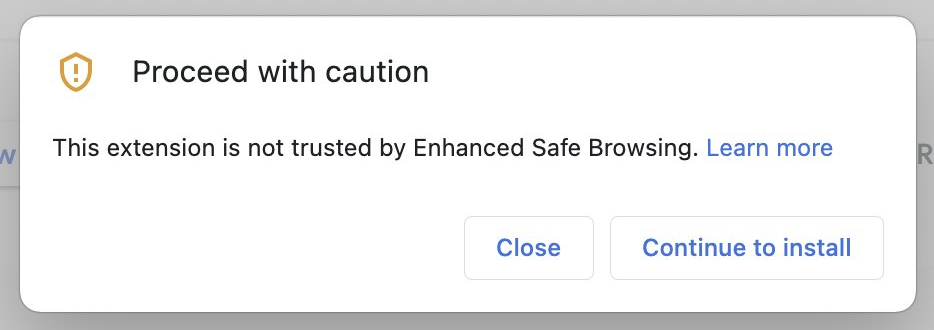
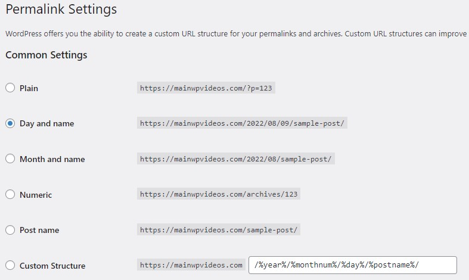

<iframe
  className="w-full aspect-video rounded-xl"
  src="https://www.youtube.com/embed/G6oE1LCKAO0"
  title="MainWP Browser Extension - Video Tutorial"
  frameBorder="0"
  allow="accelerometer; autoplay; clipboard-write; encrypted-media; gyroscope; picture-in-picture"
  allowFullScreen
></iframe>

The MainWP Browser Extension adds MainWP Dashboard visibility to your browser toolbar. It checks your child sites for available updates, surfaces changes made outside MainWP, runs Time Tracker timers, and shows Cost Tracker totals and license expiration alerts. API requests go from your browser directly to your self-hosted MainWP Dashboard over HTTPS.

## What You'll Learn

- Requirements and installation options
- How to connect the extension to MainWP Dashboard
- How the Updates, Time Tracker, Cost Tracker, and Settings views work
- How to migrate from earlier extension versions
- How to troubleshoot common connection problems

---

## Requirements

- **Chrome 116 or later.** The Chrome extension uses Manifest V3, so it can also run in Chromium-based browsers that support Manifest V3, such as Edge, Brave, Arc, Vivaldi, and Opera.
- **MainWP Dashboard 5.2 or later.** MainWP Dashboard 5.2+ is required for REST API v2, Bearer token authentication, Time Tracker, and Cost Tracker support.
- **An HTTPS MainWP Dashboard URL.** The extension rejects plain HTTP. Development URLs such as `https://localhost`, `https://127.0.0.1`, and HTTPS private IP addresses can be used when the browser can reach them.
- **An enabled REST API key** in MainWP Dashboard.
- **WordPress permalinks set to anything other than Plain.** The REST API needs pretty permalinks to route requests.

<Note>
The extension can only connect to a MainWP Dashboard URL that your browser can reach. A Dashboard running on `localhost` from another machine is not reachable from that other machine.
</Note>

---

## Installation

### Chrome

1. Visit the [Chrome Web Store extension page](https://chrome.google.com/webstore/detail/mainwp-browser-extension/kjlehednpnfgplekjminjpocdechbnge).
2. Click **Add to Chrome**.
3. Click **Add Extension** to confirm.
4. Pin the MainWP icon to your toolbar from the extensions menu.

<Note>
If Chrome Enhanced Safe Browsing flags the extension during install, click **Continue to install** to proceed.


</Note>

### Firefox

<Warning>
The Firefox extension is currently deprecated and in End-of-Life (EOL) planning. New v3 features such as Bearer token authentication, Time Tracker, and Cost Tracker ship on Chrome only. Firefox users should plan to migrate to a Chromium-based browser to keep receiving updates.
</Warning>

1. Visit the [Firefox Add-ons extension page](https://addons.mozilla.org/en-US/firefox/addon/mainwp-browser-extension/).
2. Click **Add to Firefox**.
3. Click **Add** to confirm.

---

## Connect the Extension to MainWP Dashboard

The current Chrome extension connects with MainWP REST API v2 and Bearer token authentication.

<Steps>
<Step title="Configure permalinks">
Go to **WP Admin > Settings > Permalinks** on the site running MainWP Dashboard. Choose any setting other than **Plain**.


</Step>

<Step title="Open Add API Keys">
In MainWP Dashboard, go to **MainWP > API Access > Add API Keys**.
</Step>

<Step title="Create the API key">
Enter an API key name, such as `Browser Extension`, and keep the key enabled.

For update and Cost Tracker monitoring, **Read** permission is enough. If you want to start, pause, stop, or create Time Tracker tasks from the extension, also enable the write-capable permission option, currently labeled **Write & Delete** for v2 keys.
</Step>

<Step title="Copy the Bearer token">
Copy the value from **API key (Bearer token)**. Store it securely because the token is shown only when the key is created.
</Step>

<Step title="Save the API key">
Save the key in MainWP Dashboard. The key is not active until you save it.
</Step>

<Step title="Open the extension">
Click the MainWP icon in your browser toolbar. The welcome screen appears with the heading **Welcome to MainWP**.
</Step>

<Step title="Enter your MainWP Dashboard URL">
Paste the full MainWP Dashboard URL into **Enter your MainWP Dashboard URL**. The URL must use `https://` and point to the site root, not `/wp-admin`.
</Step>

<Step title="Enter your credentials">
Paste the Bearer token into **Paste your Bearer Token**.
</Step>

<Step title="Connect MainWP Dashboard">
Click **Connect Dashboard**. Chrome prompts you to grant the extension permission to access the Dashboard origin. Allow the request.
</Step>

<Step title="Pick what to monitor">
On the **Connected Successfully!** screen, choose which data to sync: WordPress updates, plugin updates, theme updates, translation updates, and Non-MainWP changes. Choose a sync frequency and theme, then click **Start Monitoring**.
</Step>
</Steps>

---

## What You'll See in the Toolbar


The toolbar badge shows quick status after the extension syncs.

For update monitoring, a badge like `5-2` means `5` selected updates and `2` Non-MainWP changes. Each number is capped at `99`, and the badge is blank when both counts are zero.

When a Time Tracker timer is running or paused, the badge shows elapsed time instead. When the timer stops, the update-count badge returns if there are cached counts to show.

Desktop notifications can fire for available updates, timer state changes, license expiration warnings, and sync errors. Configure notification categories in **Settings > Notifications**.

---

## Updates


Open **Updates** to see the **Pending Updates** view. It shows:

- Plugins
- Themes
- WordPress Core
- Translations
- Non-MainWP Changes

Each update row can expand to show affected sites. The banner actions include shortcuts to sync data and open the relevant MainWP Dashboard page.

The sync schedule is controlled from **Settings > Monitoring**. Available frequencies range from every 15 minutes to once per day.

---

## Time Tracker


The Time Tracker card on **Dashboard Overview** lets you start, pause, resume, and stop timers without opening MainWP Dashboard. Use **Start Timer** for a quick local timer, or use **New Task** to create a task tied to a client, site, and bucket.

Timer state survives popup closes, service worker restarts, and browser restarts. Paused timers appear under **Paused Timers** so you can resume them later.

<Note>
Time Tracker requires the [Time Tracker extension](/add-ons/client/mainwp-time-tracker-extension) installed and active on MainWP Dashboard. If it is unavailable, the browser extension shows a message that Time Tracker is not installed on your Dashboard.
</Note>

---

## Cost Tracker


The Cost Tracker view summarizes costs across your portfolio:

- Monthly Total and Annual Total projections
- Sites Tracked and Costs Tracked counts
- Cost Breakdown by category
- License Expiration Alerts

License alerts use two thresholds. Licenses inside seven days are urgent. Licenses inside thirty days are warnings. Cost data refreshes daily in the background and is cached locally in the browser.

<Note>
Cost Tracker requires the [Cost Tracker](/clients/cost-tracker) feature to be available in MainWP Dashboard. If the required endpoint is unavailable, the browser extension shows an unavailable message for Cost Tracker.
</Note>

---

## Settings

Open Settings from the gear icon in the popup. Settings are grouped into five sections.

**Connection** stores your MainWP Dashboard URL and credentials, the **I have saved the API Key in my Dashboard** confirmation checkbox, and **Disconnect Dashboard**.

**Appearance** lets you choose **Light**, **Dark**, or **System (Auto)**.

**Monitoring** controls sync frequency, preferred currency, and which data types count toward sync and badge totals.

**Notifications** controls desktop notifications for updates, license expiration warnings, and sync errors.

**About** shows the installed extension version and links to documentation, support, and MainWP. **Clear All Data** removes credentials, cached counts, Cost Tracker cache, and timer history from the browser.

Save changes with **Save Settings**.

---

## Migrating From Earlier Versions

If you used an earlier Chrome extension version with Consumer Key and Consumer Secret credentials, the v3 extension checks your saved MainWP Dashboard connection after update.

If the Dashboard supports MainWP REST API v2, the extension may show a **Credential Update Available** prompt. Generate a new Bearer token in MainWP Dashboard, then update the connection in the extension.

If the Dashboard does not support MainWP REST API v2, the extension shows a migration or upgrade prompt. Upgrade MainWP Dashboard to version 5.2 or later, then reconnect the extension.

If your saved Dashboard URL uses HTTP, an **HTTPS Required** prompt appears and the extension stops API calls until you update the URL to `https://`.

---

## Troubleshooting

### Connection Issues

| Problem | What's happening | Fix |
| --- | --- | --- |
| `401 Invalid Credentials` | The Bearer token is wrong or expired. | Regenerate the API key in **MainWP > API Access** and paste the new value into the extension. |
| `403 API Key Not Activated` | The key exists but is disabled or missing required permission. | Enable the key, confirm the needed permissions, and make sure you saved the key in MainWP Dashboard. |
| `404` or non-JSON response | The URL is wrong, points to `/wp-admin`, or the site is not running MainWP Dashboard. | Use the Dashboard site root, including `https://` and the correct domain or subdirectory. |
| Dashboard version too old | The Dashboard does not support MainWP REST API v2. | Upgrade MainWP Dashboard to version 5.2 or later. |
| Connection timeout | The Dashboard is unreachable or the SSL certificate is invalid. | Open the URL in a browser tab and fix any hosting, DNS, firewall, or SSL issue first. |
| Notifications never appear | Browser or operating system notifications are disabled. | Enable notifications for your browser in your operating system settings. |

### REST API blocked by a security plugin

Security and performance plugins can block REST API access. Test by logging out of WordPress and visiting:

```text
https://your-dashboard-url.com/wp-json/
```

A working install returns JSON. An access denied message means a plugin or server rule is blocking the REST API.

Common REST API paths used by the current Chrome extension include:

- `/mainwp/v2/sites/count`
- `/mainwp/v2/sites`
- `/mainwp/v2/updates`
- `/mainwp/v2/sites/{id}/non-mainwp-changes`
- `/mainwp/v2/time-tracker`
- `/mainwp/v2/settings/cost-tracker`
- `/mainwp/v2/costs`

Only use these paths if you are specifically troubleshooting the deprecated Firefox extension or an older installed Chrome extension version:

- `/mainwp/v1/sites/all-sites`
- `/mainwp/v1/sites/sites-available-updates-count`
- `/mainwp/v1/site/non-mainwp-changes-count`

### HTTP Basic Auth conflict

The browser extension is not compatible with HTTP Basic Auth on your MainWP Dashboard site. Use the [Dashboard Lock extension](/add-ons/security/dashboard-lock-extension) instead. It provides equivalent protection without blocking REST API requests.

### Inspect the service worker

For deeper debugging, open `chrome://extensions`, find **MainWP Browser Extension**, and click **Inspect views: service worker**. The Console tab shows API calls, sync attempts, and extension errors.

---

## Permissions and Privacy

The Chrome extension requests three core permissions:

- `alarms` for scheduled syncs
- `storage` for settings, cached counts, timer state, and Cost Tracker cache
- `notifications` for desktop alerts

Host permissions are requested at runtime for the URL you enter for your MainWP Dashboard. The extension does not get access to every website at install time.

API traffic goes from your browser to your MainWP Dashboard over HTTPS. Credentials are stored in `chrome.storage.local` and are not synced through Chrome Sync. Non-sensitive preferences and cached update counts may use `chrome.storage.sync`; if Chrome Sync is enabled, Chrome may sync those values through Google's standard Chrome Sync infrastructure.

The extension does not send API data to MainWP servers, analytics services, telemetry endpoints, or external CDNs.

By installing, you agree to the [Terms of Service](https://mainwp.com/terms-of-service/) and the [MainWP Browser Extension Privacy Policy](https://mainwp.com/privacy-policy/mainwp-chrome-extension-privacy-policy/).

---

## Self-Check Checklist

- [ ] Extension installed in Chrome and pinned to the toolbar
- [ ] WordPress permalinks set to a non-Plain option
- [ ] REST API key created in **MainWP > API Access > Add API Keys** with the permissions needed for your selected features
- [ ] API key saved in MainWP Dashboard
- [ ] Dashboard URL uses `https://`
- [ ] Bearer token entered in the extension
- [ ] Chrome host permission granted for the Dashboard origin
- [ ] Monitoring preferences selected
- [ ] Pending update counts visible in the popup

---

## Related Resources

- [REST API Overview](/api-reference/rest-api/overview)
- [Time Tracker](/add-ons/client/mainwp-time-tracker-extension)
- [Cost Tracker](/clients/cost-tracker)
- [Cost Tracker Assistant](/add-ons/client/cost-tracker-assistant-extension)
- [Dashboard Lock Extension](/add-ons/security/dashboard-lock-extension)
