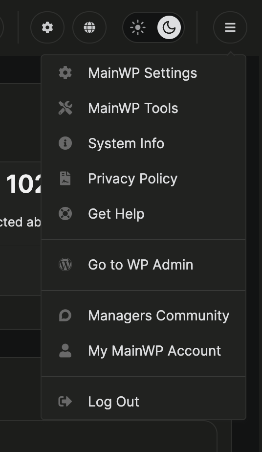

In MainWP Dashboard 6.4.1 and later, click the three-line **MainWP menu** at the top right. It replaces the profile picture or user icon from earlier versions.

Use this menu to open **MainWP Settings**, **MainWP Tools**, **System Info**, or **Go to WP Admin**. To change your appearance, see [Dashboard Themes](/customization/how-to-change-the-theme-for-mainwp).
