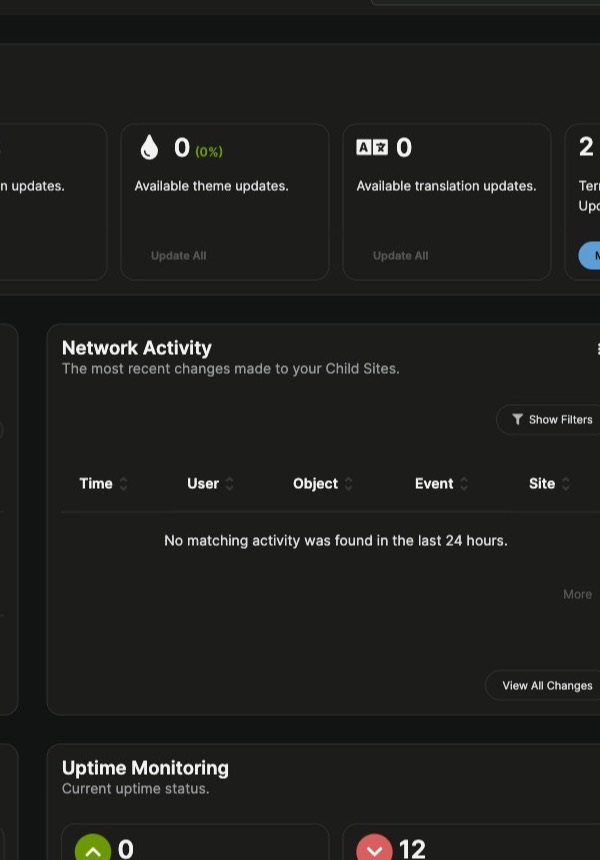

Type a question in the Assistant panel and choose the mode that fits it: **Docs** for questions about MainWP, **Sites** for work on your own child sites.

## What You'll Learn

- Ask a question in Docs mode and use the answer controls
- Switch to Sites mode and what happens when it isn't set up
- Confirm or cancel an action Sites mode wants to run
- Find, export, and delete saved conversations

## Prerequisites

- The Assistant is turned on and its privacy notice was accepted. See [Turn On the Assistant](/dashboard/mainwp-assistant/overview#turn-on-the-assistant).
- For Sites mode: WordPress 7.0 or later on the Dashboard site and an AI provider with a working API key. See [Connect an AI Provider](/dashboard/mainwp-assistant/settings-and-privacy#connect-an-ai-provider).

## Ask a Question in Docs Mode

<Steps>
<Step title="Open the chat">
Open the Assistant and select **Start Chat**, or click **New Chat** in the panel header.
</Step>
<Step title="Check the mode">
Next to **Mode:**, make sure **Docs** is selected. The line under it starts with "Answers from MainWP documentation."
</Step>
<Step title="Ask">
Type your question in the box and press **Enter**, or click **Send message**. Press **Shift + Enter** for a new line. A message can be up to 2,000 characters.
</Step>
<Step title="Read the answer">
The answer lists the documentation pages it used under **Sources:**. Click a source to open that page.
</Step>
</Steps>

While an answer is being written, the send button changes to **Stop**. Click it to stop the response.

Each Docs answer has these controls:

| Control | What it does |
|---|---|
| **Copy response** | Copies the answer text |
| **Helpful answer** / **Unhelpful answer** | Rates the answer. Click the same button again to remove your rating. |
| **Regenerate last response** | Asks again for a new answer to your last question |

After you mark an answer as unhelpful, **Still stuck? Contact MainWP Support** appears under it. See [Contact MainWP Support](/dashboard/mainwp-assistant/contact-support).

Ratings are saved with your conversation history, so they aren't available when conversation history is turned off.

## Switch Between Docs and Sites

Click **Docs** or **Sites** next to **Mode:**. The panel remembers your choice in this browser.

When Sites mode is set up, the line under the mode selector reads "Works with your sites through your configured AI provider. Actions run only after you confirm them. Responses can take 1-3 minutes."

When Sites mode isn't available, the panel stays in Docs and tells you why:

- Below WordPress 7.0: "Sites mode needs WordPress 7.0 or newer. Docs mode works on this version."
- With no AI provider: "No AI connection configured. Add a provider API key under Settings > Connectors." with an **Open Connectors settings** link.
- With no AI provider, when your account can change Assistant settings: a **Connect free AI** card instead of the message. It offers a free Google Gemini key with **Connect free AI**, or **Use OpenAI or Anthropic instead**. See [Connect an AI Provider](/dashboard/mainwp-assistant/settings-and-privacy#connect-an-ai-provider).

### When Docs Gets a Request to Change Something

If you ask Docs to do something on your sites, it may offer to move the request to Sites: "Review this request in Sites. When you send it, Sites uses your configured AI provider."

- **Continue in Sites** starts a new conversation in Sites mode with your request in the message box. It isn't sent until you send it.
- **Ask Docs instead** keeps the question in Docs.
- **Dismiss** closes the offer.

## Work with Your Sites in Sites Mode

In Sites mode, the AI provider connected to WordPress reads your request and calls MainWP actions on your behalf. It can only use the actions your access mode allows and the sites your account can access.

<Steps>
<Step title="Select Sites">
Next to **Mode:**, click **Sites**.
</Step>
<Step title="Describe what you need">
Ask about your sites, for example "Which sites have plugin updates waiting?" and send it.
</Step>
<Step title="Wait for the response">
Sites mode usually takes 1 to 3 minutes. The panel shows what it is doing, such as **Waiting for AI response...** or **Executing actions...**.
</Step>
</Steps>

Each Sites answer shows the provider that answered and the tokens it used. When the provider's prices are known, it also shows an estimated cost, and the panel shows a running estimate for the conversation. These are estimates from published per-token pricing; your provider's bill may differ.

Sites mode requests are blocked once the Dashboard reaches its daily AI spend limit. See [Spend Limits](/dashboard/mainwp-assistant/settings-and-privacy#spend-limits).

### Confirm or Cancel an Action

When an action needs your approval, Sites mode shows it in the chat and waits for you.

- **Confirm Action** appears for a change, such as syncing sites or updating plugins.
- **Confirm Destructive Action** appears for an action that deletes or removes data. It says "This action will make permanent changes. Review the preview below:" and shows a preview first.

Each confirmation lists the **Action:** and the **Affected sites:**. Expand **Technical details** to see the exact action and inputs.

Click **Proceed** to run it or **Cancel** to stop. You can also type "yes" to proceed or "cancel" to dismiss. After a cancel, the panel shows "Cancelled. The action was not executed."

If an affected site has one of your protected tags, the confirmation also says "This affects sites with protected tags. Extra confirmation required."

Which actions need a confirmation depends on your settings:

| Your settings | What happens |
|---|---|
| **Read Only** access mode | Sites mode can't run actions that change data. If it tries, the panel shows "Action blocked. You are in read-only mode." |
| **Read & Write (with confirmation)** or **Full Access**, with **Confirm all changes** | Every action that changes data asks first |
| **Read & Write (with confirmation)** or **Full Access**, with **Destructive actions only** | Changes such as syncing or adding sites run without asking. Actions that delete or remove data still ask. |

Actions with their own preview step, such as running updates, always ask. See [Access Mode and Confirmations](/dashboard/mainwp-assistant/settings-and-privacy#access-mode-and-confirmations).

### Long Operations

Some actions, such as updates across many sites, run as batch jobs on the Dashboard. The panel shows progress and how many sites succeeded or failed. If you leave the page, the job keeps running on the server; reload the page to see its progress again. Batch jobs are kept for 24 hours.

## Saved Conversations

Unless you turn off conversation history, the Assistant saves your conversations on your Dashboard for 30 days by default.

<Steps>
<Step title="Open Messages">
In the panel's tab bar, click **Messages**.
</Step>
<Step title="Find a conversation">
Scroll the list or type in **Search conversations...**.
</Step>
<Step title="Open it">
Click a conversation to open it and continue where you left off.
</Step>
</Steps>

Each conversation in the list has three buttons:

- **Export as JSON** downloads the conversation as a JSON file.
- **Export as Markdown** downloads it as a Markdown file.
- **Delete conversation** asks for confirmation, then deletes it. This can't be undone.

The **Home** tab also shows your most recent conversation under **Recent Conversation**.

To change how long conversations are kept, export all of them, or delete all of them, see [History and Privacy](/dashboard/mainwp-assistant/settings-and-privacy#history-and-privacy).

## Related Resources

- [MainWP Assistant Overview](/dashboard/mainwp-assistant/overview)
- [Contact MainWP Support](/dashboard/mainwp-assistant/contact-support)
- [Settings, Privacy, and History](/dashboard/mainwp-assistant/settings-and-privacy)
- [Troubleshooting](/dashboard/mainwp-assistant/troubleshooting)
