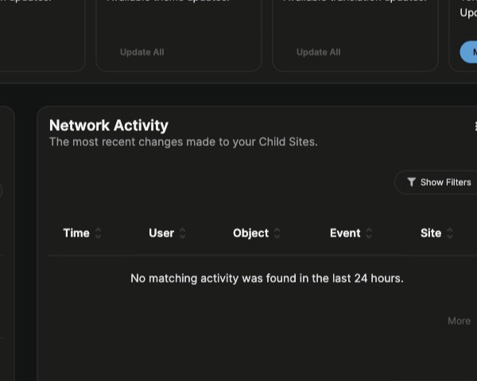

When the Assistant can't answer your question, send it to MainWP Support from the panel. Support replies by email.

## What You'll Learn

- Where to find the support form in the Assistant
- What the form sends to MainWP Support
- What changes when conversation history is turned off

## Prerequisites

- The Assistant is turned on and its privacy notice was accepted. See [Turn On the Assistant](/dashboard/mainwp-assistant/overview#turn-on-the-assistant).
- An email address where you can receive the reply

## Open the Support Form

You can reach the form in two ways:

- **After an unhelpful answer:** Click **Unhelpful answer** under a Docs answer. **Still stuck? Contact MainWP Support** appears under the answer. Click it.
- **From the tab bar:** Click **Contact support** at the bottom of the panel. It is always there.

The form takes a snapshot of the conversation you have open when you open it.

## Send a Request

<Steps>
<Step title="Check your email address">
**Email** is filled in with your WordPress account's email address. Change it if you want the reply somewhere else.
</Step>
<Step title="Write your note">
**Your note** starts with your last question in this chat. Add what you tried and what you expected, up to 1,500 characters. Don't include passwords, API keys, or other credentials.
</Step>
<Step title="Review what will be sent">
Read the list under **We will send:**.
</Step>
<Step title="Send">
Click **Send**. Click **Cancel** to go back without sending.
</Step>
</Steps>

When the request goes through, the panel shows "Thanks. MainWP Support will reply by email to" followed by your address.

If it fails, the panel shows "We couldn't send this. You can reach MainWP Support at mainwp.com/contact." Use the link to contact MainWP Support directly.

## What Is Sent

The form sends these to MainWP Support:

| Item | Details |
|---|---|
| Your email address | The address in **Email**, used for the reply |
| Your note | The text in **Your note** |
| This conversation's questions and answers | Up to the last 10 messages (your questions and the Assistant's answers) from the conversation you had open, as plain text. Very long messages are shortened. Sent only when conversation history is on and the conversation was saved. |
| Dashboard, WordPress and PHP versions | The version numbers of MainWP Dashboard, WordPress, and PHP on your Dashboard site |

The form doesn't send your site list, site credentials, or settings.

If there's no conversation to send, for example when you open **Contact support** before asking anything, a note is required. Without one, the form shows "Please add a note so MainWP Support knows how to help."

### With Conversation History Turned Off

If you turned off conversation history under **History & Privacy**, the form says "Conversation history is off. Questions and answers will not be sent." Only your email address, your note, and the version numbers are sent, so describe the problem fully in your note.

## Other Ways to Reach MainWP

The **Contact MainWP Support** card in the [Support modal](/getting-started/mainwp-support-modal) opens the MainWP Community site in a new tab. It doesn't use this form.

## Related Resources

- [Asking Questions](/dashboard/mainwp-assistant/asking-questions) - Answer controls and saved conversations
- [Settings, Privacy, and History](/dashboard/mainwp-assistant/settings-and-privacy) - Turn conversation history on or off
- [Troubleshooting](/dashboard/mainwp-assistant/troubleshooting)
