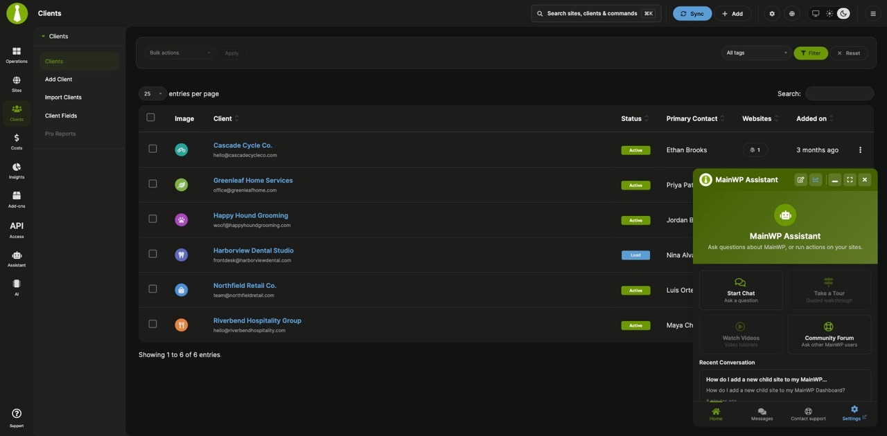
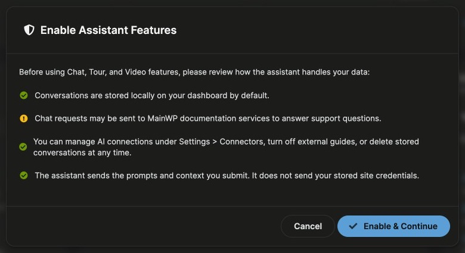
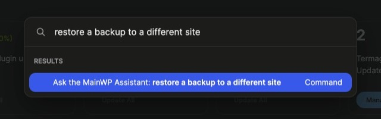

MainWP Assistant is a chat panel inside MainWP Dashboard. It has two modes:

- **Docs** answers questions about MainWP from the official MainWP documentation. It doesn't need an AI key.
- **Sites** works with your own child sites through the AI provider you connect to WordPress. It uses your API key and your provider account, starts read-only, and by default asks you to confirm each change.

## What You'll Learn

- What Docs mode and Sites mode do and what each one needs
- Who can use the Assistant
- How to turn on the Assistant the first time
- How to open the Assistant from the sidebar, the Support modal, and the Command Palette
- How the panel is laid out

## Prerequisites

| | Docs mode | Sites mode |
|---|---|---|
| WordPress account | Administrator | Administrator |
| WordPress version on the Dashboard site | Any version MainWP Dashboard supports | WordPress 7.0 or later |
| AI provider | Not needed | An AI provider with a working API key under **Settings > Connectors** in WP Admin |
| Cost | No AI key or provider account needed | Your AI provider bills your own account |

An administrator also has to accept the Assistant's privacy notice once before anyone on the Dashboard can chat. See [Turn on the Assistant](#turn-on-the-assistant).

<Note>
The Assistant opens only for WordPress administrators who can access the Dashboard's **Overview**. If you use [Team Control](/add-ons/agency/team-control-extension), turning the Assistant on, accepting the privacy notice, and changing Dashboard-wide Assistant settings also need the **Access MainWP Settings** permission.
</Note>

## Docs Mode and Sites Mode

**Docs** sends your question to the MainWP documentation service and shows the answer with links to the documentation pages it used. It can't see or change your sites. Use it for "how do I" questions about MainWP.

**Sites** sends your request to the AI provider connected to WordPress on your Dashboard site. The provider can call MainWP actions, such as listing sites, checking updates, or syncing sites, within the access you allow. Sites mode responses usually take 1 to 3 minutes.

What Sites mode can do depends on your access mode:

- **Read Only** (the default) lets it read data only.
- **Read & Write (with confirmation)** lets it make changes that don't delete anything, such as syncing sites or running updates. By default it asks you to confirm each one.
- **Full Access** also allows actions that delete or remove data. Those always show a preview and ask you to confirm.

See [Asking Questions](/dashboard/mainwp-assistant/asking-questions) for confirmations and [Settings, Privacy, and History](/dashboard/mainwp-assistant/settings-and-privacy) for access modes.

## Turn On the Assistant

On new installs the Assistant is turned on. After an upgrade, it keeps the setting of the earlier chat support option, which was off unless you turned it on. Turn it on from any of these places:

- **MainWP menu (three lines, top right) > MainWP Tools**, under **Privacy & Third-Party Services Permissions**: **MainWP Assistant (AI-Powered Chat Support)**
- The **Support Assistant** card in the [Support modal](/getting-started/mainwp-support-modal)
- **Assistant Settings > AI Access Policies > Global Assistant Toggle** (`/wp-admin/admin.php?page=AssistantSettings&tab=policies`)

The first time someone opens a chat, the **Enable Assistant Features** dialog lists how the Assistant handles your data. Nothing goes to the documentation service or an AI provider until an administrator accepts it.

<Steps>
<Step title="Open a chat">
Open the Assistant and select **Start Chat**.
</Step>
<Step title="Review the privacy notice">
Read the list in the **Enable Assistant Features** dialog.
</Step>
<Step title="Accept">
Click **Enable & Continue**. The chat opens.
</Step>
</Steps>

Accepting applies to the whole Dashboard. If your account can't accept it, the Assistant shows "Assistant features are off. Ask a dashboard administrator to enable them."

## Open the Assistant

The Assistant panel is available on MainWP Dashboard pages. Open it in any of these ways:

- **Sidebar:** Click **Assistant** (robot icon) in the left navigation.
- **Support modal:** Click **Support** at the bottom of the left navigation, then click **Open Support Assistant** on the **Support Assistant** card. The modal closes and the chat opens.
- **Command Palette:** Press **Command + K** on Mac or **Ctrl + K** on Windows and Linux.
  - Choose **Open the MainWP Assistant** to open the chat.
  - Or type a question of two or more characters and choose **Ask the MainWP Assistant: _your text_**. The chat opens with your text in the message box. It isn't sent until you click **Send message** or press **Enter**, so you can edit it or switch modes first.

The Ask result appears below any matching sites and clients. See [MainWP Command Palette](/dashboard/overview/mainwp-command-palette) for the rest of the palette.

## The Panel

The panel opens in the bottom-right corner. Drag its header to move it, drag a corner to resize it, or use the header buttons:

| Button | What it does |
|---|---|
| **New Chat** | Starts a new conversation |
| **Insights** | Opens Dashboard Insights, where the Assistant widgets are. Shown when you can access Insights and the Logs module is on. |
| **Minimize** | Collapses the panel |
| **Maximize** / **Restore** | Expands the panel to fill the window, or returns it to its normal size |
| **Close assistant panel** | Closes the panel |

The tab bar at the bottom has four entries:

- **Home**: shortcut cards (**Start Chat**, **Take a Tour**, **Watch Videos**, **Community Forum**) and your most recent conversation. **Take a Tour** and **Watch Videos** work when guided tours and video tutorials are turned on and the current page has one.
- **Messages**: your saved conversations.
- **Contact support**: a form that sends your question to MainWP Support. See [Contact MainWP Support](/dashboard/mainwp-assistant/contact-support).
- **Settings**: opens the **Assistant Settings** page.

## Related Resources

- [Asking Questions](/dashboard/mainwp-assistant/asking-questions) - Docs and Sites modes, confirmations, and saved conversations
- [Contact MainWP Support](/dashboard/mainwp-assistant/contact-support) - Send a conversation to MainWP Support
- [Settings, Privacy, and History](/dashboard/mainwp-assistant/settings-and-privacy) - AI connection, access modes, what is sent where, and history
- [Troubleshooting](/dashboard/mainwp-assistant/troubleshooting) - Messages you may see and how to fix them
- [MainWP AI Menu](/dashboard/overview/mainwp-ai) - Knowledge, MainWP MCP, and MainWP Control
