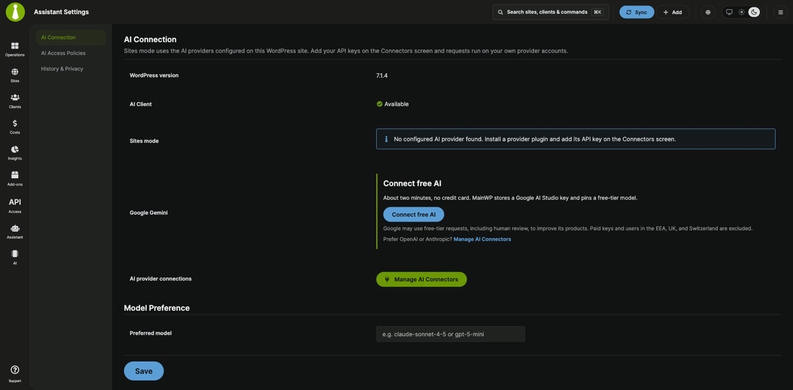
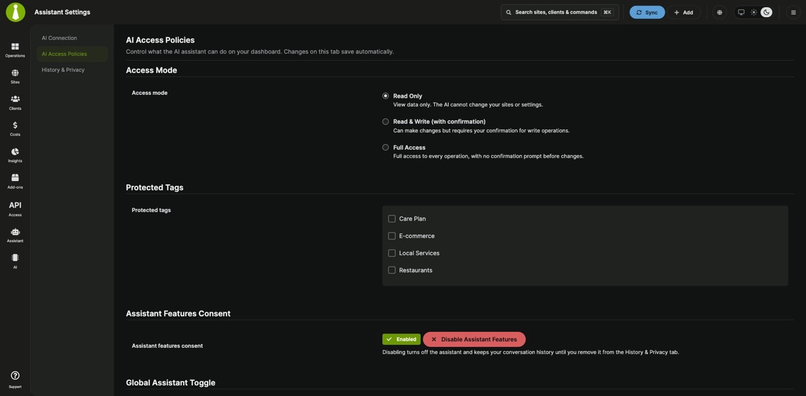

The **Assistant Settings** page controls how the Assistant connects to AI, what it may do on your sites, and how long conversations are kept.

## What You'll Learn

- Open Assistant Settings
- Connect an AI provider for Sites mode
- Choose an access mode, confirmation level, and protected tags
- Set daily spend limits
- See what the Assistant sends to MainWP and to your AI provider
- Keep, export, or delete conversation history
- Turn the Assistant on or off
- Review Assistant usage in Dashboard Insights

## Prerequisites

- A WordPress administrator account
- The **Access MainWP Settings** permission if you use [Team Control](/add-ons/agency/team-control-extension). Accounts without it see only the **History & Privacy** tab.

## Open Assistant Settings

Open the Assistant panel and click **Settings** in the tab bar, or go to `/wp-admin/admin.php?page=AssistantSettings`.

The page has three tabs:

| Tab | Applies to | Use it to |
|---|---|---|
| **AI Connection** | The whole Dashboard | Connect an AI provider for Sites mode and set a preferred model |
| **AI Access Policies** | Your account, plus Dashboard-wide consent, availability, and spend limits | Choose what Sites mode may do, protect tagged sites, and set limits |
| **History & Privacy** | Your account | Set how long your conversations are kept, export them, or delete them |

## Connect an AI Provider

Sites mode uses the AI providers configured in WordPress on your Dashboard site, with your own API key and provider account. Docs mode doesn't need this.

Open **Assistant Settings > AI Connection**. The tab shows:

- **WordPress version**: Sites mode needs WordPress 7.0 or newer.
- **AI Client**: **Available** when WordPress can send AI requests. **Disabled on this site** means AI features are turned off in WordPress. **Requires WordPress 7.0 or newer** means the site needs an update.
- **Sites mode**: **Ready. Found a configured AI provider.** or a message that no provider was found.

### Option 1: Connect a Free Google Gemini Key

If no provider is set up, the **Google Gemini** row offers **Connect free AI**. It stores a Google AI Studio key for you and picks a free-tier model.

<Warning>
Google may use free-tier requests, including human review, to improve its products. Paid keys and users in the EEA, UK, and Switzerland are excluded. Don't send anything through a free-tier key that you wouldn't want reviewed.
</Warning>

<Steps>
<Step title="Start the wizard">
Click **Connect free AI**.
</Step>
<Step title="Get key">
Sign in to Google AI Studio. Click **Get API key**, then **Create API key**, and copy the key.
</Step>
<Step title="Paste">
Paste the key into **Google API key**. Google AI Studio keys usually start with `AIza`.
</Step>
<Step title="Verify">
The wizard checks the key with Google. When it works, you see "Connected. Sites mode is on, using" followed by the model name. If it asks you to reload the page, reload it before you switch to Sites.
</Step>
</Steps>

To change the key later, click **Replace key**. If the site already sets a Google key in `wp-config.php` or an environment variable, that key takes priority and the wizard tells you to change it where it is defined.

### Option 2: Use Another Provider

Click **Manage AI Connectors** to open **Settings > Connectors** in WP Admin. Install the provider's plugin, such as one for OpenAI or Anthropic, and add its API key there. Return to **AI Connection** and check that **Sites mode** reads **Ready**.

### Preferred Model

Under **Model Preference**, **Preferred model** is optional. Enter a model ID, such as `gpt-5-mini`, and click **Save**. The Assistant asks for that model first and falls back to any available model. Leave it empty to let WordPress choose.

## Access Mode and Confirmations

Open **Assistant Settings > AI Access Policies**. Changes on this tab save as soon as you make them. **Access Mode**, **Confirmation Level**, and **Protected Tags** apply to your account only.

### Access Mode

| Access mode | What Sites mode can do |
|---|---|
| **Read Only** (default) | Read data only. It can't change your sites or settings. |
| **Read & Write (with confirmation)** | Read data, make changes that don't delete anything (such as syncing sites, adding sites, or editing clients), run updates, activate or deactivate plugins, and activate themes |
| **Full Access** | Everything, including actions that delete or remove data |

**Full Access** doesn't skip confirmations. An action that deletes or removes data still shows a preview and asks you to confirm before it runs, and your **Confirmation Level** applies to other changes.

### Confirmation Level

**Confirmation Level** appears when your access mode isn't **Read Only**. Under **Ask for confirmation**, choose:

- **Confirm all changes** (default): every action that changes data asks for your approval first.
- **Destructive actions only**: changes such as syncing or adding sites run without asking. Actions that delete or remove data still ask.

### Protected Tags

Select tags under **Protected tags**. Sites with these tags need an extra confirmation before the Assistant can change them, even in **Full Access**. If you have no tags yet, use the **Manage tags** link to create them.

## Spend Limits

Sites mode costs depend on your AI provider's prices. The Assistant estimates spend from token counts and published provider prices; your provider's bill may differ. Both limits are on **AI Access Policies** and need administrator access.

| Setting | Default | What it does |
|---|---|---|
| **Daily AI spend limit (USD)** | $2.00 | A Dashboard-wide cap. When the day's estimated spend reaches it, Sites mode requests are blocked until the next day. Set `0` for no limit. |
| **Per-user daily AI spend limit (USD)** | $0.00 (no limit) | A cap for each user on top of the Dashboard-wide limit, so one user can't spend the whole budget |

Under each field, the page shows how much was used today. When the Dashboard reaches its limit, the chat shows "This dashboard reached its daily AI spend limit, so Sites mode requests are blocked until tomorrow." with a **Change the limit** link for users who can change it. When a user reaches the per-user limit, the chat shows "You reached your daily AI spend limit, so your Sites mode requests are blocked until tomorrow."

## What the Assistant Sends and Where

The **Enable Assistant Features** dialog lists these points before anyone can chat. In detail:

| Where | What | When |
|---|---|---|
| Your Dashboard | Your conversations | Unless you turn off conversation history. They are kept for the number of days you set. |
| MainWP documentation service | Your question, your Dashboard's address, the MainWP page you have open, and a summary of your Assistant access settings | Each time you ask in Docs mode. On first use, the Dashboard also registers its address with the service. |
| MainWP documentation service | Your rating | When you click **Helpful answer** or **Unhelpful answer** |
| Your AI provider | Your requests and the results of the MainWP actions the Assistant runs | Each time you ask in Sites mode. The provider handles them under its own terms. |
| MainWP Support | Your email address, note, recent conversation, and version numbers | Only when you click **Send** on the support form. See [What Is Sent](/dashboard/mainwp-assistant/contact-support#what-is-sent). |

The Assistant doesn't send your stored site credentials.

Guided tours and video tutorials use their own external services when those options are turned on. See [Privacy & Data Handling](/getting-started/are-you-guys-watching-what-i-am-doing).

## History and Privacy

Open **Assistant Settings > History & Privacy**. These settings apply to your account only.

| Setting | What it does |
|---|---|
| **Keep conversations for** | How many days conversations are kept before they are deleted automatically, from 1 to 365. The default is 30. |
| **Disable conversation history** | Select **Disable conversation history entirely** to stop saving conversations. Turning it on also clears your previous history. |

Click **Save Settings** after changing either one.

Under **Manage History Data**:

- **Export History (JSON)** downloads every conversation of yours, with its messages, as a JSON file.
- **Clear All History** permanently deletes every conversation of yours after you confirm. It can't be undone, so export first if you want a copy.

To export or delete a single conversation, use the **Messages** tab in the panel. See [Saved Conversations](/dashboard/mainwp-assistant/asking-questions#saved-conversations).

With history turned off, the Assistant can't save answer ratings, and the support form can't include your conversation.

## Turn the Assistant On or Off

Turning the Assistant off removes the **Assistant** sidebar item and the panel for every user on the Dashboard. Saved conversations stay until each user clears them.

Use any of these:

- **Assistant Settings > AI Access Policies > Global Assistant Toggle**: switch **Assistant availability**. Turning it off asks you to confirm with **Disable Assistant**.
- **MainWP menu (three lines, top right) > MainWP Tools > Privacy & Third-Party Services Permissions**: **MainWP Assistant (AI-Powered Chat Support)**.
- The toggle on the **Support Assistant** card in the [Support modal](/getting-started/mainwp-support-modal), then **Save Support Settings**.

While the Assistant is off, **Assistant Settings** still opens at `/wp-admin/admin.php?page=AssistantSettings`. Administrators can turn it back on from **AI Access Policies**, and every user can still manage their history on **History & Privacy**.

### Withdraw Consent

Under **Assistant Features Consent**, **Disable Assistant Features** withdraws the privacy consent for the Dashboard. It turns off the Assistant for everyone, and the **Enable Assistant Features** dialog appears again the next time someone opens it. Conversation history stays until it is cleared on **History & Privacy**.

## Review Assistant Usage in Insights

When the Assistant is on and the Logs module is enabled, **MainWP > Insights** (`admin.php?page=InsightsOverview`) includes four Assistant widgets:

| Widget | Shows |
|---|---|
| **AI Assistant Summary** | **Conversations**, **Abilities Executed**, **Confirmed Actions**, and **Failed Executions** in the selected period |
| **Top Abilities** | The Assistant actions used most often |
| **Provider Usage** | Whether MainWP docs or your AI provider answered each request |
| **AI Assistant Activity** | Every Assistant action with its time, user, status, and duration. Click **Export CSV** to download it. |

The widgets show your own activity. With the **Access MainWP Settings** permission, you can filter by other users. Accounts limited to specific sites can't see Assistant Insights. The **Insights** button in the panel header opens this page. See [Dashboard Insights](/dashboard/overview/dashboard-insights) for filters and layouts.

## Related Resources

- [MainWP Assistant Overview](/dashboard/mainwp-assistant/overview)
- [Asking Questions](/dashboard/mainwp-assistant/asking-questions)
- [Contact MainWP Support](/dashboard/mainwp-assistant/contact-support)
- [Troubleshooting](/dashboard/mainwp-assistant/troubleshooting)
- [Privacy & Data Handling](/getting-started/are-you-guys-watching-what-i-am-doing)
