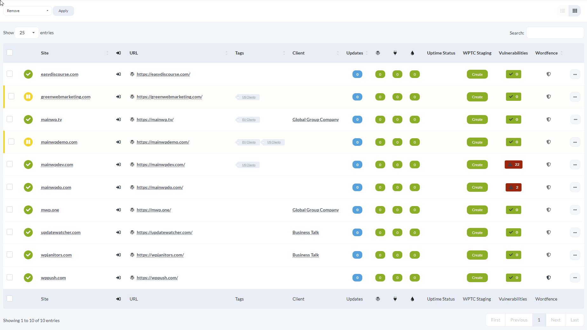

The Manage Sites page offers two display options: Table mode and Grid mode. Table mode shows sites in a traditional table with sortable columns. Grid mode displays sites as visual cards with screenshots when previews are enabled.

<Info>
Grid mode is an experimental feature. It offers fewer site management options than Table mode. If you prefer to keep site URLs out of screenshot requests to WordPress.com, [turn off site screenshots](/troubleshooting/which-outbound-connections-does-mainwp-dashboard-use#turn-off-site-screenshots).
</Info>

## Prerequisites

- Access to a MainWP Dashboard site
- At least one connected child site

## Switch Between Table and Grid View

<Steps>
<Step title="Navigate to Sites > Manage Sites">
Open your MainWP Dashboard and go to **Sites > Manage Sites**.
</Step>
<Step title="Locate the view toggle icons">
At the top right of the sites area, find the Table and Grid icons.
</Step>
<Step title="Click the desired view icon">
Click the **Table** icon for a table layout or the **Grid** icon for a card layout. The page reloads in your selected mode.

</Step>
</Steps>

## When to Use Each View

- **Table mode**: Best for sorting, filtering, comparing site details across multiple columns, and accessing the full set of site options
- **Grid mode**: Best for quick visual scanning when you recognize sites by their appearance

Your view preference persists until you change it again.
