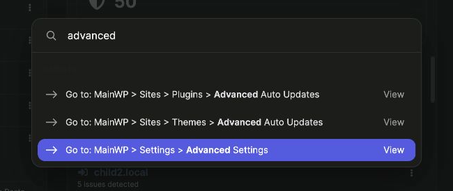

The Command Palette lets you jump to MainWP Dashboard pages by typing a page or section name. Use it to open settings, manage plugins, or reach an Add-on page without navigating through the sidebar menus.

In MainWP Dashboard 6.4.1 and later, you can also search for Child Sites and clients. Open a site's Overview, go to its WP Admin, or sync it directly from the results.

## What You'll Learn

- Open the Command Palette with a keyboard shortcut or the header button
- Search for a MainWP page and choose the correct destination
- Navigate using the keyboard or mouse
- Find a Child Site or client and run a site action
- Reopen recently used sites and clients

## Prerequisites

- MainWP Dashboard 6.2 or later (6.4.1 or later for site and client search)
- WordPress 6.9 or later on the site where MainWP Dashboard is installed
- Access to the MainWP pages you want to open

MainWP integrates with the built-in [WordPress Command Palette](https://wordpress.org/documentation/article/site-editor-command-palette/). No separate Add-on or setup is required.

## Open the Command Palette

While viewing MainWP Dashboard, use the shortcut for your operating system:

| Operating System | Shortcut |
|------------------|----------|
| Mac | **Command + K** |
| Windows or Linux | **Ctrl + K** |

You can also click the **Command Palette** button in the header. The button displays **⌘K** on Mac or **Ctrl+K** on Windows and Linux.

## Find and Open a Page

<Steps>
<Step title="Search for a page or section">
Open the palette and type a term such as `advanced`, `plugins`, or the name of an installed Add-on. Results appear as you type.
</Step>
<Step title="Check the destination">
MainWP results include **Go to: MainWP** followed by the menu path. For example, **Go to: MainWP > Settings > Advanced Settings** opens the Advanced Settings page.

This is the Command Palette's result label. To navigate there manually, open the **top-right user menu > MainWP Settings > Advanced Settings** (`/wp-admin/admin.php?page=SettingsAdvanced`).

The palette also includes regular WordPress commands. Check the full path to choose the MainWP destination you need.

</Step>
<Step title="Open the result">
Press the **Up** or **Down** arrow key to highlight a result, then press **Enter**. You can also click a result with the mouse.

The palette closes and the selected page opens. Press **Esc** to close the palette without opening a page.
</Step>
</Steps>

## Search Examples

| Type | Choose |
|------|--------|
| `advanced` | **Go to: MainWP > Settings > Advanced Settings** |
| `plugins` | **Go to: MainWP > Sites > Plugins > Manage Plugins** |
| `woocommerce` | **Go to: MainWP > Sites > Monitoring > WooCommerce Status**, when that Add-on is active |
| `acme` | A Child Site or client whose name or URL contains `acme` |

Available destinations depend on your enabled features, installed Add-ons, and user access. Search for a page or menu name as it appears in your MainWP Dashboard.

## Find a Site or Client

Type at least two characters of a site name, site URL, or client name. MainWP shows up to five matching sites and up to five matching clients. Exact matches appear first.

| Result | Label | What it opens |
|--------|-------|---------------|
| Child Site | Site name followed by its URL, for example **Acme Store (acme.example.com)** | The site's default action. See [Site actions](#site-actions). |
| Client | Client name followed by **(Client)**, for example **Acme Inc. (Client)** | The client's overview page |

You can type a URL with or without `https://` or `www.`. For example, `acme.example.com` and `https://www.acme.example.com` find the same site.

Results only include sites and clients you can access. If you use [Team Control](/add-ons/agency/team-control-extension), staff members see only their allowed sites and the clients linked to those sites.

### Site actions

When you highlight a site, the palette shows the actions available for it:

| Action | Result |
|--------|--------|
| **Operations** | Opens the site's **Overview** page in MainWP Dashboard |
| **Go to WP Admin** | Opens the Child Site's WP Admin in a new browser tab |
| **Sync Site** | Syncs the site without leaving the current page |

Press **Enter** to run the default action. The default is the first available action in the list above. Press **Tab** to move to the other site actions, **Shift + Tab** to move back, and **Esc** to return to the search field. You can also click an action.

Which actions appear depends on your access and the site's state:

- **Operations** requires access to individual site dashboards.
- **Go to WP Admin** requires permission to open WP Admin on Child Sites.
- **Sync Site** appears only for sites without sync errors and only on MainWP pages that include the sync dialog. It is unavailable while another bulk task is running.

### Recent sites and clients

Open the palette without typing to see up to five sites and clients you recently opened or synced from the palette. Select one to open it again.

## Related Resources

- [MainWP User Interface](/getting-started/mainwp-user-interface) - Sidebar navigation and header controls
- [MainWP Dashboard Settings](/sites/management/mainwp-dashboard-settings) - Settings available in your Dashboard
- [Manage Add-ons](/dashboard/overview/manage-extensions) - Install and manage MainWP Add-ons
