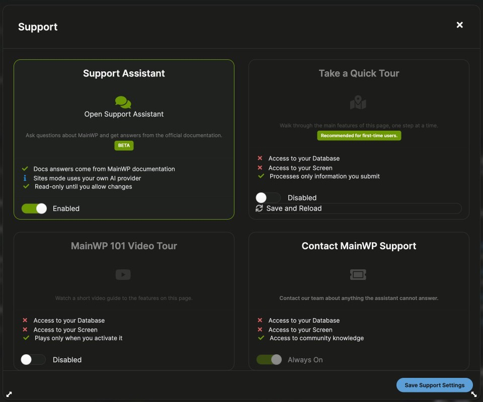

The MainWP Dashboard Support modal gives you quick access to help resources directly inside the Dashboard. You can open the MainWP Assistant, start guided tours, open page video tutorials, and jump to MainWP Support contact options.

## What You'll Learn

- How to open the Support modal from the Dashboard sidebar
- What each Support modal option does
- How to enable or disable the MainWP Assistant, guided tours, and video tutorials
- How permissions in the modal map to MainWP Tools settings

## Prerequisites

- MainWP Dashboard installed and active
- Administrator access to your MainWP Dashboard

---

## How to Open the Support Modal

<Steps>
<Step title="Open Support from the sidebar">
Click **Support** in the left navigation panel (question-mark icon near the bottom).
</Step>
</Steps>

<Note>
The **Get Help** item in the MainWP menu (three lines, top right) opens the Help sidebar. It is separate from the Support modal opened by the **Support** button.
</Note>

---

## Support Modal Options

The modal includes the following cards:

| Option | What it does | Availability |
|---|---|---|
| Support Assistant | Closes the modal and opens the [MainWP Assistant](/dashboard/mainwp-assistant/overview) chat panel | Available when **MainWP Assistant (AI-Powered Chat Support)** is enabled and your account can use the Assistant |
| Take a Quick Tour | Starts the guided tour for the current page | Available when **Usetiful (Interactive Guides & Tips)** is enabled |
| MainWP 101 Video Tour | Opens an embedded tutorial video for the current page | Available when **Youtube Embeds (Video Tutorials)** is enabled and a video is mapped to that page |
| Contact MainWP Support | Opens the MainWP community support page in a new tab | Always available |

The contact option opens: [https://community.mainwp.com/](https://community.mainwp.com/)

### Support Assistant Card

The **Support Assistant** card opens the MainWP Assistant. Click **Open Support Assistant** to close the modal and start a chat. The card lists how the Assistant works:

- Docs answers come from MainWP documentation
- Sites mode uses your own AI provider
- Read-only until you allow changes

See [MainWP Assistant](/dashboard/mainwp-assistant/overview) for the two modes, and [Contact MainWP Support from the Assistant](/dashboard/mainwp-assistant/contact-support) to send a question to MainWP Support with your conversation.

---

## Update Permissions in the Modal

Each modal card has an **Enabled / Disabled** toggle, except the support contact card, which is **Always On**. Use the **Save Support Settings** button to save changes.

<Steps>
<Step title="Open the modal">
Open **Support**.
</Step>
<Step title="Set toggles">
Enable or disable the cards you want to use.
</Step>
<Step title="Save">
Click **Save Support Settings**. If you changed guided tours, the page reloads. The **Take a Quick Tour** card also has a **Save and Reload** button.
</Step>
</Steps>

Permission toggles in the modal map to:

- **Usetiful (Interactive Guides & Tips)**: Guided tours, tooltips, and onboarding
- **MainWP Assistant (AI-Powered Chat Support)**: MainWP Assistant
- **Youtube Embeds (Video Tutorials)**: Embedded page video guides

You can also manage the same permission toggles in **MainWP menu (three lines, top right) > MainWP Tools** (`/wp-admin/admin.php?page=MainWPTools`).

---

## Privacy and Third-Party Services

The Support modal options above use third-party services that you control via permissions.

- Review privacy details: [Privacy & Data Handling](/getting-started/are-you-guys-watching-what-i-am-doing)
- Manage settings in Dashboard: **MainWP menu (three lines, top right) > MainWP Tools** (`/wp-admin/admin.php?page=MainWPTools`)
- MainWP Tools reference: [MainWP Dashboard Settings](/sites/management/mainwp-dashboard-settings)

---

## Troubleshooting

- **A card is disabled:** Enable its toggle in the modal and click **Save Support Settings**.
- **The Support Assistant toggle can't be changed:** Only administrators with access to MainWP Settings can turn the Assistant on or off.
- **The Support Assistant card is enabled but doesn't open:** See [Troubleshoot MainWP Assistant](/dashboard/mainwp-assistant/troubleshooting).
- **Video tour is missing on a page:** Not all pages have a mapped **MainWP 101 Video Tour**.
- **Tours did not start after enabling:** Reload the page, then launch the tour again.
- **Looking for the old Need Help flow:** Use **Support** in the left navigation to open the Support modal.

---

## Related Topics

- [MainWP User Interface](/getting-started/mainwp-user-interface)
- [How can I turn off guided tours?](/customization/how-to-turn-off-guided-tours)
- [MainWP Dashboard Settings](/sites/management/mainwp-dashboard-settings)
