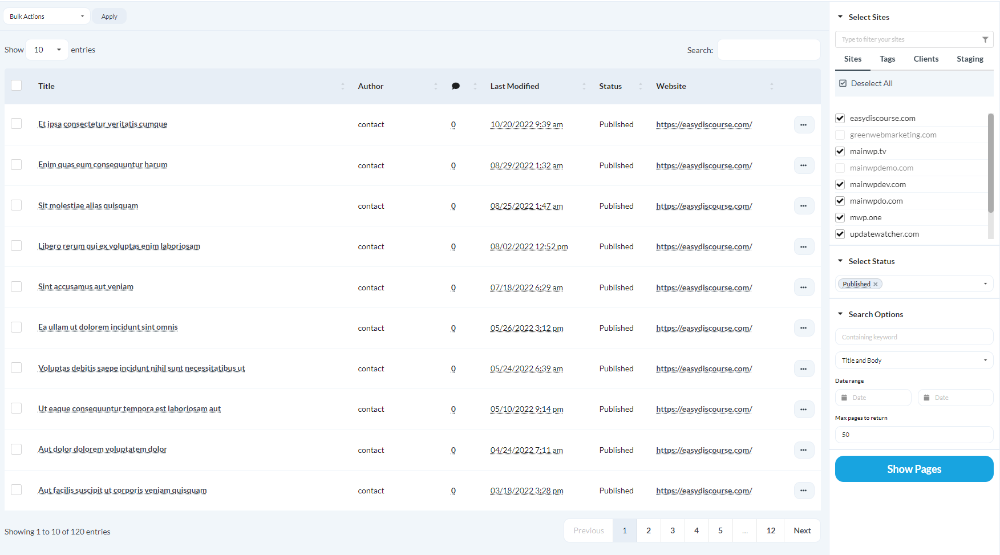
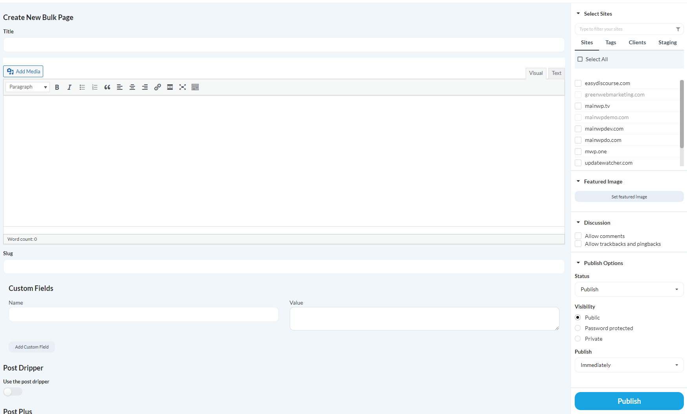
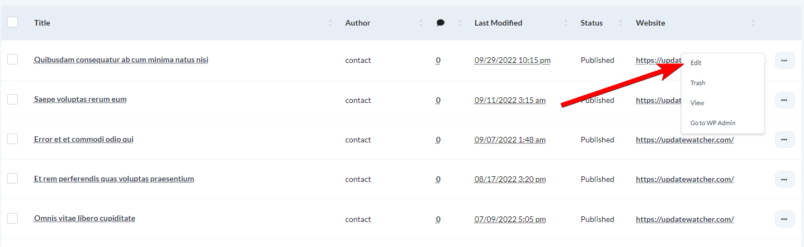
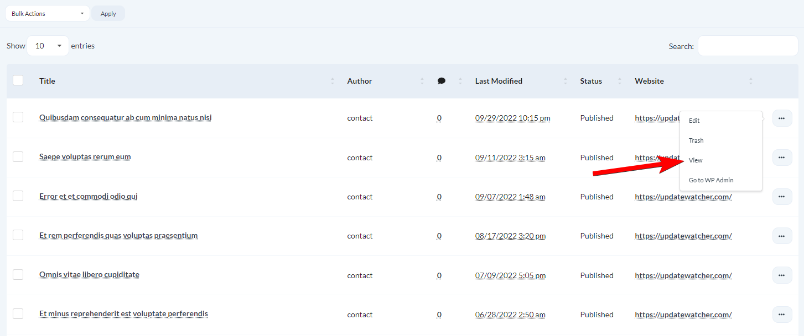
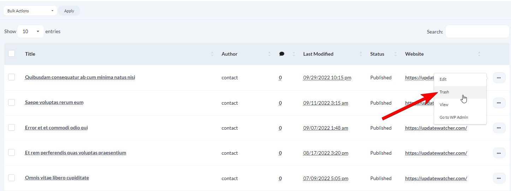
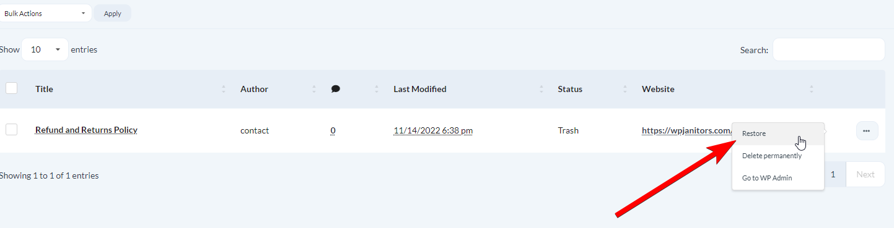

The Manage Pages feature lets you create, edit, schedule, and delete WordPress pages across all your child sites from a central location. Search for pages across your network, restore trashed pages, and manage content without logging into each site individually.

## What You'll Accomplish

- Search and view pages across all child sites
- Create new pages on one or multiple sites
- Schedule pages for future publication
- Edit existing pages
- Delete and restore pages

## Prerequisites

- MainWP Dashboard installed and activated
- At least one child site connected to your Dashboard
- Administrator access to your Dashboard site

<Note>
The Dashboard supports default WordPress post types. For custom post types, use the [MainWP Custom Post Types Extension](https://mainwp.com/extension/custom-post-types/).
</Note>

---

<iframe
  className="w-full aspect-video rounded-xl"
  src="https://www.youtube.com/embed/O4jG-GRHE2Q"
  title="Manage Pages - Video Tutorial"
  frameBorder="0"
  allow="accelerometer; autoplay; clipboard-write; encrypted-media; gyroscope; picture-in-picture"
  allowFullScreen
></iframe>

---

## View Existing Pages

<Steps>
<Step title="Navigate to Manage Pages">
Go to **MainWP > Sites > Content Operations > Manage Pages**.

</Step>
<Step title="Set search filters">
In the **Search** section:

| Filter | Description |
|--------|-------------|
| Status | Filter by Published, Pending, Private, Scheduled, Draft, Trash |
| Keyword | Search for specific text in page titles or content |
| Date Range | Filter pages last modified within a date range |
</Step>
<Step title="Select sites">
[Select the child sites](/getting-started/mainwp-user-interface) you want to search.
</Step>
<Step title="Search">
Click **Show Pages**.

A list of matching pages appears at the bottom of the page.
</Step>
</Steps>

<Note>
By default, your Dashboard returns up to 50 pages per child site. You can change this limit using **Max pages to return** under **Search Options**.
</Note>

---

## Create a New Page

<Steps>
<Step title="Navigate to Add New">
Go to **MainWP > Sites > Content Operations > Manage Pages**, then click **Create New Page**.

</Step>
<Step title="Enter page content">
Complete the page fields:

| Field | Required | Description |
|-------|----------|-------------|
| Title | No | Page title |
| Content | No | Page body content |
| Custom Fields | No | Additional metadata |
| Discussion Settings | No | Comment options |
| Featured Image | No | Page thumbnail |
| Slug | No | Custom URL path |
</Step>
<Step title="Select sites">
[Select the child sites](/getting-started/mainwp-user-interface) where you want to publish this page.
</Step>
<Step title="Publish">
Click **Publish**.

The page is created on all selected sites.
</Step>
</Steps>

---

## Schedule a Page

<Steps>
<Step title="Create page">
Follow the steps above to create a new page (steps 1-3).
</Step>
<Step title="Set schedule">
In the **Publish Options** section:
1. Under **Publish**, select **Schedule**
2. Set the date and time
</Step>
<Step title="Schedule">
Click **Publish**.

The page is scheduled on all selected sites.
</Step>
</Steps>

<Note>
Page preview is not available in your MainWP Dashboard because pages may display differently on each child site due to different themes and settings.
</Note>

---

## Edit an Existing Page

<Steps>
<Step title="Search for page">
Go to **MainWP > Sites > Content Operations > Manage Pages** and search for the page.
</Step>
<Step title="Edit">
Find the page in the results and click **Edit**.

</Step>
<Step title="Update">
Make your changes, then click **Publish**.
</Step>
</Steps>

---

## View a Page on Its Site

<Steps>
<Step title="Search for page">
Go to **MainWP > Sites > Content Operations > Manage Pages** and search for the page.
</Step>
<Step title="View">
Find the page in the results and click **View**.

The page opens on its child site in a new tab.
</Step>
</Steps>

---

## Delete Pages

### Move to Trash

<Steps>
<Step title="Search for page">
Go to **MainWP > Sites > Content Operations > Manage Pages** and search for the page.
</Step>
<Step title="Trash">
Find the page and click **Trash**.

</Step>
</Steps>

For multiple pages, select them using checkboxes and use **Bulk Actions > Move to trash**.

### Delete Permanently

The per-page **Delete permanently** action appears only for pages in Trash.

<Steps>
<Step title="Search for trashed pages">
Go to **MainWP > Sites > Content Operations > Manage Pages** and set **Status** to **Trash**.
</Step>
<Step title="Delete">
Find the page and click **Delete Permanently**.
</Step>
</Steps>

<Warning>
**Bulk Actions > Delete permanently** can permanently delete selected pages even when they are not in Trash. This action cannot be undone.
</Warning>

---

## Restore a Page

<Steps>
<Step title="Search for trashed pages">
Go to **MainWP > Sites > Content Operations > Manage Pages** and set **Status** to **Trash**.
</Step>
<Step title="Restore">
Find the page and click **Restore**.

</Step>
</Steps>

For multiple pages, select them using checkboxes and use **Bulk Actions > Restore**.

---

## Self-Check Checklist

- [ ] You can search and view pages across child sites
- [ ] New pages publish successfully to selected sites
- [ ] Scheduled pages show correct scheduling
- [ ] Page edits save correctly
- [ ] Deleted pages move to trash
- [ ] Trashed pages restore successfully

---

## Related Resources

- [Manage Posts](/sites/content/manage-posts) - Post management documentation
- [Custom Post Types Extension](https://mainwp.com/extension/custom-post-types/) - Manage custom post types
- [Boilerplate Extension](/add-ons/posts-pages/boilerplate-extension) - Create content templates
