The Manage Updates feature lets you run WordPress core, plugin, theme, and translation updates across all your child sites from your Dashboard. Configure automatic updates for trusted items, ignore updates you want to skip, and use Safe Updates to check sites before and after updating and roll back an update that breaks a site.

## What You'll Accomplish

- Update WordPress core, plugins, themes, and translations individually or in bulk
- Configure automatic updates for trusted plugins, themes, and translations
- Ignore specific updates globally or per site, including WordPress core and translation updates
- Run checked updates with Safe Updates and roll back an update that breaks a site

## Prerequisites

- MainWP Dashboard installed and activated
- At least one child site connected to your Dashboard
- Sites synced recently to have current update data

<Note>
Before running updates, synchronize your child sites to ensure all available updates are displayed.
</Note>

## Find Update and Trust Settings

Use **Sites > Updates** (`/wp-admin/admin.php?page=UpdatesManage`) to run manual updates. Trust controls are on separate pages:

- **Sites > Plugins > Advanced Auto Updates** (`/wp-admin/admin.php?page=PluginsAutoUpdate`)
- **Sites > Themes > Advanced Auto Updates** (`/wp-admin/admin.php?page=ThemesAutoUpdate`)

On either trust page, click **Show Plugins** or **Show Themes**, select the items you want to trust, then choose **Mark as Trusted** from **Bulk Actions** and click **Apply**. The trust action is not on the manual Updates or Manage Plugins/Themes pages.

To enable automatic updates, open the three-line **MainWP menu** in the top-right corner and select **MainWP Settings** (`/wp-admin/admin.php?page=Settings`). In **General Settings**, find the **Updates Settings** section. Marking items as trusted and enabling automatic updates are separate steps.

---

<iframe
  className="w-full aspect-video rounded-xl"
  src="https://www.youtube.com/embed/igOn8wOBcAQ"
  title="Manage Updates - Video Tutorial"
  frameBorder="0"
  allow="accelerometer; autoplay; clipboard-write; encrypted-media; gyroscope; picture-in-picture"
  allowFullScreen
></iframe>

---

## WordPress Core Updates

### Update All WordPress Installations

<Steps>
<Step title="Navigate to WordPress Updates">
Go to **Sites > Updates > WordPress** (`/wp-admin/admin.php?page=UpdatesManage&tab=wordpress-updates`).
</Step>
<Step title="Update all sites">
Click **Update All WP Cores** in the action bar.
</Step>
<Step title="Confirm">
Confirm when prompted.
</Step>
</Steps>

### Update a Single WordPress Installation

<Steps>
<Step title="Navigate to WordPress Updates">
Go to **Sites > Updates > WordPress** (`/wp-admin/admin.php?page=UpdatesManage&tab=wordpress-updates`).
</Step>
<Step title="Locate site">
Find the WordPress installation in the table.
</Step>
<Step title="Update">
Click **Update Now** in its row.
</Step>
</Steps>

### Auto Update WordPress Core

Enable automatic WordPress core updates in two steps: enable the feature, then enable it for individual sites.

#### Enable Auto Updates Feature

<Steps>
<Step title="Navigate to Settings">
Go to **MainWP menu (three lines, top right) > MainWP Settings > General Settings** (`/wp-admin/admin.php?page=Settings`).
</Step>
<Step title="Find Update Settings">
Locate the **Updates Settings** section in **General Settings**.
</Step>
<Step title="Enable">
Set **WP Core advanced automatic updates** to **Install Trusted Updates**.
</Step>
<Step title="Save">
Click **Save Settings**.
</Step>
</Steps>

#### Enable Auto Update for a Site

<Steps>
<Step title="Navigate to Manage Sites">
Go to **MainWP > Sites > Manage Sites**.
</Step>
<Step title="Edit site">
Find the site and click **Edit** from the actions menu.
</Step>
<Step title="Enable auto update">
Set **Auto Update Core** to **YES**.

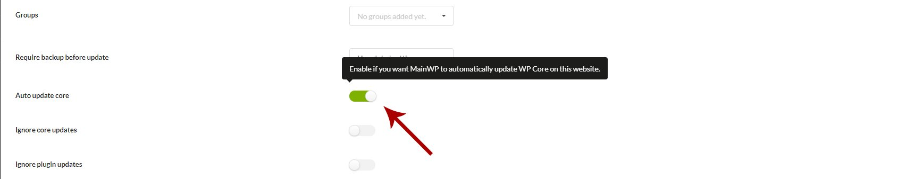
</Step>
<Step title="Save">
Click **Save Settings**.
</Step>
</Steps>

<Note>
MainWP advanced automatic updates are independent from WordPress native auto-updates. Configure **Frequency of automatic updates**, **Select time**, and **Advanced automatic updates delay** in **Updates Settings**. These settings are separate from automatic sync frequency. See [Update Frequency Settings](/sites/updates/how-to-change-daily-update-and-sync-frequency) for scheduling and cron requirements.
</Note>

### Ignore WordPress Core Updates

You can ignore WordPress core updates for individual child sites, or ignore a specific WordPress core version from the WordPress Updates table.

| Ignore Type | Scope |
|-------------|-------|
| Ignore Core Update | All WordPress core updates, this site only |
| Ignore this version | This version, this site only |
| Ignore this version globally | This version, all sites |
| Ignore all versions | All versions, this site only |

#### Ignore Core Update for a Site

<Steps>
<Step title="Navigate to Manage Sites">
Go to **MainWP > Sites > Manage Sites**.
</Step>
<Step title="Edit site">
Find the site and click **Edit** from the actions menu.
</Step>
<Step title="Enable ignore">
Set **Ignore Core Update** to **YES**.
</Step>
<Step title="Save">
Click **Save Settings**.
</Step>
</Steps>

#### Ignore a Specific Core Version

<Steps>
<Step title="Navigate to WordPress Updates">
Go to **Sites > Updates > WordPress** (`/wp-admin/admin.php?page=UpdatesManage&tab=wordpress-updates`).
</Step>
<Step title="Locate the site">
Find the child site with the WordPress core update you want to ignore.
</Step>
<Step title="Select an ignore option">
Use the row action to select **Ignore this version**, **Ignore this version globally**, or **Ignore all versions**.
</Step>
</Steps>

#### Un-ignore Core Update

Use the same child site settings steps and set **Ignore Core Update** to **NO**.

To review ignored WordPress core versions, go to **Sites > Updates > WordPress** (`/wp-admin/admin.php?page=UpdatesManage&tab=wordpress-updates`) and click **View Ignored Updates**. This button appears only when ignored WordPress core updates exist.

The ignored WordPress core updates page uses `wp-admin/admin.php?page=UpdatesManage&tab=updates-ignore`, but it is not shown as a separate Updates menu item. Your MainWP Dashboard opens it from the **View Ignored Updates** button on the WordPress Updates tab.

<Info>
If WordPress core is up to date but ignored WordPress core updates still exist, the action bar remains visible. **View Ignored Updates** stays clickable, while **Update Selected WP Cores** and **Update All WP Cores** are disabled because there are no actionable WordPress core updates on the current tab.
</Info>

---

## Plugin Updates

### Update All Plugins on All Sites

<Steps>
<Step title="Navigate to Plugin Updates">
Go to **Sites > Updates > Plugins** (`/wp-admin/admin.php?page=UpdatesManage&tab=plugins-updates`).
</Step>
<Step title="Update all">
Click **Update All Plugins**.

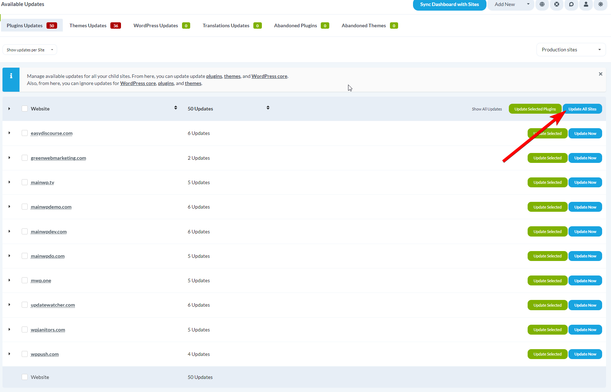
</Step>
<Step title="Confirm">
Confirm when prompted.
</Step>
</Steps>

### Update a Single Plugin on All Sites

<Steps>
<Step title="Navigate to Plugin Updates">
Go to **Sites > Updates > Plugins** (`/wp-admin/admin.php?page=UpdatesManage&tab=plugins-updates`).
</Step>
<Step title="Select view">
Set **Show updates per** to **Item**.
</Step>
<Step title="Locate plugin">
Find the plugin you want to update.

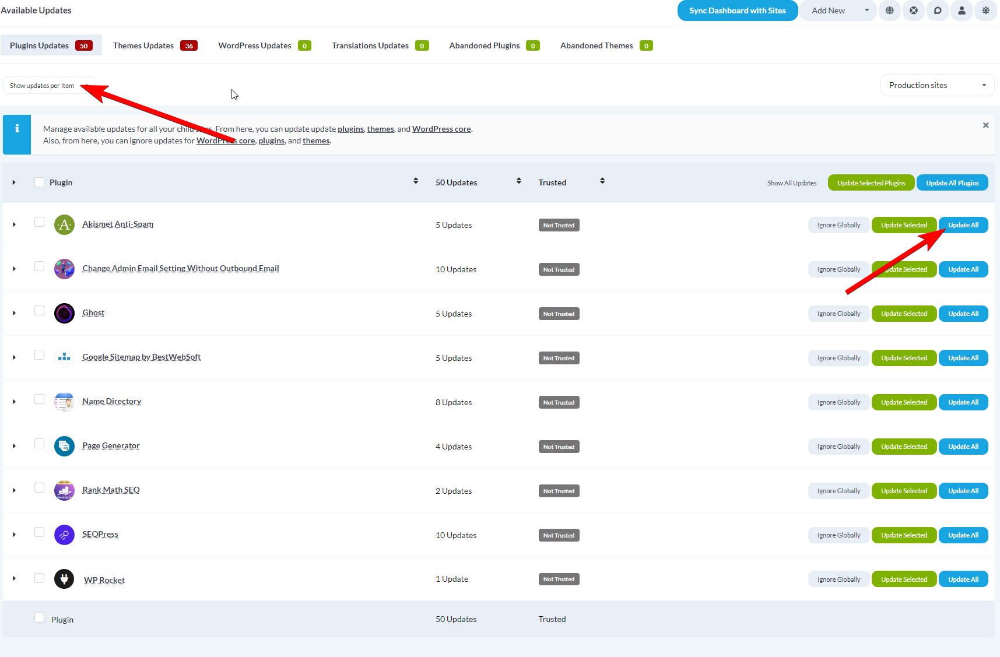
</Step>
<Step title="Update">
Click **Update All** in the plugin row.
</Step>
</Steps>

### Update All Plugins on a Single Site

<Steps>
<Step title="Navigate to Plugin Updates">
Go to **Sites > Updates > Plugins** (`/wp-admin/admin.php?page=UpdatesManage&tab=plugins-updates`).
</Step>
<Step title="Select view">
Set **Show updates per** to **Site**.
</Step>
<Step title="Locate site">
Find the child site.

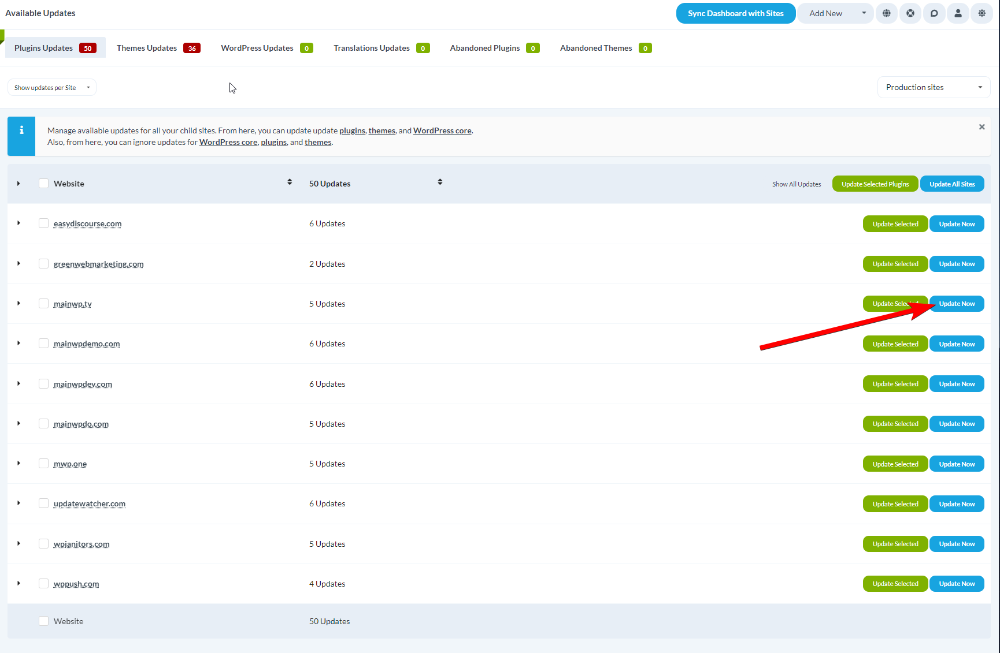
</Step>
<Step title="Update">
Click **Update All** in the site row.
</Step>
</Steps>

### Update a Single Plugin on a Single Site

<Steps>
<Step title="Navigate to Plugin Updates">
Go to **Sites > Updates > Plugins** (`/wp-admin/admin.php?page=UpdatesManage&tab=plugins-updates`).
</Step>
<Step title="Select view">
Select **Show updates per Site**.
</Step>
<Step title="Locate site">
Find the child site and expand its row.
</Step>
<Step title="Update plugin">
Find the plugin and click **Update Now**.

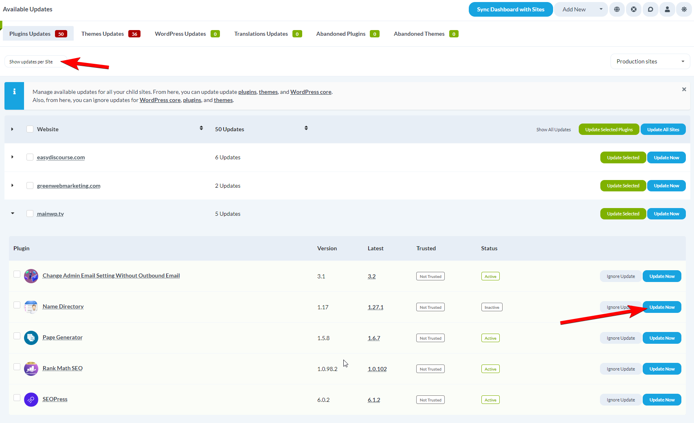
</Step>
</Steps>

### View Plugin History

The plugin update rows include a **History** action so you can review recent change activity before or after updates.

<Steps>
<Step title="Open a plugin row with History">
Go to **Sites > Updates > Plugins** (`/wp-admin/admin.php?page=UpdatesManage&tab=plugins-updates`) and use the **Site**, **Item**, or **Tag** view. You can also use **History** in plugin rows in individual site update tables.
</Step>
<Step title="Open the history modal">
Click **History** in the plugin row.
</Step>
<Step title="Review activity details">
Review the action timeline with actor, source (**Dashboard** or **WP Admin**), timestamp, and version change when available.
</Step>
<Step title="Switch history views">
Use **Day History** to group actions by date, then use **Plugin History** to switch to plugin-grouped actions for that day.
</Step>
<Step title="Load older records">
Click **Load More** in the modal to display earlier activity.
</Step>
</Steps>

<Note>
If you see "This plugin has no recorded activity in Dashboard Insights," check [Network Activity](/sites/network-activity) and [Dashboard Insights](/dashboard/overview/dashboard-insights) settings to confirm logging and retention are configured.
</Note>

### Plugin Auto Updates

#### Enable Auto Updates

<Steps>
<Step title="Navigate to Settings">
Go to **MainWP menu (three lines, top right) > MainWP Settings > General Settings** (`/wp-admin/admin.php?page=Settings`).
</Step>
<Step title="Find Update Settings">
Locate the **Updates Settings** section.
</Step>
<Step title="Enable">
Set **Plugin advanced automatic updates** to **Install Trusted Updates**.
</Step>
<Step title="Save">
Click **Save Settings**.
</Step>
</Steps>

#### Mark Plugins as Trusted

<Steps>
<Step title="Navigate to Advanced Auto Updates">
Go to **Sites > Plugins > Advanced Auto Updates** (`/wp-admin/admin.php?page=PluginsAutoUpdate`).
</Step>
<Step title="Filter plugins">
Use **Plugin Status to Search**, the trust-status dropdown under **Search Options**, and the **Plugin name** field to find plugins.
</Step>
<Step title="Search">
Click **Show Plugins**.
</Step>
<Step title="Select and trust">
Check the plugins to trust, select **Mark as Trusted** from **Bulk Actions**, and click **Apply**.
</Step>
</Steps>

### Ignore Plugin Updates

| Ignore Type | Scope |
|-------------|-------|
| Ignore Globally | All versions, all sites |
| Ignore this version | This version, this site only |
| Ignore this version globally | This version, all sites |
| Ignore all versions | All versions, this site only |

<Steps>
<Step title="Navigate to Plugin Updates">
Go to **Sites > Updates > Plugins** (`/wp-admin/admin.php?page=UpdatesManage&tab=plugins-updates`).
</Step>
<Step title="Select view">
Set **Show updates per** to **Item**.
</Step>
<Step title="Ignore">
Find the plugin and select your ignore option.

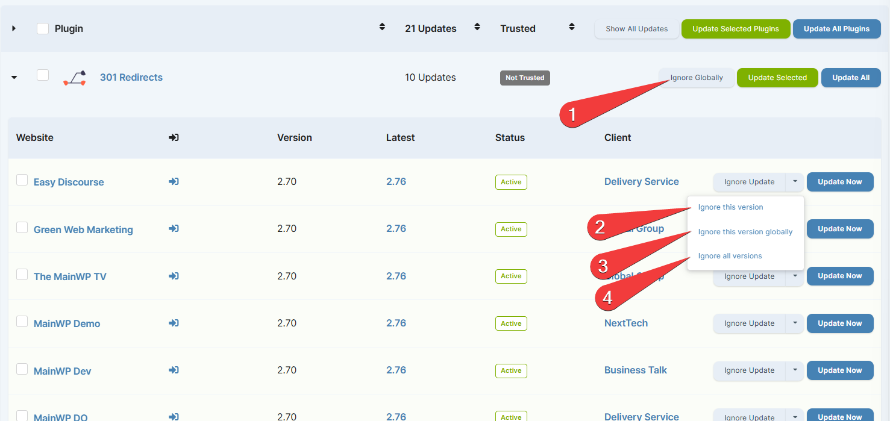
</Step>
</Steps>

#### Un-ignore a Plugin

When ignored plugin updates exist, you can click **View Ignored Updates** on **Sites > Updates > Plugins** (`/wp-admin/admin.php?page=UpdatesManage&tab=plugins-updates`). You can also use the Plugins menu path below.

<Steps>
<Step title="Navigate to Ignored Updates">
Go to **Sites > Plugins > Ignored Updates** (`/wp-admin/admin.php?page=PluginsIgnore`).
</Step>
<Step title="Un-ignore">
Find the plugin and click **Unignore**.

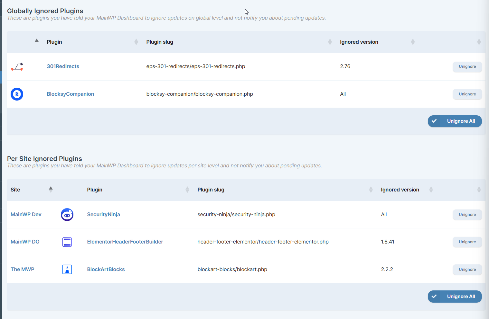
</Step>
</Steps>

<Info>
If there are no available plugin updates but ignored plugin updates exist, the Plugin Updates action bar remains visible. **View Ignored Updates** stays clickable, while plugin update buttons such as **Update Selected Plugins** and **Update All Plugins** are disabled.
</Info>

---

## Theme Updates

### Update All Themes on All Sites

<Steps>
<Step title="Navigate to Theme Updates">
Go to **Sites > Updates > Themes** (`/wp-admin/admin.php?page=UpdatesManage&tab=themes-updates`).
</Step>
<Step title="Update all">
Click **Update All Themes**.
</Step>
<Step title="Confirm">
Confirm when prompted.
</Step>
</Steps>

### Update a Single Theme on All Sites

<Steps>
<Step title="Navigate to Theme Updates">
Go to **Sites > Updates > Themes** (`/wp-admin/admin.php?page=UpdatesManage&tab=themes-updates`).
</Step>
<Step title="Select view">
Select **Show updates per Item**.
</Step>
<Step title="Locate theme">
Find the theme you want to update.

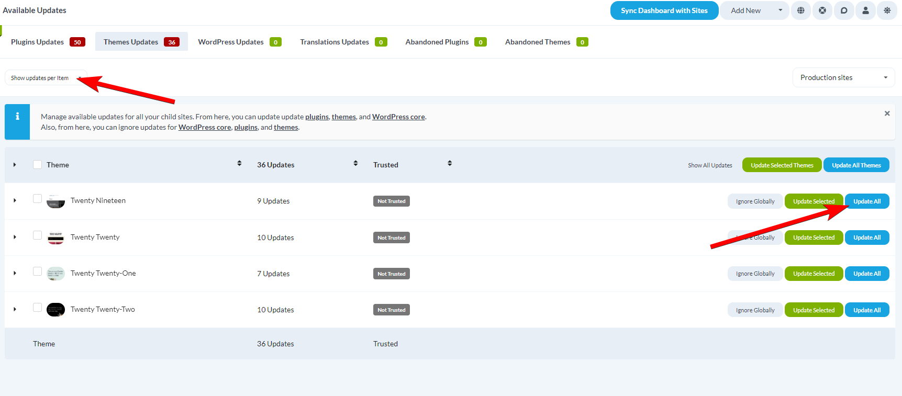
</Step>
<Step title="Update">
Click **Update All** in the theme row.
</Step>
</Steps>

### Update All Themes on a Single Site

<Steps>
<Step title="Navigate to Theme Updates">
Go to **Sites > Updates > Themes** (`/wp-admin/admin.php?page=UpdatesManage&tab=themes-updates`).
</Step>
<Step title="Select view">
Set **Show updates per** to **Site**.
</Step>
<Step title="Locate site">
Find the child site.

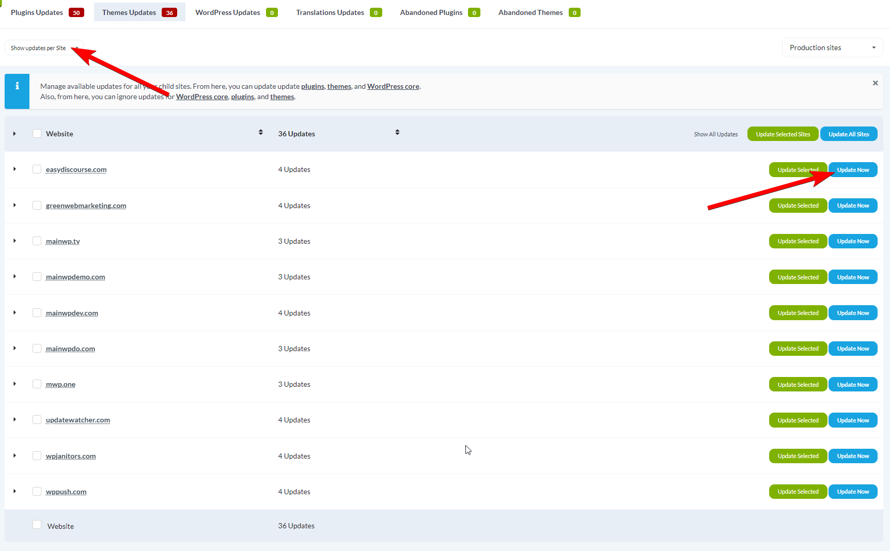
</Step>
<Step title="Update">
Click **Update All** in the site row.
</Step>
</Steps>

### Update a Single Theme on a Single Site

<Steps>
<Step title="Navigate to Theme Updates">
Go to **Sites > Updates > Themes** (`/wp-admin/admin.php?page=UpdatesManage&tab=themes-updates`).
</Step>
<Step title="Select view">
Set **Show updates per** to **Site**.
</Step>
<Step title="Locate site">
Find the child site and expand its row.
</Step>
<Step title="Update theme">
Find the theme and click **Update Now**.

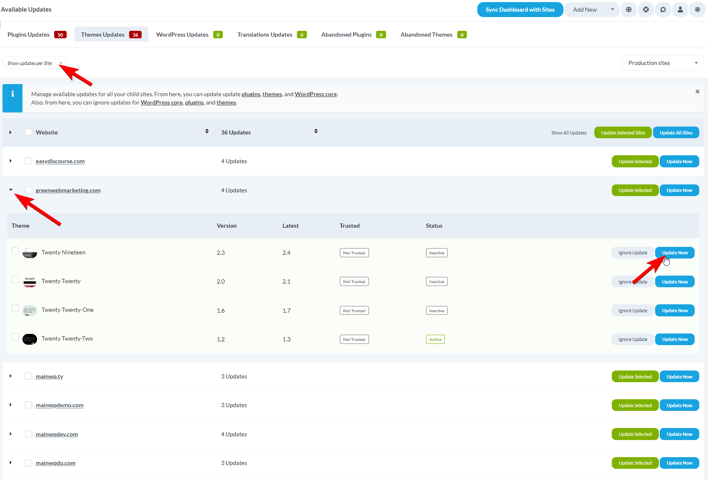
</Step>
</Steps>

### View Theme History

The theme update rows include a **History** action so you can review recent change activity before or after updates.

<Steps>
<Step title="Open a theme row with History">
Go to **Sites > Updates > Themes** (`/wp-admin/admin.php?page=UpdatesManage&tab=themes-updates`) and use the **Site**, **Item**, or **Tag** view. You can also use **History** in theme rows in individual site update tables.
</Step>
<Step title="Open the history modal">
Click **History** in the theme row.
</Step>
<Step title="Review activity details">
Review the action timeline with actor, source (**Dashboard** or **WP Admin**), timestamp, and version change when available.
</Step>
<Step title="Switch history views">
Use **Day History** to group actions by date, then use **Theme History** to switch to theme-grouped actions for that day.
</Step>
<Step title="Load older records">
Click **Load More** in the modal to display earlier activity.
</Step>
</Steps>

<Note>
If you see "This theme has no recorded activity in Dashboard Insights," check [Network Activity](/sites/network-activity) and [Dashboard Insights](/dashboard/overview/dashboard-insights) settings to confirm logging and retention are configured.
</Note>

### Theme Auto Updates

#### Enable Auto Updates

<Steps>
<Step title="Navigate to Settings">
Go to **MainWP menu (three lines, top right) > MainWP Settings > General Settings** (`/wp-admin/admin.php?page=Settings`).
</Step>
<Step title="Find Update Settings">
Locate the **Updates Settings** section in **General Settings**.
</Step>
<Step title="Enable">
Set **Theme advanced automatic updates** to **Install Trusted Updates**.
</Step>
<Step title="Save">
Click **Save Settings**.
</Step>
</Steps>

#### Mark Themes as Trusted

<Steps>
<Step title="Navigate to Advanced Auto Updates">
Go to **Sites > Themes > Advanced Auto Updates** (`/wp-admin/admin.php?page=ThemesAutoUpdate`).
</Step>
<Step title="Filter themes">
Use **Theme Status to Search**, the trust-status dropdown under **Search Options**, and the **Theme name** field to find themes.
</Step>
<Step title="Search">
Click **Show Themes**.
</Step>
<Step title="Select and trust">
Check the themes to trust, select **Mark as Trusted** from **Bulk Actions**, and click **Apply**.
</Step>
</Steps>

### Ignore Theme Updates

| Ignore Type | Scope |
|-------------|-------|
| Ignore Globally | All versions, all sites |
| Ignore this version | This version, this site only |
| Ignore this version globally | This version, all sites |
| Ignore all versions | All versions, this site only |

<Steps>
<Step title="Navigate to Theme Updates">
Go to **Sites > Updates > Themes** (`/wp-admin/admin.php?page=UpdatesManage&tab=themes-updates`).
</Step>
<Step title="Select view">
Set **Show updates per** to **Item**.
</Step>
<Step title="Ignore">
Find the theme and select your ignore option.

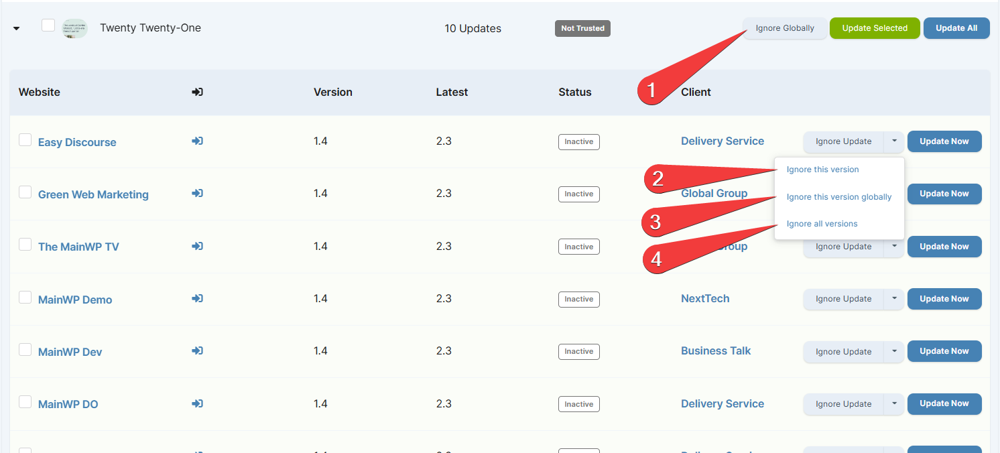
</Step>
</Steps>

#### Un-ignore a Theme

When ignored theme updates exist, you can click **View Ignored Updates** on **Sites > Updates > Themes** (`/wp-admin/admin.php?page=UpdatesManage&tab=themes-updates`). You can also use the Themes menu path below.

<Steps>
<Step title="Navigate to Ignored Updates">
Go to **Sites > Themes > Ignored Updates** (`/wp-admin/admin.php?page=ThemesIgnore`).
</Step>
<Step title="Un-ignore">
Find the theme and click **Unignore**.

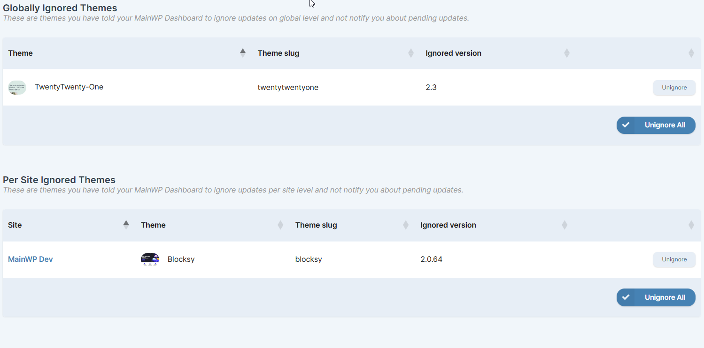
</Step>
</Steps>

<Info>
If there are no available theme updates but ignored theme updates exist, the Theme Updates action bar remains visible. **View Ignored Updates** stays clickable, while theme update buttons such as **Update Selected Themes** and **Update All Themes** are disabled.
</Info>

---

## Premium Plugin and Theme Updates

MainWP Dashboard 6.2 includes built-in update compatibility for many premium plugins and themes. Available premium updates still appear in the normal plugin and theme update screens described above.

If a premium update is missing, check its license and update availability on the child site, then sync again. For products that need extra compatibility, go to **MainWP menu (three lines, top right) > MainWP Settings > Premium Updates** (`/wp-admin/admin.php?page=PremiumUpdates`) and add a **Custom Identifier**.

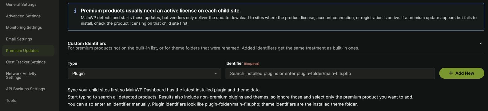

See [Premium Updates](/sites/updates/premium-updates) for setup. An active vendor license or account connection may be required on each child site before an update can download. If an individual premium update fails, try it separately and follow the [premium update troubleshooting steps](/troubleshooting/mainwp-fails-to-update-all-items-on-child-sites#troubleshoot-premium-plugin-and-theme-failures).

---

## Translation Updates

### Update All Translations on All Sites

<Steps>
<Step title="Navigate to Translation Updates">
Go to **Sites > Updates > Translation** (`/wp-admin/admin.php?page=UpdatesManage&tab=translations-updates`).
</Step>
<Step title="Update all">
Click **Update All** to run all available translation updates.
</Step>
</Steps>

### Update Translations on a Single Site

<Steps>
<Step title="Navigate to Translation Updates">
Go to **Sites > Updates > Translation** (`/wp-admin/admin.php?page=UpdatesManage&tab=translations-updates`).
</Step>
<Step title="Switch to Site view">
Set **Show updates per** to **Site**.
</Step>
<Step title="Update the site">
Find the child site and run the available translation updates for that site.
</Step>
</Steps>

### Translation Auto Updates

Configure translation auto-updates globally in **MainWP menu (three lines, top right) > MainWP Settings > General Settings** (`/wp-admin/admin.php?page=Settings`), under the **Updates Settings** section.

<Steps>
<Step title="Navigate to Settings">
Go to **MainWP menu (three lines, top right) > MainWP Settings > General Settings** (`/wp-admin/admin.php?page=Settings`).
</Step>
<Step title="Find Updates Settings">
Locate the **Updates Settings** section.
</Step>
<Step title="Enable translation auto updates">
Set **Translation advanced automatic updates** to **Install Trusted Updates**.
</Step>
<Step title="Save">
Click **Save Settings**.
</Step>
</Steps>

Translation auto-updates use trusted plugin and theme context.
Per-site translation control is available through **Ignore translation updates** in **MainWP > Sites > Manage Sites > Settings**.

The hold also applies to updates requested through the Abilities API, MCP, and REST API v1/v2. Lists and counts omit held translations. Abilities previews report them as skipped with reason `ignored_site_flag`. Update calls do not apply them, even when a request names a held translation. Turn **Ignore translation updates** off to make those updates available again.

---

## Automatic Update Summary Emails

After an automatic update run finishes, MainWP Dashboard sends an **Auto Updates Email**. The email is processed in the background, so it may arrive after the updates finish.

What the email contains depends on **Safe Updates: check sites before and after automatic updates** in **MainWP Settings > General Settings > Updates Settings**:

- **On** (the default in MainWP Dashboard X): each automatic update pass records at most one Safe Updates run for the sites it updates, and the email for that run uses the Safe Updates summary. A pass with nothing eligible to update creates no run and sends no email. It includes failed and skipped sites with their reasons, each site's items, and a link to the run with the full check results. See [Safe Updates](/sites/updates/does-mainwp-have-safe-updates#summary-email).
- **Off**: the email summarizes successful updates only, grouped by child site. It is not a complete report of failed or skipped updates, and no summary is sent when the run has no successful updates to report.

Auto Updates Email is separate from Daily Digest and does not wait for the next digest.

### Disable Auto Updates Email

1. Go to **MainWP menu (three lines, top right) > MainWP Settings > Email Settings** (`/wp-admin/admin.php?page=SettingsEmail`).
2. Click **Manage** beside **Auto Updates Email**.
3. Turn **Enable** off and click **Save Settings**.

Automatic updates continue to run when this email is disabled.

See [Email Settings](/sites/management/mainwp-dashboard-settings#manage-email-notifications) for general notification configuration.

---

## Safe Updates / Rollback

Click **Safe Update** on an update tab of the Updates page, or use **Safe Update Everything** in Manage Sites, to update with checks. MainWP checks each site, backs it up first when your settings require it, applies the updates, and checks the site again. When a check fails after the update, you can roll a plugin or theme back to its previous version from the run page, or let MainWP find which update caused the failure. See [Safe Updates](/sites/updates/does-mainwp-have-safe-updates) for the full guide.

### How Rollback Works

MainWP has two kinds of rollback:

- **When a plugin or theme update fails to install**, WordPress puts the previous version back. This works on child sites running WordPress 6.3 or later, on every Dashboard page where you can start updates, for both single and bulk updates.
- **When an update installs but breaks a check**, use **Roll back** on the Safe Updates run page. This needs MainWP Child X and WordPress 6.3 or later on the child site. See [Roll Back an Update](/sites/updates/does-mainwp-have-safe-updates#roll-back-an-update).

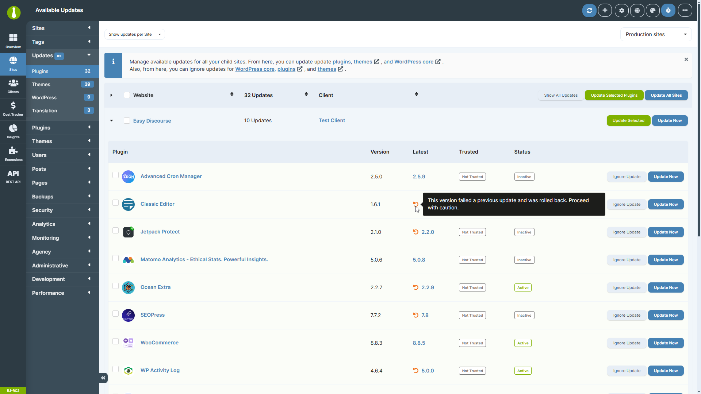

### Rollback Notices

When a rollback occurs, an orange icon with a tooltip appears beside the version that was rolled back whenever that version is offered as an update. The notice stops showing once a newer version is offered.

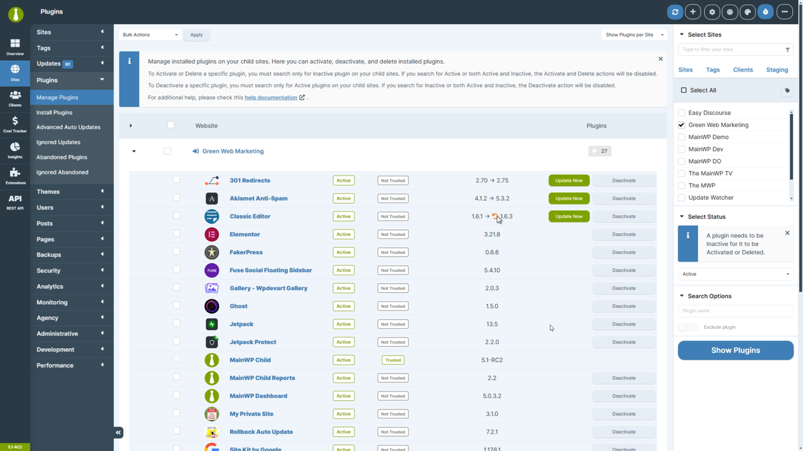

### Manual Rollback

For an item Safe Updates cannot roll back, you can install an earlier version yourself. Download the version from the plugin's page on wordpress.org (**Advanced View** in the sidebar), then install it with [Install by Upload](/sites/plugins/managing-plugins-with-mainwp#install-by-upload). For premium plugins and themes, keep earlier versions in the [Favorites Extension](https://mainwp.com/extension/favorites/).

---

## Self-Check Checklist

- [ ] WordPress core updates complete successfully
- [ ] Plugin updates work for individual and bulk operations
- [ ] Theme updates work for individual and bulk operations
- [ ] Auto updates are configured for trusted items
- [ ] Ignored updates no longer appear in update lists
- [ ] **Safe Update** starts a run and the run page lists each site with a result
- [ ] **Roll back** is offered for updated plugins and themes that have a kept copy, on sites with MainWP Child X and WordPress 6.3 or later

---

## Related Resources

- [Safe Updates](/sites/updates/does-mainwp-have-safe-updates) - Checked update runs, rollback, and finding the update that broke a site
- [Change Update Frequency](/sites/updates/how-to-change-daily-update-and-sync-frequency) - Adjust sync and update timing
- [Manage Plugins](/sites/plugins/managing-plugins-with-mainwp) - Full plugin management
- [Manage Themes](/sites/themes/managing-themes-with-mainwp) - Full theme management
